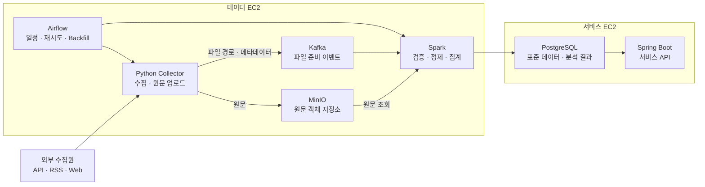

# 데이터 파이프라인 최종 구조

## 1. 전체 아키텍처



## 2. 핵심 흐름

```text
Airflow
  → Python Collector 실행
  → API · RSS · Web 데이터 수집
  → 원문을 MinIO에 저장
  → Kafka에 파일 준비 이벤트 발행
  → Spark가 이벤트 수신
  → MinIO에서 원문 조회
  → 검증 · 정제 · 중복 제거 · 키워드 집계
  → PostgreSQL에 결과 저장
```

## 3. 구성요소

| 구성요소 | 핵심 역할 | 주요 입출력 |
| --- | --- | --- |
| Airflow | 파이프라인 실행 관리 | 수집 일정, 재시도, Backfill, Spark 실행 |
| Python Collector | 사이트별 데이터 수집 | API · RSS · Web → 원문 파일 |
| MinIO | 원문 보관 | HTML · JSON · JSONL · 압축 파일 |
| Kafka | 수집과 처리 연결 | MinIO 객체 위치와 수집 메타데이터 |
| Spark | 데이터 가공과 분석 | 검증, 정제, 중복 제거, 키워드 언급량·순위 계산 |
| PostgreSQL | 서비스용 결과 저장 | 표준 콘텐츠, 키워드 통계, 처리 이력 |

## 4. 저장 구조

### MinIO

```text
Bucket: raw-data

raw-data/
└─ domain=development/
   └─ collected_date=2026-09-03/
      ├─ source=reddit/
      │  └─ run_id=20260903T000000/
      │     ├─ part-000.jsonl.gz
      │     └─ metadata.json
      ├─ source=github/
      │  └─ run_id=20260903T000000/
      │     ├─ part-000.jsonl.gz
      │     └─ metadata.json
      └─ source=stackoverflow/
         └─ run_id=20260903T000000/
            ├─ part-000.jsonl.gz
            └─ metadata.json
```

- `part-000.jsonl.gz`: 수집 배치 단위 원문. 한 배치는 파일 하나로 고정한다.
- `metadata.json`: 배치 완료 마커이자 이벤트 재구성 원본.

`domain`은 ENUM 값이며 `development`, `fashion` 으로 시작한다. `run_id`는 Airflow logical date에서 파생한 `yyyyMMddTHHmmss` (KST) 이므로, 같은 DAG run 에 속한 모든 소스가 같은 값을 가진다. 경로의 `collected_date` 도 같은 기준으로 자른다.

### metadata.json

```json
{
  "run_id": "20260903T000000",
  "domain": "development",
  "source_id": "reddit",
  "collected_at": "2026-09-03T00:00:00+09:00",
  "crawl_started_at": "2026-09-03T00:00:12+09:00",
  "crawl_finished_at": "2026-09-03T00:04:38+09:00",
  "status": "success",
  "record_count": 1250,
  "size_bytes": 382910,
  "checksum": "sha256-value",
  "format": "jsonl",
  "compression": "gzip"
}
```

`collected_at`은 logical date 라 재시도해도 값이 같다. 실제 실행 시각이 필요한 경우 `crawl_started_at` · `crawl_finished_at` 을 쓴다. 이 둘은 이벤트에 싣지 않는다.

### 데이터 층 구분

| 층 | 위치 | 담는 것 |
| --- | --- | --- |
| 문서별 | `part-000.jsonl.gz` 각 줄 | `source_document_id`, `url`, `title`, `content`, `author`, `published_at` |
| 배치별 | `metadata.json`, Kafka 이벤트 | 출처, 수집 시각, 건수, 크기, 체크섬 |

Kafka 이벤트에는 배치별 정보만 싣는다. 문서별 정보는 MinIO 원문에만 둔다.

### PostgreSQL 테이블

erd 문서 참조

## 5. Kafka 이벤트

Topic: `raw-file-ready` · message key: `source_id` · serialization: JSON

이벤트 하나는 `(domain, source_id, run_id)` 배치 하나에 대응한다.

```json
{
  "event_id": "reddit-20260903T000000",
  "schema_version": 1,
  "bucket": "raw-data",
  "object_key": "domain=development/collected_date=2026-09-03/source=reddit/run_id=20260903T000000/part-000.jsonl.gz",
  "domain": "development",
  "source_id": "reddit",
  "run_id": "20260903T000000",
  "collected_at": "2026-09-03T00:00:00+09:00",
  "status": "success",
  "record_count": 1250,
  "size_bytes": 382910,
  "checksum": "sha256-value",
  "format": "jsonl",
  "compression": "gzip",
  "failure_reason": null
}
```

### 입자가 둘이다

배치를 jsonl 로 묶어 올리는 소스와 기사를 하나씩 올리는 소스가 같은 토픽을 쓴다. 웹 수집(`S15P21A102-162`)이 후자다 — 기사마다 `article.json` 이 따로 있고, 소비 측이 기사별로 멱등 처리하려면 기사마다 이벤트가 있어야 한다.

그래서 토픽에 모양이 셋 흐른다. **`object_key` 와 `event_id` 가 가른다.**

| | 배치 이벤트 | 기사 이벤트 | 실행 요약 이벤트 |
| --- | --- | --- | --- |
| 무엇 하나에 대응하나 | `(domain, source_id, run_id)` 배치 | 기사 | 소스 하나의 한 실행 |
| `event_id` | `{source_id}-{run_id}` | `{source_id}-{article_id}` | `{source_id}-{run_id}` |
| `object_key` | jsonl 키 | `article.json` 키 | `null` |
| `format` | `jsonl` | `json` | `null` |
| `record_count` | jsonl 레코드 수 | `1` | 그 실행이 발급한 기사 수 |

기사 단위 소스도 실행 요약 이벤트를 낸다. 기사 이벤트만 내면 "새 글이 없어 0 건"과 "발견이 깨져 0 건"이 똑같이 아무것도 안 온 것으로 보인다. 규약 4·5 가 0 건과 실패에도 이벤트를 요구하는 이유가 그것이고, 기사 단위에서는 그 자리를 요약 이벤트가 맡는다.

**수집 건수 통계는 요약 이벤트만 센다.** 모양이 둘이라 "`success` 이벤트들의 `record_count` 합"으로 세면 기사 이벤트까지 걸려 두 번 센다.

### 필드 규약

| 필드 | 규약 |
| --- | --- |
| `event_id` | 배치·요약은 `{source_id}-{run_id}`, 기사 이벤트는 `{source_id}-{article_id}`. 소비 측 중복 판정 키라 이벤트가 가리키는 것마다 유일해야 한다. |
| `schema_version` | 필드 추가는 하위 호환, 제거·타입 변경은 값을 올린다. |
| `bucket` · `object_key` | 원문 위치. `status` 가 `failed` 면 `object_key` 는 `null`. 실행 요약 이벤트도 `null` 이다 — 가리킬 객체가 없다. |
| `domain` | `DOMAINS` ENUM 값과 일치한다. 크롤러마다 고정된 상수로 둔다. |
| `source_id` | 출처 식별자. message key 로 쓰므로 같은 소스의 이벤트는 순서가 보장된다. |
| `run_id` | Airflow logical date 파생 `yyyyMMddTHHmmss` (KST). 재시도해도 값이 같다. 기사 이벤트는 그 기사를 **발급한** 실행의 값이다 — 소비 측이 curated 파티션 키와 재처리 단위로 쓴다. 수집 시각은 `collected_at` 이 든다. |
| `collected_at` | 수집 기준 시각. 이벤트 발행 시각이나 재처리 시각이 아니다. Backfill·재처리로 같은 배치를 다시 처리해도 값은 바뀌지 않는다. |
| `status` | `success` 또는 `failed`. |
| `record_count` | 배치는 jsonl 레코드 수, 기사 이벤트는 `1`, 요약 이벤트는 그 실행이 발급한 기사 수. 0 건도 정상 수집이면 `success` 로 발행한다. |
| `checksum` | `sha256-` 접두. 소비 측이 원문 다운로드 후 대조한다. |
| `format` | `jsonl` (배치) · `json` (기사) · `null` (실행 요약). **소비 측이 이벤트 모양을 가르는 키다** — `event_id` 를 파싱해 가르지 않는다. 값을 늘리면 소비 계약(`spark/docs/02-input-contract.md` #2 판정 표)을 같이 고친다. |
| `failure_reason` | `status` 가 `failed` 일 때만 채운다. |

`collected_at` 은 키워드의 최초 감지 시각을 되짚는 근거가 된다. 재처리 시 값이 갱신되면 실제보다 늦게 기록되므로 수집 기준 시각을 원본 그대로 보존한다. 키워드가 언제 화제였는지는 문서별 `published_at` 으로 집계하며, `collected_at` 은 파이프라인 운영 정보로만 쓴다.

### 발행 규약

1. **순서** — `part-000.jsonl.gz` 업로드 → `metadata.json` 업로드 → 이벤트 발행. `metadata.json` 이 없는 디렉터리는 미완성으로 보고 읽지 않는다.
   기사 단위 소스는 `metadata.json` 을 쓰지 않는다. 완성 판정을 **저장을 확인한 뒤에야 장부에 적는 것**으로 대신하고, 장부에 없는 기사는 이벤트도 안 나간다. 객체를 기사 수만큼 더 만들어 얻을 것이 없다.
2. **원문 미포함** — 이벤트는 `metadata.json` 의 사본에 객체 위치와 `event_id` · `schema_version` 을 더한 것이다. 소비 측이 이벤트만으로 처리 여부를 판단할 수 있게 값을 복사한다.
3. **멱등** — 같은 `run_id` 로 재실행하면 같은 경로를 덮어쓰고 같은 `event_id` 를 다시 발행한다. 소비 측은 `event_id` 로 중복을 걸러낸다.
4. **0 건** — 정상 수집인데 결과가 없으면 빈 파일을 올리고 `status: "success"`, `record_count: 0` 으로 발행한다. `status` 가 `success` 면 `object_key` 는 항상 유효하다 — **실행 요약 이벤트만 예외로 `null` 이다.** 기사 단위 소스에는 배치 객체가 없어 빈 파일을 올릴 자리가 없다.
5. **실패** — 재시도까지 소진되면 `status: "failed"`, `record_count: 0`, `object_key: null`, `failure_reason` 을 채워 발행한다. 이벤트를 생략하지 않는 이유는 소비 측이 누락과 실패를 구분할 수 있어야 하기 때문이다.

### 시각 규약

| 대상 | 기준 |
| --- | --- |
| `run_id`, 경로 `collected_date` | KST |
| 이벤트·`metadata.json` timestamp | ISO-8601, KST offset (`+09:00`) |
| `published_at` | 소스가 준 시각을 그대로 보존 |
| 일자 집계 경계 (`stat_date`) | KST 로 변환 후 date 캐스팅 |

### 재발행

Kafka 는 원본이 아니다. 토픽이 유실되어도 `metadata.json` 이 있는 디렉터리를 훑어 이벤트를 그대로 재구성할 수 있다.
기사 단위 소스는 수집 장부(`collected_article`)로 재구성한다. MinIO 를 훑지 않아도 되고, 어디까지 발급됐는지도 `event_emitted_at` 이 들고 있다. 정제 로직을 고쳐 과거 구간을 다시 흘릴 때도 같은 경로를 쓴다.

## 6. 데이터 구분

| 단계 | 저장 위치 | 데이터 |
| --- | --- | --- |
| Raw | MinIO | 수집 당시 원문 |
| Standard | PostgreSQL | 공통 형식으로 정제된 콘텐츠 |
| Analytics | PostgreSQL | 키워드 언급량, 기간별 순위, 추세 값 |
| Error | PostgreSQL / Kafka DLQ | 검증 및 처리 실패 정보 |

## 7. 배포 구조

| 서버 | 구성 |
| --- | --- |
| 데이터 EC2 | Airflow, Python Collector, Kafka, MinIO, Spark |
| 서비스 EC2 | Spring Boot, PostgreSQL |
| 데이터 EC2 EBS | MinIO 객체, Kafka 로그, Spark Checkpoint, 실행 로그 |

Spark는 단일 노드로 실행하며 MinIO의 S3 호환 API를 통해 원문을 읽는다. Hadoop 클러스터는 포함하지 않는다.

## 8. 담당 구분

| 담당 | 범위 |
| --- | --- |
| 담당 1 | Airflow · Python Collector · MinIO 업로드 |
| 담당 2 | Kafka · Topic · 이벤트 계약 · DLQ |
| 담당 3 | Spark · MinIO 조회 · PostgreSQL 적재 · 키워드 집계 |

공통 계약은 MinIO 객체 경로, Kafka 이벤트 형식, 공통 식별자(`event_id`, `run_id`, `domain`, `source_id`)로 구성한다.
