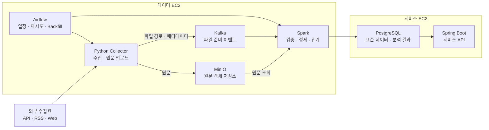

# 데이터 파이프라인 최종 구조

## 1. 전체 아키텍처



## 2. 핵심 흐름

```text
Airflow
  → Python Collector 실행
  → API · RSS · Web 데이터 수집
  → 원문을 MinIO에 저장
  → Kafka에 파일 준비 이벤트 발행
  → Spark가 이벤트 수신
  → MinIO에서 원문 조회
  → 검증 · 정제 · 중복 제거 · 키워드 집계
  → PostgreSQL에 결과 저장
```

## 3. 구성요소

| 구성요소 | 핵심 역할 | 주요 입출력 |
| --- | --- | --- |
| Airflow | 파이프라인 실행 관리 | 수집 일정, 재시도, Backfill, Spark 실행 |
| Python Collector | 사이트별 데이터 수집 | API · RSS · Web → 원문 파일 |
| MinIO | 원문 보관 | HTML · JSON · JSONL · 압축 파일 |
| Kafka | 수집과 처리 연결 | MinIO 객체 위치와 수집 메타데이터 |
| Spark | 데이터 가공과 분석 | 검증, 정제, 중복 제거, 키워드 언급량·순위 계산 |
| PostgreSQL | 서비스용 결과 저장 | 표준 콘텐츠, 키워드 통계, 처리 이력 |

## 4. 저장 구조

### MinIO

```text
Bucket: raw-data

raw-data/
└─ domain=development/
   └─ collected_date=2026-09-03/
      ├─ source=reddit/
      │  └─ run_id=20260903T100000/
      │     └─ part-000.jsonl.gz
      ├─ source=github/
      │  └─ run_id=20260903T101000/
      │     └─ part-000.jsonl.gz
      └─ source=stackoverflow/
         └─ run_id=20260903T102000/
            └─ part-000.jsonl.gz
```

- `part-000.jsonl.gz`: 수집 배치 단위 원문
- `metadata.json`: 출처, 수집 시각, 건수, 파일 크기, 체크섬

### PostgreSQL 테이블

erd 문서 참조

## 5. Kafka 이벤트

Topic 예시: `raw-file-ready`

```json
{
  "event_id": "reddit-20260903-001",
  "run_id": "20260903-001",
  "domain": "development",
  "source_id": "reddit",
  "bucket": "raw-data",
  "object_key": "domain=development/collected_date=2026-09-03/source=reddit/run_id=20260903-001/part-000.jsonl.gz",
  "format": "jsonl",
  "compression": "gzip",
  "record_count": 1250,
  "size_bytes": 382910,
  "checksum": "sha256-value",
  "collected_at": "2026-09-03T10:30:00+09:00",
  "schema_version": 1
}
```

Kafka 메시지는 원문을 포함하지 않는다. MinIO 객체 위치와 처리에 필요한 메타데이터만 포함한다.

## 6. 데이터 구분

| 단계 | 저장 위치 | 데이터 |
| --- | --- | --- |
| Raw | MinIO | 수집 당시 원문 |
| Standard | PostgreSQL | 공통 형식으로 정제된 콘텐츠 |
| Analytics | PostgreSQL | 키워드 언급량, 기간별 순위, 추세 값 |
| Error | PostgreSQL / Kafka DLQ | 검증 및 처리 실패 정보 |

## 7. 배포 구조

| 서버 | 구성 |
| --- | --- |
| 데이터 EC2 | Airflow, Python Collector, Kafka, MinIO, Spark |
| 서비스 EC2 | Spring Boot, PostgreSQL |
| 데이터 EC2 EBS | MinIO 객체, Kafka 로그, Spark Checkpoint, 실행 로그 |

Spark는 단일 노드로 실행하며 MinIO의 S3 호환 API를 통해 원문을 읽는다. Hadoop 클러스터는 포함하지 않는다.

## 8. 담당 구분

| 담당 | 범위 |
| --- | --- |
| 담당 1 | Airflow · Python Collector · MinIO 업로드 |
| 담당 2 | Kafka · Topic · 이벤트 계약 · DLQ |
| 담당 3 | Spark · MinIO 조회 · PostgreSQL 적재 · 키워드 집계 |

공통 계약은 MinIO 객체 경로, Kafka 이벤트 형식, 공통 식별자(`event_id`, `run_id`, `domain`, `source_id`)로 구성한다.
