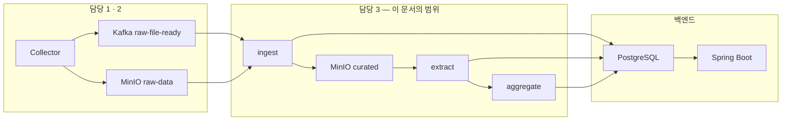

# 00 — Spark 파이프라인 개요

Kafka 이벤트를 받아 MinIO 객체을 처리하고, 서비스가 조회하는 PostgreSQL 테이블을 채우는 부분의 설계 문서 묶음이다. 이 문서는 지도이자 경계선이고, 세부는 각 번호 문서에 있다.

상위 문서는 [`../../docs/data-pipeline-design.md`](../../docs/data-pipeline-design.md) 다. 다만 **거기 적힌 배치 단위 계약은 구현과 다르다** — 저장·이벤트가 기사 단위로 갔다 (2026-09-07 확정). 이 묶음이 주어진 것으로 받는 계약의 기준은 셋이다.

| 무엇 | 어디 |
| --- | --- |
| 생산 측 설계 (키 규칙·메시지·불변식) | [`../../docs/web-collect.md`](../../docs/web-collect.md) #5·#6·#7 |
| 연동 요약 (접속 정보·전달 절차·통보 절차) | [`../../docs/spark-integration.md`](../../docs/spark-integration.md) |
| 소비 측 계약 (이 묶음이 정한 것) | [02](02-input-contract.md) |

서비스 테이블은 [`erd/erd-00-current.md`](erd/erd-00-current.md) 가 정의하며, 이 묶음은 그 스키마를 **바꾸지 않는다**.

## 1. 담당 경계



### 하는 것

| 범위 | 문서 |
| --- | --- |
| Kafka 이벤트 소비, 중복 판별, MinIO 객체 조회와 검증 | [02](02-input-contract.md) |
| 객체 정제, 표준화, 문서 중복 제거, 품질 필터 | [03](03-normalization-spec.md) |
| 키워드 후보 생성, 스코어링, 선별 | [04](04-keyword-extraction-spec.md) |
| 표기 정규화, 동의어·별칭 통합, 신규 키워드 승격 | [05](05-keyword-registry-spec.md) |
| 연관 키워드 산출 | [06](06-related-keyword-spec.md) |
| 언급량·순위·성장률·트렌드 유형 판별 | [07](07-metrics-and-ranking-spec.md) |
| PostgreSQL 적재와 파이프라인 내부 저장소 | [08](08-storage-schema.md) |

### 쓰는 서비스 테이블

| 테이블 | Job |
| --- | --- |
| `contents` | ingest |
| `keywords` · `keyword_contents` | extract |
| `trends` · `keyword_metrics` · `keyword_metric_history` · `keyword_relations` | aggregate |

지표 테이블이 둘로 갈렸다 — `keyword_metrics` 가 기간별 통합 지표, `keyword_metric_history` 가 시계열 언급량이다. 둘 다 `keywords` 를 직접 참조하므로 **트렌드가 아닌 키워드도 지표를 갖는다** ([07 §3](07-metrics-and-ranking-spec.md)).

### 안 하는 것

경계를 흐리면 나중에 서로 미루게 되므로 명시한다.

| 안 하는 것 | 누가 하나 |
| --- | --- |
| 외부 사이트 수집, MinIO 객체 업로드(`raw` · `article.json`), 수집 이력(`collected_article`), 이벤트 발행 (`dag_factory.py` 의 `publish` 태스크) | 담당 1 (Collector) |
| Kafka 토픽 운영, 이벤트 발행, DLQ 토픽 관리 | 담당 2 |
| 서비스 테이블 DDL 소유, 마이그레이션 | 백엔드 |
| 조회 API, 페이징, 인증 | 백엔드 |
| `members` · `member_domains` · `member_interest_keywords` 쓰기 | 백엔드 |
| **`briefings` · `briefing_trends`** | **차후 확장. MVP 범위 밖** |
| **`notifications`** | **차후 확장. MVP 범위 밖** |
| **`trends.description` · `.summary` · `.reason`** | **MVP 제외 — `NULL` 유지** |

위 세 컬럼과 세 테이블은 **의도적으로 비워두는 것**이지 누락이 아니다. 근거는 [§4](#4-확정된-설계-결정).

v1 에 있던 `contents.summary` 는 **스키마에서 아예 없어졌다.** 그 결정이 컬럼 부재로 굳었다 ([03 §8](03-normalization-spec.md)).

## 2. 왜 Airflow 가 Spark 를 직접 부르지 않고 Kafka 를 거치는가

Airflow 는 수집이 언제 끝났는지 이미 안다. 트리거 목적만 보면 Kafka 는 없어도 된다. 그런데도 두는 이유는 네 가지다. 이 네 가지가 사라지면 Kafka 를 걷어내도 된다.

1. **담당 분리** — 담당 2가 토픽·계약·DLQ 를 소유한다. 인터페이스가 코드가 아니라 메시지 스키마다.
2. **소스별 독립 진행** — 소스가 끝나는 시점이 제각각이고 주기도 다르다(fashion 7소스 1시간, `hn` 30분 — `hn` 은 어댑터 대기 중이라 아직 안 돈다). 전부 기다리지 않고 끝난 것부터 다시 처리해보낼 수 있다.
3. **실패와 누락의 구분** — 수집 실패는 **실행 요약 이벤트**의 `status: "failed"` 로 온다. 이벤트가 아예 없는 것(누락)과 실패한 것을 소비 측이 구분할 수 있다 ([02 §2](02-input-contract.md)).
4. **주기 분리** — 생산자는 시간 단위로 발행하고 소비자는 자기 주기로 소비한다. `Trigger.AvailableNow` 가 쌓인 오프셋을 한 번에 소비하므로 두 주기를 맞출 필요가 없다 ([01 §2](01-architecture.md)). Kafka 없이 태스크 의존성으로 이었다면 `ingest` 도 하루 24~48 번 떠야 했다.

**4 번은 배치 계약 시절의 "재발행 경로" 를 대체한다.** 그때는 `metadata.json` 을 훑어 이벤트를 재구성하는 것이 Kafka 이점의 하나였는데, 기사 단위로 가면서 그 파일이 없어졌다. 재처리는 이제 MinIO 프리픽스 스캔으로 하며 Kafka 와 무관하다 ([02 §6](02-input-contract.md)).

## 3. 규모 전제

`web-collect.md` 실측 기준 — `hn` 시간당 약 26건, fashion 7소스 합쳐 하루 100건 안팎. **하루 약 700건**, 연 25만 건 수준이다.

여기에 실행 요약 이벤트가 하루 약 216 개 붙는다(fashion 7소스 × 24회 + `hn` 48회). 객체 조회가 없으므로 처리 비용은 무시할 만하지만, 이벤트 수로는 무시할 수 없다 — 하루 메시지의 약 1/4 이다.

**`hn` 이 붙기 전까지는 이 숫자의 fashion 몫만 흐른다.** 어댑터가 `S15P21A102-165` 대기 중이고 `dags/dev/dev_collect.py` 의 `source_keys` 가 비어 있어서, 지금 토픽에 오는 것은 fashion 7소스뿐이다 (요약 이벤트 하루 168 개).

**솔직히 Spark 가 필요한 규모가 아니다.** 단일 PostgreSQL 과 Python 스크립트로도 돈다. 그래도 쓰는 이유는 (a) 프로젝트 요구사항 (b) 소스·도메인 추가 시의 확장 여지 (c) Structured Streaming 의 offset·checkpoint 관리를 공짜로 얻는 것이다.

**배치 계약 시절 전제(한 회차 7,500건, 연 270만 건)의 1/10 이다.** 원래 숫자는 `data-pipeline-design.md` 의 reddit·github·stackoverflow 예시에서 나왔고, 실제 소스 셋은 국내 패션 매체 7곳과 Hacker News 다. 04~07 의 임계값을 정할 때 이 차이가 중요하다 — 문서 수가 적으면 동시출현·NPMI 같은 통계량의 분산이 커진다.

이 전제를 적어두는 이유는 **튜닝을 과하게 하지 않기 위해서**다. 파티션 수, executor 메모리, 브로드캐스트 임계값을 대규모 클러스터 기준으로 잡으면 단일 노드에서 오히려 느려진다. 기본값에서 시작하고, 느려진 뒤에 측정해서 고친다.

## 4. 확정된 설계 결정

| 항목 | 결정 | 근거 |
| --- | --- | --- |
| 실행 모델 | `Trigger.AvailableNow` 마이크로배치. Airflow 가 `spark-submit` 으로 깨우고 Job 은 스스로 종료. **그 DAG 은 아직 없다** — 지금은 `submit.sh` 로 손으로 부른다 | [01 §1](01-architecture.md) · [09 §5](09-dev-and-test.md) |
| Job 분해 | `ingest` / `extract` / `aggregate` 세 개 | [01 §2](01-architecture.md) |
| 구현 언어 | PySpark | 팀 스택이 Python, 한국어 형태소 분석기가 Python |
| 키워드 추출 | 통계·자동 발견 중심. 사전 화이트리스트를 쓰지 않는다 | [04](04-keyword-extraction-spec.md) |
| 한국어 토큰화 | **형태소 분석기**(`kiwipiepy`)로 명사구만 뽑는다. 규칙 기반 조사·어미 표에서 2026-09-09 갈아탔다 | [04 §2](04-keyword-extraction-spec.md) |
| 의미 유사도 | 경량 임베딩까지. **LLM API 는 쓰지 않는다** | 아래 |
| 중간 저장소 | 정제 본문을 MinIO `curated` 에 Parquet 으로 둔다. `contents.body_object_key` 가 가리킨다 | [01 §3](01-architecture.md) |
| 서비스 스키마 | Spark 는 값만 넣는다. DDL 권한 없음 | [08 §1](08-storage-schema.md) |

### LLM 을 쓰지 않기로 한 것의 결과

현행 스키마에 생성형 텍스트를 담는 자리가 세 개 있다. 전부 `trends` 에 있다.

| 컬럼 | 무엇 | 임베딩으로 가능한가 |
| --- | --- | --- |
| `trends.description` varchar | 카드용 한 줄 설명 | **불가능** |
| `trends.summary` text | 콘텐츠 기반 요약 | **불가능** |
| `trends.reason` text | 상승 배경 | **불가능** |

임베딩은 벡터를 주지 문장을 주지 않는다. 셋 다 원리적으로 못 만든다.

**전부 `NULL` 로 둔다. 템플릿 문장으로 채우지 않는다.** `"{keyword}는 최근 7일간 {n}회 언급되었습니다"` 식으로 채우면 모든 카드가 같은 문장이 된다. 빈 화면보다 나쁘다. `NULL` 이면 프론트가 해당 영역을 접을 수 있지만, 무의미한 문장이 채워져 있으면 접을 수도 없다.

**⚠️ 상태를 표현할 자리가 없다.** 현행 스키마에는 `summary` 의 생성 상태(미생성 / 생성 실패 / 대상 없음)를 구분할 컬럼이 없다. `NULL` 하나가 세 경우를 다 뜻하게 된다. 나중에 LLM 을 붙일 때 재시도 대상을 고를 수 없으므로, 그때 상태 컬럼을 추가해야 한다. 이건 [§7](#7-현행-스키마의-한계와-미결-항목) 의 한계 항목이다.

**나중에 붙일 때의 위치** — Spark executor 안에서 API 를 호출하면 안 된다. 태스크 재시도가 곧 중복 과금이고, executor 하나가 rate limit 에 걸리면 Job 전체가 죽는다. 별도 Airflow 태스크(순수 Python)로 둔다.

## 5. 문서 지도와 읽는 순서

```
00 개요           ← 지금 여기
01 아키텍처       실행 모델 · Job 분해 · 중간 저장소 · 멱등성
02 입력 계약      Kafka 소비 · MinIO 조회 · 검증 · DLQ · 재처리
03 정제 규격      객체 → 표준 문서 · 중복 제거 · 품질 필터
04 키워드 추출    후보 생성 · 스코어링 · 선별 · 평가
05 키워드 레지스트리  정규화 · 동의어 통합 · 승격
06 연관 키워드    동시출현 · NPMI · 임베딩 결합
07 지표와 순위    언급량 · 윈도우 · 성장률 · 트렌드 유형
08 저장 스키마    서비스 테이블 적재 · 파이프라인 내부 저장소
09 개발과 테스트  폴더 구조 · 로컬 실행 · 테스트 전략
10 실행 계획      에픽 · 스토리 분해 · 착수 순서 · 차단 항목
```

의존 순서대로 쓰여 있으므로 번호대로 읽으면 된다. 다만 **08 은 두 번 읽게 된다** — 03 을 읽기 전에 §1(계층 구분)만 보고, 04~07 을 읽은 뒤 전체를 본다.

**00~09 가 규격이고 [10](10-delivery-plan.md) 이 일정이다.** 무엇을 어느 순서로 끊어 만드는지, 지금 무엇이 막혀 있는지는 10 에 있다. 규격이 바뀌면 해당 번호 문서를 고치고, 10 은 링크만 따라간다.

## 6. 용어

| 용어 | 뜻 |
| --- | --- |
| **raw 객체** | Collector 가 MinIO `raw-data` 에 올린 기사 하나. `article.json`(정규화된 공통 스키마)과 `raw.{xml\|html\|json}`(받은 바이트 그대로) 두 객체다. `ingest` 가 읽는 것은 `article.json` 뿐이다 ([02 §3](02-input-contract.md)) |
| **정제 문서 (curated)** | 객체를 표준 스키마로 접고 텍스트를 씻은 것. MinIO `curated` 에 Parquet |
| **콘텐츠 (content)** | 서비스 테이블 `contents` 의 행. 본문은 없고 `body_object_key` 가 위치만 가리킨다 |
| **키워드 후보 (candidate)** | 추출은 됐지만 아직 승격되지 않은 표기. 파이프라인 내부에만 있다 |
| **정규 키워드 (canonical)** | 승격되어 `keywords` 에 들어간 것. 서비스에 노출된다 |
| **트렌드 (trend)** | `trends` 행이 생긴 키워드. **모든 키워드가 트렌드는 아니다** |
| **별칭 (alias)** | 정규 키워드로 흡수된 다른 표기. `MCP` ← `Model Context Protocol` |
| **언급량 (mention count)** | 키워드가 등장한 **문서 수**. 출현 횟수가 아니다. [07 §1](07-metrics-and-ranking-spec.md) |
| **기간 (period)** | `keyword_metrics.period`. `24H` / `7D` / `30D` 를 제안하며 값 규약 확정이 필요하다 |
| **기간 지표** | `keyword_metrics` 한 행. **한 키워드·한 기간에 1행**이고 매 실행이 그 행을 덮어쓴다 |
| **버킷 (bucket)** | `keyword_metric_history` 한 행이 덮는 구간. **1일**이며 폭은 `bucket_end − bucket_start` 가 담는다 ([07 §3](07-metrics-and-ranking-spec.md)) |
| **기준일 (D)** | 집계의 마지막 날. KST 로 완결된 마지막 날이며 기본은 실행일의 전날이다 ([07 §4](07-metrics-and-ranking-spec.md)) |
| **처리 이력 (ledger)** | `event_id` 별 처리 상태 기록. 파이프라인 내부 테이블 |

## 7. 현행 스키마의 한계와 미결 항목

현행 스키마는 단순해서 좋지만, Spark 쪽에서 표현할 수 없게 되는 것들이 있다. 우회할 수 있는 것과 없는 것을 나눈다.

DB 는 초기 버전이라 구현하면서 고칠 수 있고, **그게 옳은 방식이다.** 다만 변경 비용이 균일하지 않아 무엇을 먼저 박아야 하는지는 [08 §6](08-storage-schema.md) 에서 정리했다.

### 합의된 것

| 항목 | 결론 |
| --- | --- |
| `domain` 문자열 값 | **enum 상수명.** 이벤트 슬러그 `dev` → `DEVELOP`, `fashion` → `FASHION`. `ingest` 가 매핑한다 ([01 §6](01-architecture.md)) |
| `keywords` 유일성 | **`(domain, normalized_name)` 복합 UNIQUE.** 적용 대기 |
| 지표의 키 | **`keyword_id`.** `trends` 를 거치지 않는다. 기간 지표는 `keyword_metrics`, 시계열은 `keyword_metric_history` ([erd](erd/erd-00-current.md)) |
| 트렌드 유형 | **`trends.trend_types` 배열. 복수 가능하고 배타적이지 않다.** `CURRENT`/`NEW`/`RISING` ([07 §6](07-metrics-and-ranking-spec.md)) |

이벤트 슬러그가 `development` 가 아니라 **`dev`** 인 것에 주의한다. 상위 문서 예시와 다르고, 틀리면 dev 도메인 전량이 DLQ 로 간다 ([01 §6](01-architecture.md)).

`normalized_name` 단독이 아니라 복합인 이유는 개발의 `모델` 과 패션의 `모델` 이 충돌하면 안 되기 때문이다 ([08 §5](08-storage-schema.md)).

### 우회할 수 없는 한계 — 백엔드·기획과 합의가 필요

| # | 한계 | 결과 |
| --- | --- | --- |
| 1 | **일자별 수집 상태 테이블이 없다** | "언급량 0인 날"과 "수집이 실패해 데이터가 없는 날"을 구분할 자리가 없다. **[07 §3](07-metrics-and-ranking-spec.md) 에 부분 우회안이 있다** — `keyword_metric_history` 행의 유무로 구분하는 방식이며 프론트 합의가 필요하다 |
| 2 | **`keyword_relations` 에 `period` 가 없다** | 기간별 연관도를 담을 수 없다. **하나의 기준 기간으로만** 계산한다 ([06 §3](06-related-keyword-spec.md)) |
| 3 | `keyword_relations` 에 이전 점수·변화율·상태 컬럼이 없다 | 연관도의 변화를 보여줄 수 없다 |
| 4 | ~~`trends` 행이 없는 키워드는 지표가 전혀 없다~~ | **v2 에서 해소됐다.** 지표가 `keywords` 를 직접 참조하므로 관심 키워드로 등록만 한 키워드도 그래프가 나온다 |
| 5 | `summary`·`reason` 의 생성 상태 컬럼이 없다 | [§4](#4-확정된-설계-결정) |
| 6 | `keyword_contents` 에 점수 컬럼이 없다 | 관련 콘텐츠를 관련도순으로 정렬할 수 없다. 발행일순만 가능 |
| 22 | **`trend_types` 에 기간 구분이 없다** | 판별은 기간별로 하는데 저장 자리는 키워드당 하나다. `24H` 에서만 `RISING` 인 키워드가 `30D` 목록에서도 `RISING` 배지를 단다. **`keyword_metrics` 에 컬럼을 더하면 해소된다** ([07 §6](07-metrics-and-ranking-spec.md), [08 §5](08-storage-schema.md) 티어 3) |
| 23 | `keyword_metrics` 에 `previous_rank` 가 없다 | "3위 → 1위" 같은 순위 변동을 보여줄 수 없다. 계산은 하고 있고 담을 자리만 없다 ([07 §5](07-metrics-and-ranking-spec.md)) |
| 24 | `keyword_metric_history` 의 해상도가 하나다 | `period` 컬럼이 없어 버킷 계열이 하나뿐이다. **1일로 정했으므로 `24H` 상세의 추이가 점 하나가 된다** — 프론트 합의가 필요하다 ([07 §3](07-metrics-and-ranking-spec.md)) |

1·22·24 는 사용자에게 보이는 문제라 **기획·프론트 확인이 필요하다.** 2·3·6·23 은 기능 축소로 감수한다. 전부 티어 3(나중에 컬럼을 추가하면 되는 것)이라 지금 막지는 않는다.

**4번이 v2 의 가장 큰 이득이다.** v1 에서는 우회 방법이 없어 "관심 키워드로 등록했는데 상세가 빈칸" 을 기획이 받아들여야 했다.

### 우회할 수 없는 한계 — 입력 쪽

스키마가 아니라 **수집 가능한 데이터** 때문에 생기는 한계다. 이건 컬럼을 추가해도 해결되지 않는다.

| # | 한계 | 결과 |
| --- | --- | --- |
| 19 | **dev 도메인에 본문이 없다** | `hn` 은 공식 API 메타데이터(제목·URL·점수·댓글수)만 저장하고 링크된 외부 객체를 받지 않는다 (`web-collect.md` #8 확정 3). 즉 **dev 키워드는 제목만으로 뽑아야 한다.** [04](04-keyword-extraction-spec.md) 가 본문 기반 통계를 전제하므로 도메인별로 추출 경로가 나뉜다 |
| 20 | **fashion 기사 7.4% 에 본문이 없다** | `harpersbazaar`·`cosmopolitan` 회원 전용 기사는 불변식 2 에 따라 본문을 저장하지 않는다. 제목·URL·발행일·요약은 있다 |
| 21 | **객체 보존 90일** | 그 뒤로는 정제 로직을 고쳐도 옛 구간을 다시 돌릴 수 없다. `curated` 를 객체보다 짧게 두기로 한 [01 §3](01-architecture.md) 결정과 함께 보면, 90일이 실질적인 재처리 지평이다 |

**19 가 가장 무겁다.** dev 는 도메인의 절반인데 입력이 제목 한 줄이다. 제목만으로 동시출현·NPMI([06](06-related-keyword-spec.md))를 계산하면 문서당 토큰이 10개 안팎이라 통계가 거의 안 선다. 선택지는 (a) dev 는 키워드 빈도만 쓰고 연관 키워드를 포기 (b) `hn` 댓글 API 를 추가로 받아 본문 대용으로 쓴다 — 둘 다 `source-discovery.md` 의 승인 도메인 화이트리스트와 함께 정할 문제다. **04~07 의 임계값을 정하기 전에 결론이 필요하다.**

### 지금 처리해야 하는 것

| # | 항목 | 없으면 | 티어 |
| --- | --- | --- | --- |
| 7 | **`ddl-auto: create` → `update`** | 백엔드 재배포마다 수집 데이터가 전부 사라진다. 사용자의 관심 키워드도 함께 간다. 지표는 내부 원자료에서 다시 계산되지만 `contents` 는 MinIO 재스캔이 필요하다 ([08 §6](08-storage-schema.md)) | — |
| 8 | **`keywords (domain, normalized_name)` UNIQUE 적용** | 같은 키워드가 매 배치마다 새 행으로 쌓인다. **나중에 붙일 수 없다** | 1 |
| 9 | **`keyword_metrics (keyword_id, period)` · `keyword_metric_history (keyword_id, bucket_start)` UNIQUE** | 기간별 1행이 보장되지 않고, 그래프에 같은 날짜가 여러 번 나온다 | 1 |
| 10 | `period` 허용 값 확정 | varchar 라 코드가 정하는 대로 굳는다. `24H`/`7D`/`30D` 를 제안 | 3 |
| 21 | **`trend_type_array` 의 실제 타입 확인** | 네이티브 enum 배열이면 Spark JDBC 쓰기가 캐스트 없이 죽고, JPA `@ElementCollection` 이면 실제 DDL 이 별도 조인 테이블이라 적재 대상이 달라진다 ([08 §4](08-storage-schema.md)) | — |
| 11 | `@Enumerated(EnumType.STRING)` 확인 | JPA 기본값이 `ORDINAL` 이라 컬럼이 int 가 된다 ([01 §6](01-architecture.md)) | 2 |
| 12 | `growth_amount` 가 생성 컬럼인지 | 생성 컬럼이면 INSERT 에서 빼야 한다 ([07 §5](07-metrics-and-ranking-spec.md)) | — |
| 13 | `contents.url` 길이·인덱스 | varchar UK 라 긴 URL 에서 삽입이 실패한다 ([03 §8](03-normalization-spec.md)) | 2 |
| 14 | `keywords` 참조 FK 의 `ON DELETE` 정책 | [05 §1](05-keyword-registry-spec.md) | — |

7·8 이 가장 급하다. 7 은 데이터를 지키는 것이고 8 은 나중에 할 수 없는 것이다. 나머지 요청 목록과 근거는 [08 §5](08-storage-schema.md).

### 밖에서 와야 하는 것

| # | 항목 | 막히는 것 |
| --- | --- | --- |
| 15 | **실제 수집 데이터 샘플** | 04~07 의 임계값을 정할 근거가 없다. **추측으로 정하면 전부 다시 하게 된다.** fashion 수집기는 구현돼 있다(`src/trendin/fashion/collect/`). **계약 샘플은 받았다** — `tests/fixtures/contract/` 에 이벤트 3건과 그 객체 2개가 있고 파싱·검증 코드를 짜기엔 충분하다. 하지만 임계값에 필요한 것은 **분포**라 `tests/fixtures/corpus.json` 이 채워져야 한다 ([09 §7](09-dev-and-test.md) 항목 5) |
| 16 | Kafka · MinIO 로컬 환경 | 통합 테스트 ([09 §4](09-dev-and-test.md)). `datastore/compose.yaml` 로 뜬다 |
| 17 | Spark 버전 정합 검증 | [01 §7](01-architecture.md) — **끝났다** |
| 18 | `contents.source` 값 규약 | 이벤트의 `source_id`(`vogue`·`hn` 등 소스 키)를 그대로 넣을지 표시명(`보그`)으로 바꿀지 |
| 19 | **DLQ 토픽명과 메시지 스키마** | [02 §5](02-input-contract.md). 담당 2 소관이고 아직 없다. 없으면 검증 실패의 재투입 경로가 없다 |
| 20 | **dev 도메인 본문 부재 결론** | 위 한계 19. 04~07 임계값의 선행 조건이다 |

**7·8 만 적용되면 `ingest` 와 `extract` 는 착수할 수 있다.** `aggregate` 는 9·10·21 이 더 필요하다. 착수 순서는 [09 §7](09-dev-and-test.md).
