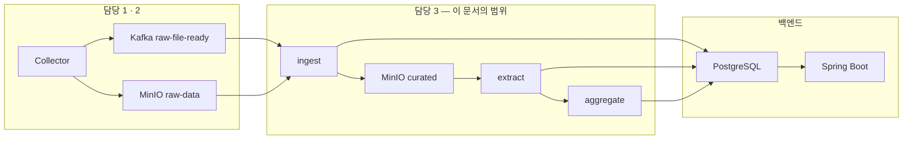

# 00 — Spark 파이프라인 개요

Kafka 이벤트를 받아 MinIO 원문을 처리하고, 서비스가 조회하는 PostgreSQL 테이블을 채우는 부분의 설계 문서 묶음이다. 이 문서는 지도이자 경계선이고, 세부는 각 번호 문서에 있다.

상위 문서는 [`../../docs/data-pipeline-design.md`](../../docs/data-pipeline-design.md) 다. 거기서 정의한 MinIO 경로 규약과 Kafka 이벤트 계약을 이 묶음은 **주어진 것으로 받는다**. 서비스 테이블은 [`erd/erd-00-current.md`](erd/erd-00-current.md) 가 정의하며, 이 묶음은 그 스키마를 **바꾸지 않는다**.

## 1. 담당 경계



### 하는 것

| 범위 | 문서 |
| --- | --- |
| Kafka 이벤트 소비, 중복 판정, MinIO 원문 조회와 검증 | [02](02-input-contract.md) |
| 원문 정제, 표준화, 문서 중복 제거, 품질 필터 | [03](03-normalization-spec.md) |
| 키워드 후보 생성, 스코어링, 선별 | [04](04-keyword-extraction-spec.md) |
| 표기 정규화, 동의어·별칭 통합, 신규 키워드 승격 | [05](05-keyword-registry-spec.md) |
| 연관 키워드 산출 | [06](06-related-keyword-spec.md) |
| 언급량·순위·성장률·트렌드 유형 판정 | [07](07-metrics-and-ranking-spec.md) |
| PostgreSQL 적재와 파이프라인 내부 저장소 | [08](08-storage-schema.md) |

### 쓰는 서비스 테이블

| 테이블 | Job |
| --- | --- |
| `contents` | ingest |
| `keywords` · `keyword_contents` | extract |
| `trends` · `trend_metrics` · `keyword_relations` | aggregate |

### 안 하는 것

경계를 흐리면 나중에 서로 미루게 되므로 명시한다.

| 안 하는 것 | 누가 하나 |
| --- | --- |
| 외부 사이트 수집, MinIO 원문 업로드, `metadata.json` 작성 | 담당 1 (Collector) |
| Kafka 토픽 운영, 이벤트 발행, DLQ 토픽 관리 | 담당 2 |
| 서비스 테이블 DDL 소유, 마이그레이션 | 백엔드 |
| 조회 API, 페이징, 인증 | 백엔드 |
| `members` · `member_domains` · `member_interest_keywords` 쓰기 | 백엔드 |
| **`briefings` · `briefing_trends`** | **차후 확장. MVP 범위 밖** |
| **`notifications`** | **차후 확장. MVP 범위 밖** |
| **`trends.description` · `.summary` · `.reason`** | **MVP 제외 — `NULL` 유지** |
| **`contents.summary`** | **MVP 제외 — `NULL` 유지** |

아래 네 컬럼과 두 테이블은 **의도적으로 비워두는 것**이지 누락이 아니다. 근거는 [§4](#4-확정된-설계-결정).

## 2. 왜 Airflow 가 Spark 를 직접 부르지 않고 Kafka 를 거치는가

Airflow 는 수집이 언제 끝났는지 이미 안다. 트리거 목적만 보면 Kafka 는 없어도 된다. 그런데도 두는 이유는 네 가지다. 이 네 가지가 사라지면 Kafka 를 걷어내도 된다.

1. **담당 분리** — 담당 2가 토픽·계약·DLQ 를 소유한다. 인터페이스가 코드가 아니라 메시지 스키마다.
2. **소스별 독립 진행** — 소스 셋이 끝나는 시점이 제각각일 때 전부 기다리지 않고 끝난 것부터 흘려보낼 수 있다.
3. **실패와 누락의 구분** — 수집 실패도 `status: "failed"` 이벤트로 온다. 이벤트가 아예 없는 것(누락)과 실패한 것을 소비 측이 구분할 수 있다. 상위 문서 §5 발행 규약 5번이 이걸 위해 실패 이벤트를 생략하지 않는다.
4. **재발행 경로** — 정제 로직을 고쳐 과거 구간을 다시 흘릴 때 `metadata.json` 을 훑어 이벤트를 재구성하는 경로가 이미 정의돼 있다.

## 3. 규모 전제

상위 문서 예시 기준 배치당 1,250건 × 소스 3 × 도메인 2 = **한 회차 약 7,500건**. 일 1회면 연 270만 건 수준이다.

**솔직히 Spark 가 필요한 규모가 아니다.** 단일 PostgreSQL 과 Python 스크립트로도 돈다. 그래도 쓰는 이유는 (a) 프로젝트 요구사항 (b) 소스·도메인 추가 시의 확장 여지 (c) Structured Streaming 의 offset·checkpoint 관리를 공짜로 얻는 것이다.

이 전제를 적어두는 이유는 **튜닝을 과하게 하지 않기 위해서**다. 파티션 수, executor 메모리, 브로드캐스트 임계값을 대규모 클러스터 기준으로 잡으면 단일 노드에서 오히려 느려진다. 기본값에서 시작하고, 느려진 뒤에 측정해서 고친다.

## 4. 확정된 설계 결정

| 항목 | 결정 | 근거 |
| --- | --- | --- |
| 실행 모델 | `Trigger.AvailableNow` 마이크로배치. Airflow 가 `spark-submit` 으로 깨우고 Job 은 스스로 종료 | [01 §1](01-architecture.md) |
| Job 분해 | `ingest` / `extract` / `aggregate` 세 개 | [01 §2](01-architecture.md) |
| 구현 언어 | PySpark | 팀 스택이 Python, 한국어 형태소 분석기가 Python |
| 키워드 추출 | 통계·자동 발견 중심. 사전 화이트리스트를 쓰지 않는다 | [04](04-keyword-extraction-spec.md) |
| 의미 유사도 | 경량 임베딩까지. **LLM API 는 쓰지 않는다** | 아래 |
| 중간 저장소 | 정제 본문을 MinIO `curated` 에 Parquet 으로 둔다. `contents.body_object_key` 가 가리킨다 | [01 §3](01-architecture.md) |
| 서비스 스키마 | Spark 는 값만 넣는다. DDL 권한 없음 | [08 §1](08-storage-schema.md) |

### LLM 을 쓰지 않기로 한 것의 결과

현행 스키마에 생성형 텍스트를 담는 자리가 네 개 있다.

| 컬럼 | 무엇 | 임베딩으로 가능한가 |
| --- | --- | --- |
| `trends.description` varchar | 카드용 한 줄 설명 | **불가능** |
| `trends.summary` text | 콘텐츠 기반 요약 | **불가능** |
| `trends.reason` text | 상승 배경 | **불가능** |
| `contents.summary` text | 콘텐츠 요약 | **불가능** |

임베딩은 벡터를 주지 문장을 주지 않는다. 네 개 모두 원리적으로 못 만든다.

**전부 `NULL` 로 둔다. 템플릿 문장으로 채우지 않는다.** `"{keyword}는 최근 7일간 {n}회 언급되었습니다"` 식으로 채우면 모든 카드가 같은 문장이 된다. 빈 화면보다 나쁘다. `NULL` 이면 프론트가 해당 영역을 접을 수 있지만, 무의미한 문장이 채워져 있으면 접을 수도 없다.

**⚠️ 상태를 표현할 자리가 없다.** 현행 스키마에는 `summary` 의 생성 상태(미생성 / 생성 실패 / 대상 없음)를 구분할 컬럼이 없다. `NULL` 하나가 세 경우를 다 뜻하게 된다. 나중에 LLM 을 붙일 때 재시도 대상을 고를 수 없으므로, 그때 상태 컬럼을 추가해야 한다. 이건 [§7](#7-현행-스키마의-한계와-미결-항목) 의 한계 항목이다.

**나중에 붙일 때의 위치** — Spark executor 안에서 API 를 호출하면 안 된다. 태스크 재시도가 곧 중복 과금이고, executor 하나가 rate limit 에 걸리면 Job 전체가 죽는다. 별도 Airflow 태스크(순수 Python)로 둔다.

## 5. 문서 지도와 읽는 순서

```
00 개요           ← 지금 여기
01 아키텍처       실행 모델 · Job 분해 · 중간 저장소 · 멱등성
02 입력 계약      Kafka 소비 · MinIO 조회 · 검증 · DLQ · 재처리
03 정제 규격      원문 → 표준 문서 · 중복 제거 · 품질 필터
04 키워드 추출    후보 생성 · 스코어링 · 선별 · 평가
05 키워드 레지스트리  정규화 · 동의어 통합 · 승격
06 연관 키워드    동시출현 · NPMI · 임베딩 결합
07 지표와 순위    언급량 · 윈도우 · 성장률 · 트렌드 유형
08 저장 스키마    서비스 테이블 적재 · 파이프라인 내부 저장소
09 개발과 테스트  폴더 구조 · 로컬 실행 · 테스트 전략
```

의존 순서대로 쓰여 있으므로 번호대로 읽으면 된다. 다만 **08 은 두 번 읽게 된다** — 03 을 읽기 전에 §1(계층 구분)만 보고, 04~07 을 읽은 뒤 전체를 본다.

## 6. 용어

| 용어 | 뜻 |
| --- | --- |
| **원문 (raw)** | Collector 가 MinIO `raw-data` 에 올린 `part-000.jsonl.gz`. 수집 당시 그대로 |
| **정제 문서 (curated)** | 원문을 표준 스키마로 접고 텍스트를 씻은 것. MinIO `curated` 에 Parquet |
| **콘텐츠 (content)** | 서비스 테이블 `contents` 의 행. 본문은 없고 `body_object_key` 가 위치만 가리킨다 |
| **키워드 후보 (candidate)** | 추출은 됐지만 아직 승격되지 않은 표기. 파이프라인 내부에만 있다 |
| **정규 키워드 (canonical)** | 승격되어 `keywords` 에 들어간 것. 서비스에 노출된다 |
| **트렌드 (trend)** | `trends` 행이 생긴 키워드. **모든 키워드가 트렌드는 아니다** |
| **별칭 (alias)** | 정규 키워드로 흡수된 다른 표기. `MCP` ← `Model Context Protocol` |
| **언급량 (mention count)** | 키워드가 등장한 **문서 수**. 출현 횟수가 아니다. [07 §1](07-metrics-and-ranking-spec.md) |
| **기간 (period)** | `trend_metrics.period`. `24H` / `7D` / `30D` 를 제안하며 값 규약 확정이 필요하다 |
| **측정 (measurement)** | `trend_metrics` 한 행. 한 트렌드·한 기간에 대해 **여러 행이 쌓인다** |
| **원장 (ledger)** | `event_id` 별 처리 상태 기록. 파이프라인 내부 테이블 |

## 7. 현행 스키마의 한계와 미결 항목

현행 스키마는 단순해서 좋지만, Spark 쪽에서 표현할 수 없게 되는 것들이 있다. 우회할 수 있는 것과 없는 것을 나눈다.

DB 는 초기 버전이라 구현하면서 고칠 수 있고, **그게 옳은 방식이다.** 다만 변경 비용이 균일하지 않아 무엇을 먼저 박아야 하는지는 [08 §6](08-storage-schema.md) 에서 정리했다.

### 합의된 것

| 항목 | 결론 |
| --- | --- |
| `domain` 문자열 값 | **enum 상수명.** `development` → `DEVELOP`, `fashion` → `FASHION`. `ingest` 가 매핑한다 ([01 §6](01-architecture.md)) |
| `keywords` 유일성 | **`(domain, normalized_name)` 복합 UNIQUE.** 적용 대기 |

`normalized_name` 단독이 아니라 복합인 이유는 개발의 `모델` 과 패션의 `모델` 이 충돌하면 안 되기 때문이다 ([08 §5](08-storage-schema.md)).

### 우회할 수 없는 한계 — 백엔드·기획과 합의가 필요

| # | 한계 | 결과 |
| --- | --- | --- |
| 1 | **일자별 수집 상태 테이블이 없다** | "언급량 0인 날"과 "수집이 실패해 데이터가 없는 날"을 구분할 자리가 없다. **[07 §2](07-metrics-and-ranking-spec.md) 에 부분 우회안이 있다** — 행의 유무로 구분하는 방식이며 프론트 합의가 필요하다 |
| 2 | **`keyword_relations` 에 `period` 가 없다** | 기간별 연관도를 담을 수 없다. **하나의 기준 기간으로만** 계산한다 ([06 §3](06-related-keyword-spec.md)) |
| 3 | `keyword_relations` 에 이전 점수·변화율·상태 컬럼이 없다 | 연관도의 변화를 보여줄 수 없다 |
| 4 | **`trends` 행이 없는 키워드는 지표가 전혀 없다** | 관심 키워드로 등록했지만 트렌드가 아닌 키워드는 언급량 그래프가 빈칸이다 ([07 §2](07-metrics-and-ranking-spec.md)) |
| 5 | `summary`·`reason` 의 생성 상태 컬럼이 없다 | [§4](#4-확정된-설계-결정) |
| 6 | `keyword_contents` 에 점수 컬럼이 없다 | 관련 콘텐츠를 관련도순으로 정렬할 수 없다. 발행일순만 가능 |

1·4 는 사용자에게 보이는 문제라 **기획 확인이 필요하다.** 2·3·6 은 기능 축소로 감수한다. 전부 티어 3(나중에 컬럼을 추가하면 되는 것)이라 지금 막지는 않는다.

### 지금 처리해야 하는 것

| # | 항목 | 없으면 | 티어 |
| --- | --- | --- | --- |
| 7 | **`ddl-auto: create` → `update`** | 백엔드 재배포마다 수집 데이터가 전부 사라진다. `first_seen_at` 은 재수집으로 복구되지 않는다 ([08 §6](08-storage-schema.md)) | — |
| 8 | **`keywords (domain, normalized_name)` UNIQUE 적용** | 같은 키워드가 매 배치마다 새 행으로 쌓인다. **나중에 붙일 수 없다** | 1 |
| 9 | **`trend_metrics (trend_id, period, period_start)` UNIQUE** | 재실행마다 중복 측정이 쌓인다 | 1 |
| 10 | `period` · `trend_type` 허용 값 확정 | varchar 라 코드가 정하는 대로 굳는다. `24H`/`7D`/`30D`, `CURRENT`/`NEW`/`RISING` 을 제안 | 3 |
| 11 | `@Enumerated(EnumType.STRING)` 확인 | JPA 기본값이 `ORDINAL` 이라 컬럼이 int 가 된다 ([01 §6](01-architecture.md)) | 2 |
| 12 | `growth_amount` 가 생성 컬럼인지 | 생성 컬럼이면 INSERT 에서 빼야 한다 ([07 §5](07-metrics-and-ranking-spec.md)) | — |
| 13 | `contents.url` 길이·인덱스 | varchar UK 라 긴 URL 에서 삽입이 실패한다 ([03 §8](03-normalization-spec.md)) | 2 |
| 14 | `keywords` 참조 FK 의 `ON DELETE` 정책 | [05 §1](05-keyword-registry-spec.md) | — |

7·8 이 가장 급하다. 7 은 데이터를 지키는 것이고 8 은 나중에 할 수 없는 것이다. 나머지 요청 목록과 근거는 [08 §5](08-storage-schema.md).

### 밖에서 와야 하는 것

| # | 항목 | 막히는 것 |
| --- | --- | --- |
| 15 | **실제 수집 데이터 샘플** | 04~07 의 임계값을 정할 근거가 없다. **추측으로 정하면 전부 다시 하게 된다** |
| 16 | Kafka · MinIO 로컬 환경 | 통합 테스트 ([09 §4](09-dev-and-test.md)) |
| 17 | Spark 버전 정합 검증 | [01 §7](01-architecture.md) |
| 18 | `contents.source` 값 규약 | 이벤트의 `source_id` 를 그대로 넣을지 표시명으로 바꿀지 |

**7·8 만 적용되면 `ingest` 와 `extract` 는 착수할 수 있다.** `aggregate` 는 9·10 이 더 필요하다. 착수 순서는 [09 §7](09-dev-and-test.md).
