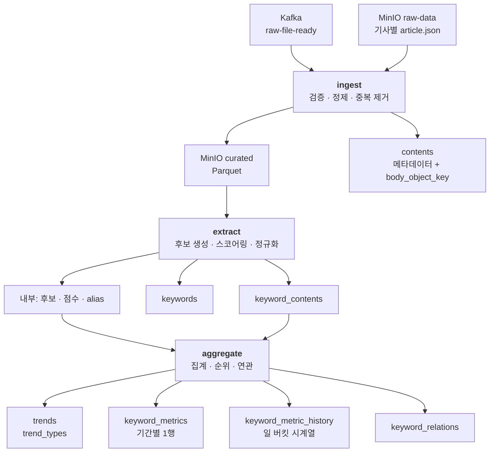

# 01 — 아키텍처

실행 모델, Job 분해, 중간 저장소, 멱등성. 어떤 프로세스가 언제 뜨고 무엇을 남기는지를 정한다. 알고리즘은 04~07 이 다룬다.

## 1. 실행 모델 — `Trigger.AvailableNow`

Airflow 가 `spark-submit` 으로 Job 을 깨우고, Job 은 Kafka 에 그때까지 쌓인 오프셋까지 소비한 뒤 **스스로 종료한다.**

```
[Airflow 태스크 시작 → spark-submit]
  ↳ Spark 프로세스 기동
  ↳ readStream(kafka) + Trigger.AvailableNow
  ↳ 지금 쌓여 있는 것까지 여러 마이크로배치로 나눠 소비
  ↳ MinIO 조회 → 처리 → 적재
  ↳ checkpoint 커밋 후 프로세스 종료
[다음 스케줄까지 아무 프로세스도 없음]
```

코드는 상시 Structured Streaming 과 거의 같다. `readStream.format("kafka")` 를 그대로 쓰고 트리거만 다르다.

**⚠️ 2026-09-09 현재 이 Job 을 부르는 Airflow DAG 은 없다.** `dags/` 에는 수집 DAG(`fashion_collect` · `dev_collect`) 과 예제만 있다. Job 은 `spark/scripts/submit.sh ingest --profile local` 로 손으로 부르고, DAG 배선은 [09 §5](09-dev-and-test.md) 의 모양으로 후속이다 ([10 §5](10-delivery-plan.md)).

### 이 선택의 이점

- **오프셋 관리를 직접 짜지 않는다.** checkpoint 디렉터리를 그대로 쓰므로 "어디까지 읽었나"는 Spark 가 관리한다. 순수 배치로 갔다면 이 코드를 직접 써야 했고, 그게 가장 흔한 버그 원천이다.
- **프로세스가 상시 뜨지 않는다.** 데이터 EC2 한 대에 Airflow · Kafka · MinIO 가 이미 있다. Spark driver 와 executor 가 24시간 메모리를 점유하면 여유가 없다.
- **Airflow 의 재시도·backfill·태스크 의존성·실패 알림이 그대로 붙는다.** 수집 태스크의 downstream 으로 걸면 끝이다.
- **집계 Job 과 실행 모델이 같다.** `aggregate` 는 이벤트가 아니라 날짜 단위라 어차피 배치다. 상시 streaming 을 골랐다면 실행 모델이 두 벌이 되고, 운영 문서도 두 벌이 됐다.

### 기각한 대안

| 대안 | 기각 이유 |
| --- | --- |
| 상시 Structured Streaming | 지연이 초 단위가 되지만 트렌드 집계는 일·주·월 단위라 값을 하지 않는다. 단일 노드 메모리 상시 점유, 코드 변경 시 수동 재시작, 재처리 경로 별도 구축, 그리고 `aggregate` 는 어차피 배치라 실행 모델이 두 개가 된다 |
| 순수 배치 (Kafka 미사용) | [00 §2](00-overview.md) 의 Kafka 이점 네 가지가 전부 사라지고 오프셋 관리를 직접 짜야 한다 |

### 지연

수집 완료부터 서비스 반영까지의 지연은 **`ingest` 스케줄 간격 + Job 실행 시간**이다. 수집은 시간 단위지만 `ingest` 는 그보다 드물게 돈다 ([§2](#airflow-dag-배치)) — 일 1회로 두면 최대 하루. 이게 허용되는 이유는 서비스가 파는 것이 `24H`/`7D`/`30D` 트렌드이지 실시간 피드가 아니기 때문이다. 실시간성이 요구사항으로 올라오면 이 결정을 다시 본다.

## 2. Job 분해

세 개로 쪼갠다. 쪼갠 이유는 **트리거 단위가 서로 다르기 때문**이다. 같은 단위였다면 합쳤다.

| Job | 트리거 단위 | 입력 | 출력 |
| --- | --- | --- | --- |
| `ingest` | Kafka 이벤트 | Kafka `raw-file-ready`, MinIO `raw-data` | MinIO `curated`, `contents`, 처리 이력 |
| `extract` | 새 정제 문서 | MinIO `curated` | 내부 후보·점수 테이블, `keywords`, `keyword_contents` |
| `aggregate` | **날짜** | 내부 통계 테이블 | `trends`, `keyword_metrics`, `keyword_metric_history`, `keyword_relations` |



### `aggregate` 를 분리해야만 하는 이유

날짜 단위이지 이벤트 단위가 아니다. "9월 3일의 상위 5개"는 그날 문서가 다 들어와야 계산된다. 그리고 발행이 늦은 문서가 어제 날짜로 들어오면 어제치를 다시 계산해야 한다 ([07 §3](07-metrics-and-ranking-spec.md)). 이벤트에 묶어두면 이 재계산을 표현할 방법이 없다.

### `extract` 를 분리해야만 하는 이유

키워드 알고리즘은 **자주 바뀐다.** 통계·자동 발견 방식이라 임계값 튜닝 반복이 전제다 ([04 §10](04-keyword-extraction-spec.md)). `ingest` 와 붙여두면 알고리즘을 고칠 때마다 MinIO 에서 기사 객체 수백 개를 다시 내려받아 정제부터 다시 해야 한다. 분리하면 `curated` Parquet 부터 다시 돌린다.

셔플이 한 번 더 생기는 것은 사실이지만, [00 §3](00-overview.md) 의 규모에서 그 비용은 무시할 수 있고 반복 속도가 훨씬 값지다.

### Airflow DAG 배치

수집 DAG 은 **도메인당 하나**이고, 소스별 태스크가 그 안에서 동적으로 매핑된다 (`web-collect.md` #13, `src/trendin/common/collect/dag_factory.py`). 각 수집 DAG 의 마지막 태스크 `publish` 가 기사 이벤트와 소스별 요약 이벤트를 낸다.

```
fashion_collect (7소스, 매시 정각)      ensure_schema >> collect_one[×7] >> publish(ALL_DONE) ─┐
dev_collect     (30분, 소스 비어 있음)  ensure_schema >> publish                               ─┤ Kafka raw-file-ready
                                                                                                ↓
                                        ingest >> extract >> aggregate   ← 별도 DAG, 자기 스케줄 (아직 없다)
```

`ALL_DONE` 은 **수집 DAG 의 `publish` 태스크**에 있다 — 소스 하나가 죽어도 살아남은 소스의 기사와 죽은 소스의 `status: "failed"` 요약을 내야 하기 때문이다 (`pipeline/README.md` DAG 규약 8번). `ingest` 쪽에는 그 규칙이 필요 없다 — 실패가 이벤트로 토픽에 들어오고 `ingest` 는 그걸 데이터로 읽는다 ([02 §2](02-input-contract.md)).

**⚠️ 수집 주기와 `ingest` 주기가 다르다.** 수집은 시간 단위인데 `ingest` 는 일 1회를 전제로 쓰여 있다 ([§1](#1-실행-모델--triggeravailablenow) 의 지연 절). 즉 수집 태스크의 downstream 으로 그냥 걸면 `ingest` 도 하루 24~48 번 돈다. 둘 중 하나를 정해야 한다.

| 안 | 결과 |
| --- | --- |
| `ingest` 를 수집과 같은 주기로 | 지연이 1시간 이하로 줄지만 Spark 프로세스가 하루 24 번 기동한다. 회당 이벤트가 수십 건이라 기동 비용이 처리 비용보다 크다 |
| `ingest` 를 별도 스케줄(일 1~수회)로 | 수집 DAG 과 태스크 의존성이 끊긴다. `Trigger.AvailableNow` 가 그때까지 쌓인 것을 한 번에 소비하므로 동작은 문제없다 |

**후자로 간다.** `AvailableNow` 를 고른 이유가 정확히 이것이다 — 쌓인 오프셋을 한 번에 소비하고 종료하므로 생산자 주기와 소비자 주기를 맞출 필요가 없다. 대신 `ingest` 는 수집 DAG 의 downstream 이 아니라 **자기 스케줄을 가진 별도 DAG** 이 된다. `trigger_rule` 은 그러면 의미가 없어진다.

## 3. MinIO `curated` — 중간 저장소

**`contents` 에는 본문 컬럼이 없고, 대신 `body_object_key` 가 있다.** 본문을 객체 저장소에 두고 DB 는 위치만 가리키라는 뜻이다. 스키마가 이 설계를 이미 예상하고 있다.

`extract` 의 입력도 여기서 나온다. DB 에 본문이 없으니 키워드를 뽑을 대상이 필요한데, 그게 이 중간 저장소다.

```text
Bucket: curated

curated/
└─ domain=fashion/
   └─ published_date=2026-09-03/
      └─ source=vogue/
         └─ ingest_run_id=20260903T000000/
            └─ part-*.snappy.parquet
```

| 항목 | 결정 | 이유 |
| --- | --- | --- |
| 형식 | Parquet + snappy | 컬럼 프루닝. `extract` 는 `content_id`·`title`·`body`·`lang` 만 읽는다 |
| 파티션 키 | `domain` / `published_date` / `source` / `ingest_run_id` | `published_date` 가 앞인 이유는 [07 §3](07-metrics-and-ranking-spec.md) 의 소급 재계산이 날짜 범위로 읽기 때문 |
| 버킷 소유 | Spark | `raw-data` 는 담당 1 소유. 섞지 않는다 |
| 보존 | 객체보다 짧게. 재생성 가능하므로 | 객체가 있으면 언제든 다시 만든다 |

### `ingest_run_id` 는 생산자의 `run_id` 가 아니다

기사 이벤트에도 `run_id` 가 있다 — **그 기사를 발급한 수집 실행**이다 (`S15P21A102-204`, [02 §2](02-input-contract.md)). 그 값을 이 파티션에 쓰지 않는다. 이유가 둘이다.

- **재처리 단위가 아니다.** `--force` 가 지우고 다시 쓰는 것은 "이 Job 이 한 번 돌아 쓴 것" 이다. 생산자 실행으로 자르면 한 번의 `ingest` 가 여러 생산자 실행분을 받아 파티션이 흩어지고, 모드 B 재처리(`--source objects`)에는 그 값이 아예 없다 — 객체에 `run-id` 가 없다 ([02 §3](02-input-contract.md)).
- **기사와 실행의 관계가 약하다.** 저장만 되고 못 나간 기사는 다음 실행이 내므로, 이벤트의 `run_id` 는 "언제 받았나" 가 아니라 "어느 발급에 딸려 나갔나" 다.

대신 **이 Spark Job 자신의 실행 식별자**를 쓴다. `--run-id` 로 받고 없으면 지금 시각(KST) — Airflow 가 붙으면 logical date 를 넘기는 자리다 (`spark/jobs/ingest.py`). 생산자의 `run_id` 와 형식(`yyyyMMddTHHmmss`)은 같고 뜻이 다르다.

| | 뜻 | 어디서 |
| --- | --- | --- |
| 생산자 `run_id` | 수집기가 한 번 돈 것. 기사 이벤트에서는 그 기사를 **발급한** 실행 | 두 형태 모두 (`events.py`) |
| `ingest_run_id` | `ingest` 가 한 번 돈 것 | Spark 가 만든다 |

**파티션 4단을 유지하는 이유** — 재처리 단위가 필요하다. `--force` 로 다시 돌릴 때 "그 실행이 쓴 것" 을 통째로 지우고 다시 쓸 수 있어야 한다 ([02 §6](02-input-contract.md)). 4단을 없애고 `domain/published_date/source` 로만 자르면 재처리가 그 날짜·소스의 **모든** 실행분을 함께 덮어쓰게 되고, 범위 밖 문서가 딸려 사라진다.

**한 실행 안에서는 첫 배치만 `overwrite` 다.** `Trigger.AvailableNow` 가 배치를 여럿 내면 전부 같은 `ingest_run_id` 파티션에 쓰는데, 배치마다 `overwrite`(dynamic) 하면 배치 2 가 배치 1 의 문서를 지운다 (2026-09-09 리뷰). 그래서 실행 안 첫 쓰기만 `overwrite` 로 그 실행의 옛 파티션을 갈아치우고 뒤 배치는 `append` 한다 (`normalize/curated.write`). 남는 한계 하나 — `--force` 재실행의 첫 배치가 건드리지 않은 파티션은 옛 실행분이 남는다. 지금은 `maxOffsetsPerTrigger` 가 없어 실행당 배치가 하나라 드러나지 않고, 그 옵션을 켤 때 실행 시작에 그 `ingest_run_id` 파티션을 미리 지우는 단계를 더한다.

**대가는 작은 파일이다.** 실행마다 파티션이 하나 생기므로, `ingest` 를 하루 여러 번 돌리면 같은 날짜·소스 밑에 파티션이 여럿 쌓인다. [00 §3](00-overview.md) 규모(하루 700건, 소스 8개 — `hn` 이 붙기 전이라 지금은 7개)에서 파티션당 수십 건이라 감당되지만, `ingest` 를 시간 주기로 돌리기로 하면 이 결정을 다시 봐야 한다.

`published_date` 로 파티션을 자르므로 **하나의 `ingest_run_id` 가 여러 날짜 파티션에 흩어질 수 있다.** 발행이 오래된 글이 섞여 들어오기 때문이고, 과거분 백필(`web-collect.md` #9)에서는 6주치가 한 번에 흩어진다. 이건 의도한 것이고, `extract` 가 "이번에 새로 쓰인 파티션" 을 알아야 하므로 `ingest` 가 쓴 파티션 목록을 처리 이력에 남긴다.

### `contents.body_object_key` 에 무엇을 넣나

**그 문서가 들어 있는 Parquet 파일의 객체 키**를 넣는다. 파일 안에서 문서 하나를 특정하는 것은 `contents.url` 로 한다.

문서마다 개별 객체(`bodies/{hash}.txt`)를 만드는 방법도 있지만 쓰지 않는다. [00 §3](00-overview.md) 규모에서 연 25만 개의 작은 객체가 더 생기고(객체 쪽에 이미 그만큼 있다), 그 관리 비용이 얻는 정확도보다 크다. Parquet 한 파일에 수천 건을 묶는 편이 읽기도 빠르다.

**한계** — 키가 파일을 가리키지 문서를 가리키지 않는다. 이 값을 읽는 쪽은 파일을 열어 `url` 로 행을 찾아야 한다. **지금은 실제 소비자가 없다** — `contents` 에 요약 컬럼이 아예 없고([erd](erd/erd-00-current.md)) `trends.summary` 는 키워드 단위라 문서 본문을 이 키로 찾을 일이 아직 없다. 나중에 본문을 읽는 태스크가 생기면 그 태스크가 이 규칙을 따른다.

`curated` 파티션을 재작성하면 이 키가 가리키는 대상이 바뀐다. 파일명이 바뀌는 재처리에서는 `body_object_key` 도 함께 갱신해야 한다 ([02 §6](02-input-contract.md)).

## 4. 멱등성 — 3중

같은 이벤트가 두 번 와도, 같은 Job 을 두 번 돌려도 결과가 같아야 한다. 하나로는 부족해서 셋을 둔다.

| 중복 차단 | 무엇을 막나 | 어떻게 |
| --- | --- | --- |
| 1. Kafka checkpoint | 같은 오프셋 재소비 | Spark 가 관리. Job 별 별도 디렉터리 |
| 2. `event_id` 처리 이력 | checkpoint 를 지웠거나 이벤트가 재발행된 경우 | 내부 테이블에 `(event_id, job)` 별 상태. 이미 `COMPLETED` 면 건너뛴다 |
| 3. DB upsert | 위 둘을 다 뚫고 온 경우, 그리고 의도적 재처리 | 모든 적재가 `ON CONFLICT DO UPDATE` 또는 범위 삭제 후 삽입 |

**중복 차단 1만으로는 안 되는 이유** — checkpoint 는 파일이고, 디스크가 날아가거나 실수로 지우면 처음부터 다시 읽는다. 중복 차단 2가 그때 방어한다.

**중복 차단 2만으로는 안 되는 이유** — 재처리는 정상적인 요구다. 로직을 고쳐 과거를 다시 돌릴 때 처리 이력을 강제로 무시해야 하는데, 그러면 중복 차단 3만 남는다.

checkpoint 경로:

```text
{CHECKPOINT_ROOT}/ingest/
{CHECKPOINT_ROOT}/extract/
{CHECKPOINT_ROOT}/aggregate/
```

Job 마다 따로 두는 이유는 하나를 재실행하려고 checkpoint 를 지울 때 나머지가 말려들면 안 되기 때문이다. 지우는 것은 [02 §6](02-input-contract.md) 의 재처리 절차를 따를 때만 한다.

`CHECKPOINT_ROOT` 가 가리키는 곳은 실행 위치에 따라 다르다.

| | 어디 |
| --- | --- |
| 로컬 (호스트 `.venv`) | 저장소 안 `spark/.checkpoints` (git 제외) |
| 데이터 EC2 (컨테이너) | named volume `s15p21a102-spark-checkpoints` → `/opt/airflow/checkpoints` |

컨테이너에서 볼륨을 쓰는 이유는, 컨테이너를 다시 만들 때 checkpoint 가 함께 사라지면 토픽을 처음부터 다시 읽기 때문이다. 배선은 [09 §2](09-dev-and-test.md).

## 5. 무거운 객체 — executor 에서 다루는 법

[05](05-keyword-registry-spec.md) 와 [06](06-related-keyword-spec.md) 이 문장 임베딩을 쓰고, [04 §2](04-keyword-extraction-spec.md) 의 한국어 형태소 분석기가 이미 같은 처지다. PySpark UDF 에서 이런 객체를 다루는 방식이 성능을 가른다.

**하면 안 되는 것** — UDF 안에서 매 호출마다 모델을 로드하는 것. row 당 수백 MB 로딩이 일어나 Job 이 사실상 멈춘다. 파이썬 클로저로 모델 객체를 잡아 드라이버에서 executor 로 직렬화하는 것도 안 된다. 모델은 대개 pickle 이 안 되고, 되더라도 태스크마다 전송된다.

**하는 것** — 모듈 수준 lazy singleton.

```python
_model = None

def _get_model():
    global _model
    if _model is None:
        _model = SentenceTransformer(MODEL_PATH)   # executor 프로세스당 한 번
    return _model
```

그리고 `mapInPandas` 또는 `pandas_udf` 로 **배치 단위 추론**을 한다. row 단위 UDF 는 파이썬 왕복 비용이 추론 비용을 넘는다.

### 형태소 분석기가 이 패턴의 첫 사례다 (2026-09-09)

`extract/morphology.py` 의 `analyzer_for` 가 위 그림 그대로다. **위 두 금지 사항이 추측이 아니라 실측이라는 것**이 확인됐다 — Kiwi 객체는 `pickle.dumps` 가 `TypeError` 로 죽고(클로저 직렬화 불가), 문서마다 만들면 초기화 0.8초가 문서 수만큼 곱해진다.

| 그때 정한 것 | 형태소 분석기에서 |
| --- | --- |
| 모델 객체를 클로저로 보내지 않는다 | 클로저에는 `AnalyzerSpec`(사용자 사전 튜플)만 담는다. **작고 해시 가능해야** 캐시 키가 된다 |
| 모듈 수준 lazy singleton | `_CACHE: dict[AnalyzerSpec, Analyzer]` — spec 별로 하나. 워커 프로세스가 태스크 사이에 살아남으므로(`spark.python.worker.reuse` 기본 참) 워커당 한 번 만들어진다 |
| 이미지에 포함, 런타임에 받지 않는다 | `kiwipiepy_model` 이 pip 의존성이라 이미지에 들어간다 (약 110 MB) |
| 배치 단위 추론 | **안 했다.** 분석기는 1,600자 문서 120건/초라 row 단위 UDF 로 충분하고, 문서 × 후보 규모에서 파이썬 왕복 비용이 배치 시작 비용에 묻힌다 ([04 §1](04-keyword-extraction-spec.md)). 임베딩은 사정이 다르므로 그때 `pandas_udf` 로 간다 |

**클로저에 무엇이 들어가는지를 층 1 테스트가 지킨다** — `test_extract_tokenize.py::test_분석기_설정은_pickle_되고_분석기는_안_된다` 가 `pickle.dumps` 한 줄로 배선 실수를 잡는다. 층 2 까지 가야 드러나는 종류의 실수인데 층 1 에서 잡힌다.

| 항목 | 결정 |
| --- | --- |
| 호출 위치 | `extract` Job 안. 키워드 **후보 표기**에 대해서만 (문서 본문 전체가 아님) |
| 대상 규모 | 승격 후보 수준. 문서 수가 아니라 고유 키워드 수라 수천 단위 |
| 모델 배포 | 이미지에 포함하거나 MinIO 에서 executor 로컬로 내려받아 캐시. **런타임에 인터넷에서 받지 않는다** |
| 캐시 | 계산된 벡터를 내부 테이블에 저장. 표기가 바뀌지 않으면 다시 계산하지 않는다 |

문서 본문이 아니라 **키워드 표기에만** 임베딩을 거는 것이 핵심이다. 문서 수십만 건을 인코딩하면 단일 노드에서 감당이 안 되지만, 고유 키워드 수천 개는 몇 초다.

### ⚠️ 임베딩은 executor 가 아니라 드라이버에서 배치로 돈다 (2026-09-09)

위 "배치 단위 추론" 을 `mapInPandas`·`pandas_udf` 가 아니라 드라이버에서 한 번에 하도록 짰다 (`registry/embedding.py`). **바로 위 줄이 그 근거다** — 대상이 문서가 아니라 사용자에게 보이게 될 표기라 수백~수천이고, 그 규모를 executor 로 흩으면 워커마다 모델을 한 번씩(110 MB~수백 MB) 올리는 비용이 계산보다 크다.

| | |
| --- | --- |
| 지켜지는 것 | 모델은 여전히 **모듈 수준 lazy singleton** 이고(`provider_for`), 클로저에 담기는 것은 `EmbeddingSpec` 뿐이다. 계산된 벡터는 `pl_embedding_cache` 에 남는다 |
| 부수 효과 | `pandas` · `pyarrow` 를 이미지에 넣지 않아도 된다 (지금 둘 다 없다) |
| 옮길 때 | `provider_for(spec)` 를 `mapInPandas` 안에서 부르면 그대로 executor 당 1회 로드가 된다. **바뀌는 것은 부르는 자리 하나다** |
| 무엇이 그 성질을 지키나 | 층 1 테스트 — spec 은 `pickle` 되고 제공자는 spec 안에 없다 (`test_registry_embedding.py`) |

**형태소 분석기와 결론이 갈린 이유**는 규모가 아니라 **대상**이다. 분석기는 문서마다 돌아야 해서 executor 에 있어야 하고, 임베딩은 코퍼스 전체에서 접힌 표기 목록에 한 번 돌면 끝난다.

## 6. `domain` 값 규약

`keywords.domain` 과 `member_domains.domain` 은 **varchar** 이고, 백엔드의 Java enum `Domain` 을 문자열로 저장한 것이다. 분야 테이블도 FK 도 없다.

**확정된 값** — `keywords.domain` 에는 **enum 상수명**이 들어간다.

| 이벤트 `domain` | `keywords.domain` | 표시명 (백엔드 보유) |
| --- | --- | --- |
| `dev` | `DEVELOP` | 개발 |
| `fashion` | `FASHION` | 패션 |

`ingest` 가 이 매핑을 한다. 표시명(`개발`)을 넣지 않는 이유는 그게 화면 문자열이라 바뀔 수 있고, 바뀌면 저장된 데이터가 통째로 어긋나기 때문이다. enum 상수명은 코드 식별자라 훨씬 안정적이다.

```python
# 이벤트 슬러그 → keywords.domain
DOMAIN_VALUES = {
    "dev":     "DEVELOP",
    "fashion": "FASHION",
}
```

### ⚠️ 슬러그가 `development` 가 아니라 `dev` 다

**`data-pipeline-design.md` §5 예시는 `development` 를 쓰지만, 실제로 발행되는 값은 `dev` 다.**

| 근거 | |
| --- | --- |
| `web-collect.md` #1 | *"도메인은 `fashion` / `dev` 둘이다"* |
| `contracts.py` `SourceDef.domain` | `# "fashion" \| "dev"` |
| MinIO 키 첫 조각 | `{domain}/…` 이므로 객체 경로도 `dev/` 다 |

`development` 로 매핑을 짜면 **dev 도메인 전량이 `UNKNOWN_DOMAIN` 으로 DLQ 에 간다.** 지금은 `hn` 어댑터가 아직 없어서(`web-collect.md` #1) dev 이벤트가 하나도 안 나오므로 드러나지 않는다. 어댑터가 붙는 날 전량이 막힌다.

`erd/erd-00-current.md` 의 요청 6번도 `development` 로 적혀 있어 함께 고쳤다.

### 허용 목록에 없으면 DLQ

DB 가 FK 로 막아주지 않으므로 **이 검증이 유일한 방어선이다.** 오타 하나가 새 분야를 만든다 — `DEVELOP` 과 `Develop` 이 별개 분야가 되고, 그 순간부터 통계가 조용히 나뉜다.

매핑에 없는 값이 오면 처리하지 않고 DLQ 로 보낸다 ([02 §5](02-input-contract.md)). 조용히 넘기지 않는 이유는, 잘못된 도메인 값으로 들어간 키워드가 **어느 화면에도 안 나오면서 통계만 갉아먹기** 때문이다. 그런 데이터는 몇 주 뒤에야 발견되고 그때는 원인을 찾을 수 없다.

**슬러그가 늘어나면 사전 통보가 필요하다.** 소스 추가는 `web-collect.md` #1 표에 줄을 더하는 것만으로 되므로(#10 교체 지점), 새 도메인이 조용히 들어올 수 있다. 그때 이 매핑을 먼저 고치지 않으면 그 도메인 전량이 DLQ 로 간다.

### ⚠️ 백엔드에 부탁할 것 두 가지

**1. `@Enumerated(EnumType.STRING)` 을 명시할 것.**

JPA 의 기본값은 `ORDINAL` 이다. 명시하지 않으면 컬럼이 int 가 되고 `DEVELOP=0`, `FASHION=1` 로 저장된다. 그 상태에서 enum 중간에 값을 하나 끼워 넣으면 **기존 행의 의미가 전부 한 칸씩 밀린다.** 다이어그램이 `varchar domain` 이니 STRING 을 의도한 것으로 보이지만, 명시하지 않으면 기본값이 우선한다.

**2. PostgreSQL 네이티브 enum 타입을 쓰지 말 것.**

`CREATE TYPE domain_enum AS ENUM (...)` 으로 만들면 Spark 의 JDBC 쓰기가 이것으로 죽는다.

```
column "domain" is of type domain_enum but expression is of type character varying
```

Spark 는 varchar 로 보내는데 PostgreSQL 이 암묵 캐스팅을 하지 않는다. 우회하려면 스테이징 테이블에 넣고 `::domain_enum` 캐스트를 직접 걸어야 하는데, 그 캐스트를 빠뜨린 컬럼이 하나만 생겨도 배치가 죽는다. **Java enum + varchar 컬럼**이면 이 문제가 없다.

### ⚠️ `trends.trend_types` 가 바로 그 사례다

v2 ERD 의 타입 표기가 **`trend_type_array`** 다 ([erd](erd/erd-00-current.md)). 위 2번이 경고한 것이 이 컬럼에서 현실이 됐다 — 배열이라 1중 더 까다롭다.

| 실제 타입 | Spark 쪽 처리 |
| --- | --- |
| `varchar[]` · `text[]` | 그대로 쓸 수 있다. **이걸 권한다** |
| 네이티브 enum 배열 (`trend_type[]`) | 스테이징에 `text[]` 로 넣고 MERGE 에서 `::trend_type[]` 캐스트 |
| JPA `@ElementCollection` | 배열 컬럼이 아니라 **별도 조인 테이블**이 생긴다. 적재 대상이 테이블 하나 더가 된다 |

**세 경우의 적재 코드가 서로 다르므로 실제 DDL 을 보고 확인해야 한다.** 어느 쪽이든 동작하게 하려면 스테이징 컬럼을 `text[]` 로 두고 캐스트를 MERGE SQL 한 줄에 모은다 ([08 §4](08-storage-schema.md)).

`domain` 과 달리 이건 **선택 가능한 여지가 적다** — 값이 복수인 것은 기획 결정이고, 배열 컬럼과 조인 테이블 중 무엇이 되든 Spark 는 받아야 한다. 그래서 요청이 아니라 확인 항목이다 ([00 §7](00-overview.md) 21번).

## 7. 배포와 리소스

| 항목 | 값 | 비고 |
| --- | --- | --- |
| 위치 | 데이터 EC2 | Airflow · Kafka · MinIO 와 같은 호스트 |
| 클러스터 | 없음. `local[*]` 단일 프로세스 | 상위 문서 §7: "Hadoop 클러스터는 포함하지 않는다" |
| driver 메모리 | 기본값에서 시작 | [00 §3](00-overview.md) 규모 전제. 측정 전에 올리지 않는다 |
| MinIO 접근 | S3A. `path.style.access=true`, endpoint 와 **`endpoint.region`** 지정 | AWS S3 가 아니므로 경로 스타일 필수. 리전은 SDK v2 가 요구한다 (아래) |
| 실행 | Airflow `SparkSubmitOperator` 또는 `BashOperator` + `spark-submit` | [09](09-dev-and-test.md) |

`local[*]` 로 시작하는 이유는 standalone 마스터를 띄워도 노드가 하나뿐이라 얻는 게 없고, 관리할 프로세스만 늘기 때문이다. 노드가 늘어나면 그때 바꾼다.

### 설정 주입

`pipeline/README.md` 규약 10번을 따른다 — **UI 에서 Connection·Variable 을 만들지 않는다.** 전부 환경변수로 넣는다.

| 환경변수 | 용도 |
| --- | --- |
| `KAFKA_BOOTSTRAP_SERVERS` · `KAFKA_TOPIC_RAW_FILE_READY` · `KAFKA_GROUP_ID_PREFIX` | 브로커 주소와 토픽 |
| `MINIO_ENDPOINT` · `MINIO_ACCESS_KEY` · `MINIO_SECRET_KEY` | S3A 자격 |
| `MINIO_RAW_BUCKET` · `MINIO_CURATED_BUCKET` | 버킷 이름 |
| `APP_DB_URL` · `APP_DB_USER` · `APP_DB_PASSWORD` | 적재 대상. `AIRFLOW_CONN_APP_DB` 와 같은 DB |
| `CHECKPOINT_ROOT` | checkpoint 루트 |
| `SPARK_MASTER` | 기본 `local[*]` |
| `SPARK_JOB_PROFILE` | `local` / `dev`. 임계값 프로파일 선택 |

**이 목록이 전부다.** 설정을 덮는 이름의 기준은 `src/trendin/spark/common/config.py` 의 `ENV_BINDINGS` 고, 여기 없는 이름은 설정을 덮지 않는다. `SPARK_JOB_PROFILE` 만 성격이 다르다 — 설정 값을 덮는 것이 아니라 **어느 프로파일 파일을 읽을지**를 고르므로 `ENV_BINDINGS` 가 아니라 `common/cli.py` 의 `--profile` 기본값에 있다. 일반 규칙(`TRENDIN__EXTRACT__MIN_SCORE` 같은 것)을 열지 않은 이유는 오타 난 이름이 조용히 무시되기 때문이다 — [09 §3](09-dev-and-test.md).

주소는 비밀이 아니므로 프로파일 파일이 기본값을 갖고, 환경변수가 그것을 덮는다. **비밀만 환경변수 전용이다.** 파일에 적으면 그대로 커밋된다.

알고리즘 임계값(추출 점수 하한, 승격 조건, 상위 N 등)은 **코드 상수가 아니라 설정 파일**에 둔다. 튜닝이 반복되는데 그때마다 이미지를 다시 빌드할 수는 없다. 값과 근거는 04~07 각 문서에 있고, 파일 위치는 [09](09-dev-and-test.md).

### 의존성 — 검증 끝났다

버전 정합이 까다로운 조합이다. 하나라도 어긋나면 런타임에 `NoSuchMethodError` 로 죽는다.

| 패키지 | 제약 | 확정값 |
| --- | --- | --- |
| `pyspark` | Python 3.12 를 지원해야 한다. `pipeline/pyproject.toml` 이 `>=3.12,<3.13` 으로 묶여 있다 | **4.0.4** |
| `spark-sql-kafka-0-10` (+ `spark-token-provider`) | Spark 버전과 **정확히** 일치해야 한다 | 4.0.4 |
| `kafka-clients` · `commons-pool2` | 위 두 개의 compile 의존성. 번들에 없다 | 3.9.1 · 2.12.0 |
| `hadoop-aws` + **`software.amazon.awssdk:bundle`** | Spark 가 번들한 Hadoop 버전과 맞아야 한다 | 3.4.1 + 2.24.6 |
| `postgresql` JDBC | 비교적 자유롭다 | 42.7.13 |
| **형태소 분석기** `kiwipiepy` | Airflow constraints 에 없으므로 최신이 잡힌다. jar 가 아니라 pip 패키지라 위 정합과 무관하다 | **0.23.2** (모델 0.23.0) |
| 임베딩 모델 | 같음 | 미착수 ([05](05-keyword-registry-spec.md)·[06](06-related-keyword-spec.md)) |

**형태소 분석기는 `pipeline/pyproject.toml` 에 있다** — jar 가 아니라 pip 의존성이라
`versions.sh` 가 아니라 그쪽이 단일 출처다. **의존성을 바꿨으면 이미지를 다시 빌드해야
한다** (`spark/scripts/build-image.sh`) — Job 이 컨테이너 안에서 도므로 호스트 `.venv` 만
고치면 실행이 안 된다. 모델이 약 110 MB 라 이미지 한 겹이 그만큼 커진다
([04 §2](04-keyword-extraction-spec.md)).

**이 절은 원래 "Spark 버전을 확정하지 않는다" 였다.** 실제 실행으로 확인해 [09 §2](09-dev-and-test.md) 에 고정했고, 위 표는 그 요약이다. 값의 단일 출처는 `spark/versions.sh` 다 — 문서가 아니라 그 파일을 고친다.

**`aws-java-sdk-bundle` 은 틀린 이름이었다.** Hadoop 3.4 부터 S3A 가 AWS SDK **v2** 를 쓰고, 아티팩트가 `software.amazon.awssdk:bundle` 로 바뀌었다. v1 번들은 이 조합에서 안 맞는다.

그리고 SDK v2 는 **리전을 못 찾으면 요청을 만들기 전에 죽는다.** MinIO 에는 리전 개념이 없지만 값은 있어야 해서 `fs.s3a.endpoint.region` 을 준다 (`conf/base.yaml` 의 `minio.region`).
