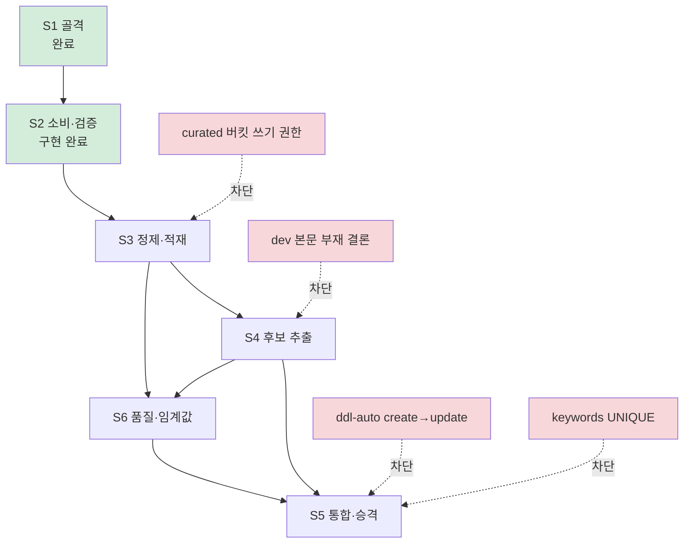

# 10 — 에픽과 스토리 실행 계획

00~09 가 **무엇을 만드는가**를 정의한다면, 이 문서는 **어떤 순서로 어디까지 끊어 만드는가**를 정의한다. Jira 에픽 하나와 그 아래 스토리 여섯 개를 이 문서 묶음에 붙이고, 각 완료 조건이 어느 규격에서 나왔는지 연결한다.

**규격의 단일 출처는 여전히 02~08 이다.** 여기서 규격을 다시 쓰지 않는다. 스토리 문구와 규격이 어긋나면 규격이 이긴다 — 어긋난 지점은 [§2](#2-에픽-스토리-문구와-현행-설계의-차이) 에 전부 모아 뒀다.

## 1. 에픽

> Kafka `raw-file-ready` 이벤트로 전달된 MinIO 원문을 Spark 로 읽어 공통 콘텐츠 형식으로 표준화하고, 문서에서 키워드를 뽑아 서비스 테이블에 적재한다. URL 해시 기반 upsert 와 트랜잭션으로 재처리 안전성을 보장한다.
>
> 범위는 **콘텐츠 표준화 · 키워드 추출 · 일별 언급량 적재**까지다. 트렌드 유형 · 순위 · 증가율 · 연관 관계 분석은 별도 에픽이다.

### 이 에픽이 덮는 것과 안 덮는 것

| Job | 이 에픽 | 문서 |
| --- | --- | --- |
| `ingest` | **전부** | [02](02-input-contract.md) · [03](03-normalization-spec.md) |
| `extract` | **전부** | [04](04-keyword-extraction-spec.md) · [05](05-keyword-registry-spec.md) |
| `aggregate` | **일별 원자료(`pl_keyword_daily_stat`) 적재까지만.** 순위·증가율·트렌드 유형·연관 키워드는 다음 에픽 | [06](06-related-keyword-spec.md) · [07](07-metrics-and-ranking-spec.md) |

즉 이 에픽이 끝나면 **`contents` · `keywords` · `keyword_contents` 가 채워지고, 지표를 계산할 원자료가 쌓이기 시작한다.** `trends` · `keyword_metrics` · `keyword_metric_history` · `keyword_relations` 는 비어 있다.

경계를 이렇게 그은 이유는 [07 §2](07-metrics-and-ranking-spec.md) 다 — 순위와 증가율은 **이력이 쌓인 뒤에야** 의미가 생긴다. 원자료가 하루치뿐인 상태에서 `30D` 증가율 코드를 짜면 검증할 방법이 없다. 이 에픽으로 원자료를 먼저 쌓고, 다음 에픽에서 그걸 읽는다.

## 2. 에픽·스토리 문구와 현행 설계의 차이

**⚠️ 에픽과 일부 스토리 문구는 v1 설계(`docs/data-pipeline-design.md`)를 기준으로 쓰여 있다.** 그 뒤 이벤트 계약이 기사 단위로 바뀌었고([02 §1](02-input-contract.md)), ERD 가 v2 로 갱신됐다([erd](erd/erd-00-current.md)). **아래는 전부 현행 설계가 맞다고 보고 진행한다.** 이 표를 반영해 고친 Jira 문구는 [§6](#6-부록--고친-jira-문구) 에 붙여넣을 수 있는 형태로 두었다.

| # | 스토리·에픽 문구 | 현행 설계 | 근거 |
| --- | --- | --- | --- |
| 1 | `KEYWORD_DAILY_METRICS` 에 저장 | **그런 테이블이 없다.** 일별 언급량은 파이프라인 내부 `pl_keyword_daily_stat`, 서비스 노출은 `keyword_metric_history` | [08 §3](08-storage-schema.md) |
| 2 | `DAILY_COLLECTION_STATUS` 에 저장 | **그런 테이블이 없다.** 일자별 수집 상태는 [00 §7](00-overview.md) 한계 1 로 남아 있고, 배치 통계는 내부 `pl_batch_stat` 에 쌓는다 | [08 §3](08-storage-schema.md) |
| 3 | 문서별 **대표 키워드 하나**를 선정 | **문서당 상위 K 개**를 뽑는다. 하나만 뽑으면 `keyword_contents` 가 1:1 이 되어 연관 키워드 산출이 불가능하다 | [04 §7](04-keyword-extraction-spec.md) |
| 4 | 제목·본문 **가중 TF-IDF** 로 점수 | TF-IDF 단독이 아니라 **C-value · BM25 · 위치 가중**의 결합 | [04 §6](04-keyword-extraction-spec.md)~§7 |
| 5 | 직전 30일 동일 도메인을 IDF 말뭉치로 | 방향은 같다. 다만 창 길이는 **아직 미확정** — 실데이터 분포를 재고 정한다 | [09 §7](09-dev-and-test.md) 항목 5 |
| 6 | (S2) `record_count` 불일치를 DLQ 로 | **그 `error_type` 은 없어졌다.** 기사 이벤트의 `record_count` 는 늘 1 이라 대조 대상이 없다. 남는 검증은 일곱 가지 | [02 §5](02-input-contract.md) |
| 7 | (S3) `--source manifest --from --to` | 플래그 이름은 **`--source objects`** 다. `metadata.json` 이 없어지면서 manifest 라는 개념 자체가 사라졌다 | [02 §6](02-input-contract.md) |
| 8 | (S3) reddit · github · stackoverflow 어댑터 | 실제 소스는 **fashion 7 매체 + `hn`** 이다. 셋은 v1 예시였다 | [00 §3](00-overview.md) |
| 9 | (S4) 한국어는 **형태소** 분석기로 토큰화 | **형태소 분석기를 쓰지 않는다.** 의존성·정확도·충분성 셋을 근거로 규칙 기반으로 정했다 | [04 §2](04-keyword-extraction-spec.md) |
| 10 | (S5) `keywords.first_seen_at` 이 최초 관측 시각 | **그 컬럼이 v2 에서 없어졌다.** 최초 관측 시각은 `pl_candidate` 에만 두고 서비스 테이블로 옮기지 않는다 | [05 §5](05-keyword-registry-spec.md) |
| 11 | 중간 산출물을 **PostgreSQL 에 저장하지 않는다** | 반만 맞다. **본문**은 PostgreSQL 에 넣지 않고 MinIO `curated` Parquet 에 둔다. **중간 산출물**은 서비스 테이블이 아닌 `pl_` 내부 테이블에 넣으며, 그건 같은 PostgreSQL 안이다 | [08 §1](08-storage-schema.md) |

**3번이 가장 무겁다.** "대표 키워드 하나" 로 만들면 [06](06-related-keyword-spec.md) 이 통째로 불가능해진다 — 한 문서에서 키워드가 하나면 동시출현 쌍이 아예 생기지 않는다. 다음 에픽을 미리 죽이는 결정이라 상위 K 로 간다.

**9번은 스토리를 통과시키는 방법이 바뀌는 차이다.** 완료 조건을 문자 그대로 읽으면 형태소 분석기 의존성을 넣어야 하는데, 규격은 그걸 명시적으로 거부했다. 조건의 **의도**(언어별로 토큰화가 갈린다)는 그대로 만족시킨다.

## 3. 스토리 한눈

| # | 스토리 | Job | 규격 | 산출물 | 상태 |
| --- | --- | --- | --- | --- | --- |
| S1 | 실행 환경 및 프로젝트 골격 | — | [01](01-architecture.md) · [09](09-dev-and-test.md) | `jobs/` · `conf/` · `versions.sh` · `scripts/` | **완료** |
| S2 | Kafka 이벤트 소비 및 MinIO 원문 검증 | `ingest` 전반 | [02](02-input-contract.md) | `io/` · `ingest/` · `pl_processing_ledger` · `pl_processing_error` | **구현 완료** (`ms/S15P21A102-170`, MR 대기) · 통합 테스트 [후속](#후속으로-뺀-것) |
| S3 | 원문 정제 및 콘텐츠 적재 | `ingest` 후반 | [03](03-normalization-spec.md) | `normalize/` · `curated` Parquet · `contents` · `pl_content_id_map` | 미착수 |
| S4 | 키워드 후보 추출 및 스코어링 | `extract` 전반 | [04](04-keyword-extraction-spec.md) | `extract/` · `pl_document_candidate` · `pl_candidate` · `pl_keyword_daily_stat` | 미착수 |
| S5 | 키워드 정규화·통합 및 승격 | `extract` 후반 | [05](05-keyword-registry-spec.md) | `registry/` · `keywords` · `keyword_contents` · `pl_merge_log` · `pl_review_queue` | 미착수 (**차단**) |
| S6 | 추출 품질 측정 및 임계값 확정 | `extract` 검증 | [04 §9](04-keyword-extraction-spec.md) · [09 §4](09-dev-and-test.md) | `fixtures/corpus/` · `fixtures/snapshots/` · `conf/base.yaml` 임계값 · `pl_config_history` | 미착수 (**S3 선행**) |

**서비스 테이블을 건드리는 스토리는 S3 와 S5 둘뿐이다.** S2 · S4 는 파이프라인 내부 테이블만 쓴다. 이게 S5 의 차단 조건([§4.5](#s5--키워드-정규화통합-및-승격))이 앞 스토리들을 막지 않는 이유다.

## 4. 스토리별 상세

완료 조건은 [§2](#2-에픽-스토리-문구와-현행-설계의-차이) 를 반영해 고친 문구다. **근거** 열이 그 조건이 나온 규격 위치이고, 원문에서 무엇이 바뀌었는지는 각 절 아래 ⚠️ 로 적었다.

### S1 — 실행 환경 및 프로젝트 골격

`spark-submit` 이 로컬에서 도는 최소 뼈대. 세 Job 의 진입점 스켈레톤, 설정 로더, SparkSession 팩토리, 로컬 컴포즈 오버레이, jar 버전 고정. **로직은 넣지 않는다.**

| 완료 조건 | 근거 | 상태 |
| --- | --- | --- |
| 컴포즈로 Kafka · MinIO · Postgres 가 뜬다 | [09 §3](09-dev-and-test.md) | ✅ `datastore/compose.yaml` (S15P21A102-156·157) |
| `spark-submit jobs/ingest.py --profile local` 이 오류 없이 시작·종료한다 | [09 §3](09-dev-and-test.md) | ✅ `scripts/submit.sh` |
| `base.yaml` → 프로파일 → 환경변수 3단 병합이 단위 테스트로 검증된다 | [09 §3](09-dev-and-test.md) | ✅ `tests/unit/test_config.py` |
| jar 목록과 버전이 스크립트에 고정돼 있고 `--packages` 를 쓰지 않는다 | [09 §2](09-dev-and-test.md) | ✅ `versions.sh` · `scripts/fetch-jars.sh` · `check-jars.py` |
| Spark 버전과 Python 3.12 정합이 실제 실행으로 확인된다 | [09 §2](09-dev-and-test.md) | ✅ 확정된 버전 표 |

`--packages` 를 금지한 이유는 실행 때마다 Maven 을 때리기 때문이다. 오프라인에서 못 뜨고, 같은 명령이 날에 따라 다른 jar 를 끌어온다.

### S2 — Kafka 이벤트 소비 및 MinIO 원문 검증

`Trigger.AvailableNow` 로 `raw-file-ready` 를 소비하고, MinIO 원문을 내려받아 계약대로 검증한다. 계약을 어긴 이벤트는 처리하지 않고 DLQ 로 보낸다. **정제·적재는 하지 않는다.**

| 완료 조건 | 근거 | 상태 |
| --- | --- | --- |
| 정상 이벤트 하나로 원문 `article.json` 이 DataFrame 으로 읽힌다 | [02 §3](02-input-contract.md) | ✅ `io/objects.py` |
| 검증 실패가 각각의 `error_type` 으로 DLQ 로 간다 | [02 §5](02-input-contract.md) | ✅ 일곱 가지 — `tests/unit/test_object_verify.py` · `test_routing.py` |
| `status: failed` 이벤트가 원장에 기록되고 원문 조회를 건너뛴다 | [02 §2](02-input-contract.md) | ✅ `SOURCE_FAILED` — `test_routing.py` |
| 같은 `event_id` 를 두 번 흘리면 두 번째가 원장에서 걸러진다 | [02 §4](02-input-contract.md) · [08 §3](08-storage-schema.md) | ✅ `tests/spark/test_ingest_batch.py` |
| ~~checkpoint 를 그대로 두고 재실행하면 아무것도 다시 처리하지 않는다~~ | [01 §4](01-architecture.md) | **[후속으로 뺐다](#후속으로-뺀-것)** — 실제 Kafka 가 필요하다 |

**네 조건은 단위·Spark 테스트로 덮였다** (`pytest spark/tests/unit spark/tests/spark` 150건 통과). **다섯 번째는 [후속으로 뺐다](#후속으로-뺀-것)** — checkpoint 디렉터리를 유지한 채 두 번 도는 것을 봐야 해서 compose 를 띄우는 층 3 이어야 하고 ([09 §4](09-dev-and-test.md)), 그 층은 S2 만을 위해 세우기에는 배선이 크다. S3 의 종단 시나리오(Kafka → MinIO → curated → `contents`)와 같은 자리라 함께 세우는 편이 싸다.

**그 사이의 위험은 낮다.** 오프셋 진행은 Spark Structured Streaming 이 보장하고 우리 코드가 관여하지 않는다. 우리가 짠 중복 차단(처리 이력)은 `tests/spark/test_ingest_batch.py` 가 덮고 있어, checkpoint 가 실패해도 두 번째 방어선이 남는다 ([01 §4](01-architecture.md) 중복 차단 2).

**⚠️ `record_count` 불일치 조건은 삭제한다** ([§2](#2-에픽-스토리-문구와-현행-설계의-차이) 6번). 대신 실제로 발생하는 것은 `PARSE_ERROR` · `UNKNOWN_SCHEMA_VERSION` · `CONTRACT_VIOLATION` · `UNKNOWN_DOMAIN` · `OBJECT_NOT_FOUND` · `CHECKSUM_MISMATCH` · `ARTICLE_CONTRACT_VIOLATION` 일곱이다.

**DLQ 토픽이 아직 없다** ([02 §5](02-input-contract.md)). 싱크를 인터페이스로 두고 `pl_processing_error` 테이블만 쓰는 것으로 이 스토리를 닫는다. 토픽이 생기면 구현 하나를 더하는 후속 작업이다 — 그때까지 재투입 경로는 없고 복구는 `--source objects` 로 한다.

### S3 — 원문 정제 및 콘텐츠 적재

소스별 원문을 표준 문서로 접고, 씻고, 중복·쓰레기를 걸러 `curated` Parquet 에 쓴다. `contents` 에 메타데이터를 upsert 하고 `id` 를 회수한다. 백필 경로도 여기서 완성한다.

| 완료 조건 | 근거 |
| --- | --- |
| 소스별 어댑터가 표준 문서 스키마를 채운다 | [03 §1](03-normalization-spec.md) |
| 중복 제거 3단계가 동작하고, 근사 중복은 지우지 않고 `dup_of` 로 표시된다 | [03 §6](03-normalization-spec.md) |
| `curated` Parquet 이 `domain/published_date/source/run_id` 파티션으로 쓰인다 | [01 §3](01-architecture.md) |
| 같은 배치를 두 번 돌려도 `contents` 행 수가 늘지 않고 `(url_hash → id)` 매핑이 남는다 | [08 §3](08-storage-schema.md) `pl_content_id_map` |
| 버린 건수와 `published_at` 대체 건수가 `pl_batch_stat` 에 남는다 | [03 §7](03-normalization-spec.md) |
| `--source objects --from --to` 로 Kafka 없이 지정 구간이 재처리된다 | [02 §6](02-input-contract.md) |
| 정제 순수 함수 단위 테스트 (빈 문자열 · NULL 시각 · 미래 시각) | [03 §3](03-normalization-spec.md) · [09 §4](09-dev-and-test.md) |

**어댑터는 fashion 7 매체 + `hn` 이다** ([§2](#2-에픽-스토리-문구와-현행-설계의-차이) 8번). 실질적으로는 어댑터가 둘 — fashion 쪽은 Collector 가 이미 공통 `article.json` 으로 접어 주므로 소스별 분기가 거의 없고, `hn` 은 본문이 없어 경로가 갈린다 ([03 §2](03-normalization-spec.md)).

**⚠️ 백필 플래그 이름이 `--source objects` 다** ([§2](#2-에픽-스토리-문구와-현행-설계의-차이) 7번). `metadata.json` 이 없어지면서 manifest 라는 개념 자체가 사라졌고, 재처리는 MinIO 프리픽스 스캔으로 한다.

**선행 조건 — MinIO `curated` 버킷과 Spark 쓰기 권한.** 지금 Spark 키는 `raw-data` 읽기만 한다 (`datastore/minio-init/init.sh`). 정제 결과를 쓸 곳이 없으면 이 스토리가 통째로 막힌다 ([09 §7](09-dev-and-test.md) 항목 4b).

**이 스토리가 끝나야 임계값을 잴 수 있다.** S6 가 필요로 하는 실데이터 분포가 `curated` 에서 나온다.

### S4 — 키워드 후보 추출 및 스코어링

정제 문서에서 후보를 넓게 뽑고 점수를 매긴다. **승격 판단은 하지 않고** 파이프라인 내부 테이블까지만 채운다.

| 완료 조건 | 근거 |
| --- | --- |
| `lang` 에 따라 한국어·영어 토큰화가 분기한다 | [04 §2](04-keyword-extraction-spec.md) — **형태소 분석기는 쓰지 않는다** |
| n-gram · 대문자 약어 · 코드 식별자 · 해시태그 후보가 생성되고, 약어-전개형 쌍이 기록된다 | [04 §3](04-keyword-extraction-spec.md) |
| 비교키와 대표 표기가 생성된다 (대표는 빈도 최다 표기) | [04 §4](04-keyword-extraction-spec.md) |
| DF 상·하한 필터가 절대값이 아니라 **코퍼스 크기 비율**로 동작한다 | [04 §5](04-keyword-extraction-spec.md) |
| C-value · BM25 · 제목 가중이 결합되어 문서당 상위 K 가 선별된다 | [04 §6](04-keyword-extraction-spec.md)~§7 |
| `pl_document_candidate` · `pl_candidate` · `pl_keyword_daily_stat` 이 채워진다 | [08 §3](08-storage-schema.md) |
| **서비스 테이블을 전혀 건드리지 않는다** | [08 §1](08-storage-schema.md) |

마지막 조건이 이 스토리를 S5 보다 먼저 놓을 수 있게 하는 근거다 — S5 의 차단 조건(`keywords` UNIQUE)과 무관하게 진행된다.

**⚠️ 한국어도 형태소 분석기를 쓰지 않는다** ([§2](#2-에픽-스토리-문구와-현행-설계의-차이) 9번). 조사·어미 경계를 규칙으로 끊고 n-gram 으로 덮는다. 조건의 의도(언어별 분기)는 그대로 만족한다.

**DF 필터를 비율로 거는 이유** — 코퍼스가 하루 700건 규모라 절대값으로 걸면 초기에는 전부 통과하고 반년 뒤에는 전부 탈락한다. 규모가 변해도 같은 의미를 유지하려면 비율이어야 한다 ([00 §3](00-overview.md)).

**⚠️ dev 도메인에서 스코어링·선별이 성립하지 않는다.** `hn` 은 본문이 없어 문서당 토큰이 10 개 안팎이다 ([04](04-keyword-extraction-spec.md) 머리말). 이 스토리를 시작하기 전에 [00 §7](00-overview.md) 한계 19 의 결론이 필요하다 — 안 정하면 fashion 기준으로 짜고 dev 에서 다시 짠다.

### S5 — 키워드 정규화·통합 및 승격

후보를 같은 것끼리 합치고, 승격 심사를 통과한 것만 `keywords` 에 넣는다. **병합은 승격 전에만 한다** — 한 번 들어가면 되돌릴 수 없다.

| 완료 조건 | 근거 |
| --- | --- |
| 층1 결정적 규칙과 층2 약어-전개형 자동 병합이 동작하고 `pl_merge_log` 에 근거가 남는다 | [05 §3](05-keyword-registry-spec.md) |
| 임베딩 모델이 executor 당 1회 로드되고 벡터가 캐시된다 | [01 §5](01-architecture.md) · `pl_embedding_cache` |
| 임베딩 유사도만으로는 자동 병합하지 않고 `pl_review_queue` 로 간다 | [05 §4](05-keyword-registry-spec.md) |
| 승격 조건(문서 수 · 관측 일수 · 소스 수 · 저자 수)을 전부 만족한 후보만 `keywords` 에 들어간다 | [05 §5](05-keyword-registry-spec.md) |
| 같은 배치를 두 번 돌려도 `keywords` 행 수가 늘지 않는다 | [08 §4](08-storage-schema.md) |
| `keyword_contents` 가 채워진다 | [08 §4](08-storage-schema.md) |

**🚫 차단 — `keywords (domain, normalized_name)` UNIQUE 적용, `ddl-auto: create → update`.** 둘 다 백엔드 소관이다 ([09 §7](09-dev-and-test.md) 항목 1·2).

UNIQUE 는 **나중에 붙일 수 없다.** 중복 행이 쌓인 뒤에는 무엇을 남길지 사람이 정해야 하고, 그 사이 발급된 `keyword_id` 를 참조하는 `keyword_contents` 도 함께 정리해야 한다. `ddl-auto` 를 먼저 고쳐야 하는 이유는 `create` 상태에서 UNIQUE 를 걸어도 다음 재배포에 제약까지 함께 날아가기 때문이다.

**⚠️ `first_seen_at` 완료 조건은 삭제한다** ([§2](#2-에픽-스토리-문구와-현행-설계의-차이) 10번). 최초 관측 시각은 `pl_candidate` 에 두고 서비스 테이블로 옮기지 않는다. 그 값이 근거였던 `NEW` 판별은 언급량 이력으로 바뀌었다 ([07 §6](07-metrics-and-ranking-spec.md)).

**임베딩을 executor 당 1회 로드하는 것이 성능 조건이 아니라 정확성 조건에 가깝다.** row 단위로 로드하면 태스크 하나가 수십 초씩 걸려 Job 이 사실상 끝나지 않는다. `mapPartitions` 안에서 모듈 전역으로 잡는다.

### S6 — 추출 품질 측정 및 임계값 확정

임계값을 실데이터로 정하고, 회귀를 막을 도구를 만든다. **코드보다 판단이 주된 작업이다.**

| 완료 조건 | 근거 |
| --- | --- |
| 고정 코퍼스 30건(도메인 2 · 언어 3 · 소스 3 포함) 스냅샷 테스트가 CI 에서 돈다 | [09 §4](09-dev-and-test.md) · `fixtures/corpus/` |
| 무작위 100문서의 상위 10후보 수동 검수 1회, precision@10 기록 | [04 §9](04-keyword-extraction-spec.md) |
| 문서당 평균 후보 수 · 신규 후보 유입률 · DF 탈락 비율이 배치마다 로깅된다 | [04 §9](04-keyword-extraction-spec.md) · `pl_batch_stat` |
| `conf/base.yaml` 임계값이 측정 근거와 함께 확정되고 `pl_config_history` 에 초기값이 기록된다 | [08 §3](08-storage-schema.md) |
| 상위 100 후보를 눈으로 훑어 오타 · 문장 조각이 없다 | [04 §9](04-keyword-extraction-spec.md) |

**`conf/base.yaml` 의 `extract.thresholds` 가 지금 비어 있는 것이 이 스토리 때문이다.** 04~07 이 숫자를 명시하지 않은 것도 같은 이유다 — 실데이터의 문서 빈도 분포 · 문서 길이 · 발행일 지연을 재기 전에 정한 숫자는 전부 다시 정하게 된다 ([09 §7](09-dev-and-test.md) 항목 5).

**S3 가 끝나야 시작할 수 있다.** `fixtures/corpus/` 30건은 `curated` 에서 뽑아 고정한 것이라, 정제 규격이 확정되기 전에 채우면 정제가 바뀔 때마다 스냅샷이 통째로 무효가 된다.

**S4·S5 와 병렬이 아니라 그 사이에 낀다.** 순서는 S4 구현 → S6 로 임계값 확정 → S5 승격 문턱 결정이다. 승격 조건은 후보 분포를 본 뒤라야 정할 수 있다.

## 5. 진행 순서와 차단

### 지금 막고 있는 것

| 대상 | 필요한 것 | 누구 | 언제까지 |
| --- | --- | --- | --- |
| S3 | MinIO `curated` 버킷 + Spark 쓰기 권한 | 담당 2 | **S2 종료 전** |
| S4 | dev 도메인 본문 부재 결론 ([00 §7](00-overview.md) 한계 19) | 기획 · 담당 1 | S3 진행 중 |
| S5 | `ddl-auto: create` → `update` | 백엔드 | **지금.** 늦을수록 잃는 데이터가 는다 |
| S5 | `keywords (domain, normalized_name)` UNIQUE | 백엔드 | S4 종료 전 |

**세 번째가 가장 급하다.** 나머지는 늦으면 착수가 밀리는 것이지만, 이건 늦는 동안 이미 쌓인 데이터가 재배포마다 사라진다. 사용자의 관심 키워드도 함께 간다.

**S2 를 닫으면서 S3 의 선행을 같이 요청한다.** 버킷 권한은 요청부터 반영까지 걸리는 시간이 있고, S2 종료 시점에 요청하면 그만큼 S3 가 논다.

### 후속으로 뺀 것

스토리를 닫되 별도 이슈로 남기는 것들이다. **범위에서 빠진 것이지 없어진 것이 아니다.**

| 무엇 | 왜 뺐나 | 언제 |
| --- | --- | --- |
| S2 — checkpoint 유지 재실행 통합 테스트 | compose 를 띄우는 층 3 이 필요한데 S2 만을 위해 세우기에는 배선이 크다 ([09 §4](09-dev-and-test.md)) | **S3 와 함께.** 종단 시나리오가 같은 자리를 쓴다 |
| S2 — DLQ 토픽 싱크 | 토픽이 아직 없다. 담당 2 소관 ([02 §5](02-input-contract.md)) | 토픽이 생기면. 싱크 인터페이스에 구현 하나를 더한다 |

둘 다 **인터페이스는 이미 자리를 잡아 뒀다.** 나중에 붙이는 것이 코드 구조를 바꾸지 않는다는 뜻이고, 그래서 뒤로 미뤄도 되는 종류다 — [§5 의 차단 항목](#지금-막고-있는-것)과는 성격이 다르다.

### 다음 에픽으로 넘기는 것

| 항목 | 문서 | 추가로 필요한 것 |
| --- | --- | --- |
| 기간 지표 · 순위 · 증가율 (`keyword_metrics`) | [07 §4](07-metrics-and-ranking-spec.md)·§5 | `period` 값 규약, `(keyword_id, period)` UNIQUE |
| 시계열 (`keyword_metric_history`) | [07 §3](07-metrics-and-ranking-spec.md) | `(keyword_id, bucket_start)` UNIQUE |
| 트렌드 유형 (`trends.trend_types`) | [07 §6](07-metrics-and-ranking-spec.md) | `trend_type_array` 실제 타입 확인 |
| 연관 키워드 (`keyword_relations`) | [06](06-related-keyword-spec.md) | 기준 기간 확정 (`30D` 제안) |

넷 다 이 에픽이 쌓는 `pl_keyword_daily_stat` 을 읽는다. **원자료 스키마만 지금 제대로 잡아 두면 다음 에픽은 읽기만 하는 작업이다** ([07 §2](07-metrics-and-ranking-spec.md)).

## 6. 부록 — 고친 Jira 문구

[§2](#2-에픽-스토리-문구와-현행-설계의-차이) 를 반영해 다시 쓴 것이다. **S1 · S6 은 고칠 것이 없어 뺐다.** 그대로 붙여넣으면 된다.

### 에픽 — Spark 수집 데이터 처리 및 키워드 추출 구현

> Kafka `raw-file-ready` 이벤트로 전달된 MinIO 원문(`article.json`)을 Spark 로 읽어 공통 콘텐츠 형식으로 표준화한다. 동일 도메인의 최근 N일 원문을 IDF 말뭉치로 쓰고 — N 은 실데이터 분포를 재고 확정한다 — C-value · BM25 · 제목 가중을 결합해 **문서별 상위 K개** 키워드를 선별한다.
>
> 결과는 서비스 테이블 `contents` · `keywords` · `keyword_contents` 와 파이프라인 내부 테이블 `pl_keyword_daily_stat`(일별 언급량 원자료)에 저장한다. **본문은 PostgreSQL 에 넣지 않고 MinIO `curated` Parquet 에 둔다.** 중간 산출물은 서비스 테이블이 아니라 `pl_` 접두 내부 테이블에 둔다. URL 해시 기반 upsert 와 `event_id` 처리 이력으로 재처리 안전성을 보장한다.
>
> 범위는 콘텐츠 표준화, 키워드 추출, 일별 언급량 원자료 적재까지다. 트렌드 유형 · 순위 · 증가율 · 연관 관계 분석은 별도 에픽에서 구현한다.

원문에서 바뀐 것 — 대표 키워드 하나 → 상위 K개(3), 가중 TF-IDF → C-value·BM25·제목 가중(4), 직전 30일 → 최근 N일 미확정(5), `KEYWORD_DAILY_METRICS`·`DAILY_COLLECTION_STATUS` → `pl_keyword_daily_stat`(1·2), 중간 산출물 저장 위치(11).

### S2 — Kafka 이벤트 소비 및 MinIO 원문 검증

> `Trigger.AvailableNow` 로 `raw-file-ready` 를 소비하고, MinIO 원문을 내려받아 계약대로 검증한다. 계약을 어긴 이벤트는 처리하지 않고 DLQ 로 보낸다. 정제·적재는 하지 않는다.
>
> * 정상 기사 이벤트 하나로 `article.json` 이 DataFrame 으로 읽힌다
> * 일곱 가지 검증 실패가 각각의 `error_type` 으로 DLQ 로 간다 — `PARSE_ERROR` · `UNKNOWN_SCHEMA_VERSION` · `CONTRACT_VIOLATION` · `UNKNOWN_DOMAIN` · `OBJECT_NOT_FOUND` · `CHECKSUM_MISMATCH` · `ARTICLE_CONTRACT_VIOLATION`
> * `status: failed` 요약 이벤트가 원장에 `SOURCE_FAILED` 로 기록되고 원문 조회를 건너뛴다
> * 같은 `event_id` 를 두 번 흘리면 두 번째가 원장에서 걸러진다
> * DLQ 토픽이 아직 없으므로 싱크는 인터페이스로 두고 `pl_processing_error` 테이블에만 쓴다
>
> 후속(별도 이슈): checkpoint 를 유지한 채 재실행하면 아무것도 다시 처리하지 않는 것 — compose 통합 테스트가 필요해 S3 의 종단 시나리오와 함께 세운다.

원문에서 바뀐 것 — `record_count` 불일치 삭제, `success` 인데 `object_key` 가 null 은 `CONTRACT_VIOLATION` 에 흡수, 다섯 → 일곱 가지(6). DLQ 항목은 새로 넣었다 — 원문에 없어 "DLQ 로 보낸다" 를 토픽으로 읽으면 이 스토리를 닫을 수 없다. checkpoint 조건은 완료 조건에서 빼고 후속으로 돌렸다.

### S3 — 원문 정제 및 콘텐츠 적재

> 소스별 원문을 표준 문서로 접고, 씻고, 중복·쓰레기를 걸러 `curated` Parquet 에 쓴다. `contents` 에 메타데이터를 upsert 하고 `id` 를 회수한다. 백필 경로도 여기서 완성한다.
>
> * fashion 7 매체와 `hn` 어댑터가 각각 표준 문서 스키마를 채운다. `hn` 은 본문이 없는 경로다
> * 중복 제거 3단계가 동작하고, 근사 중복은 지우지 않고 `dup_of` 로 표시된다
> * `curated` Parquet 이 `domain/published_date/source/run_id` 파티션으로 쓰인다
> * 같은 배치를 두 번 돌려도 `contents` 행 수가 늘지 않고, `(url_hash → id)` 매핑이 `pl_content_id_map` 에 남는다
> * 필터로 버린 건수와 `published_at` 대체 건수가 `pl_batch_stat` 에 남는다
> * `--source objects --from --to` 로 Kafka 없이 지정 구간이 재처리된다
> * 정제 순수 함수 단위 테스트 (빈 문자열 · NULL 시각 · 미래 시각 포함)

원문에서 바뀐 것 — reddit·github·stackoverflow → fashion 7매체 + `hn`(8), `--source manifest` → `--source objects`(7).

### S4 — 키워드 후보 추출 및 스코어링

> 정제 문서에서 키워드 후보를 넓게 뽑고 점수를 매긴다. 승격 판단은 하지 않고 파이프라인 내부 테이블까지만 채운다.
>
> * `lang` 에 따라 한국어·영어 토큰화가 분기한다. **형태소 분석기는 쓰지 않고** 조사·어미 경계를 규칙으로 끊는다
> * n-gram · 대문자 약어 · 코드 식별자 · 해시태그 후보가 생성되고, 약어-전개형 쌍이 별도로 기록된다
> * 비교키와 대표 표기가 생성된다 (대표는 빈도 최다 표기)
> * DF 상·하한 필터가 절대값이 아니라 코퍼스 크기 비율로 동작한다
> * C-value · BM25 · 제목 가중이 결합되어 문서당 상위 K 가 선별된다
> * `pl_document_candidate` · `pl_candidate` · `pl_keyword_daily_stat` 이 채워진다
> * 서비스 테이블을 전혀 건드리지 않는다 (선행 제약 없이 진행 가능한 근거)
>
> ⚠️ 선행: dev 도메인 본문 부재 결론. `hn` 은 제목만 오므로 스코어링·선별이 그대로 성립하지 않는다.

원문에서 바뀐 것 — 한국어 토큰화 방식(9). 선행 조건 줄을 새로 넣었다.

### S5 — 키워드 정규화·통합 및 승격

> 후보를 같은 것끼리 합치고, 승격 심사를 통과한 것만 `keywords` 에 넣는다. 병합은 승격 전에만 한다 — 한 번 들어가면 되돌릴 수 없다.
>
> * 층1 결정적 규칙과 층2 약어-전개형 자동 병합이 동작하고, `pl_merge_log` 에 근거가 남는다
> * 임베딩 모델이 executor 당 1회 로드되고 벡터가 `pl_embedding_cache` 에 캐시된다 (row 단위 재로드가 없음을 확인)
> * 임베딩 유사도만으로는 자동 병합하지 않고 `pl_review_queue` 로 간다
> * 승격 조건(문서 수 · 관측 일수 · 소스 수 · 저자 수)을 전부 만족한 후보만 `keywords` 에 들어간다
> * 최초 관측 시각은 `pl_candidate` 에만 두고 서비스 테이블로 옮기지 않는다. 재실행해도 갱신되지 않는다
> * 같은 배치를 두 번 돌려도 `keywords` 행 수가 늘지 않는다
> * `keyword_contents` 가 채워진다
>
> ⚠️ 차단: `keywords (domain, normalized_name)` UNIQUE 적용, `ddl-auto: create → update`

원문에서 바뀐 것 — `keywords.first_seen_at` → `pl_candidate` 의 최초 관측 시각(10). 그 컬럼이 v2 ERD 에서 없어졌다.
