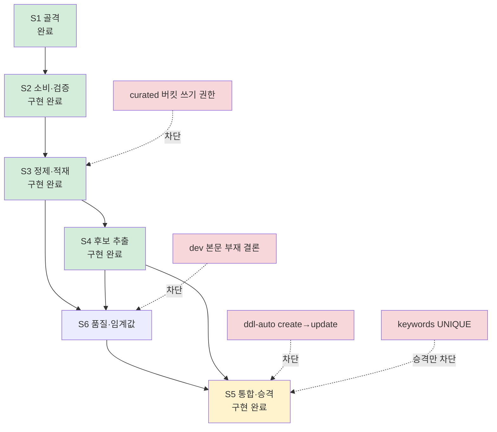

# 10 — 에픽과 스토리 실행 계획

00~09 가 **무엇을 만드는가**를 정의한다면, 이 문서는 **어떤 순서로 어디까지 끊어 만드는가**를 정의한다. Jira 에픽 하나와 그 아래 스토리 여섯 개를 이 문서 묶음에 붙이고, 각 완료 조건이 어느 규격에서 나왔는지 연결한다.

**모르는 말이 나오면 [§0 용어](#0-용어) 를 먼저 보라.** 이 묶음이 쓰는 말을 한 줄씩 풀어 뒀다.

**§1~§6 은 첫 에픽(`ingest`·`extract`)을 다룬다.** 그 뒤를 잇는 지표 집계 에픽(`aggregate`)의 스토리 분해는 [§7](#7-다음-에픽--지표-집계-및-트렌드-판별) 에 있다.

**규격의 단일 출처는 여전히 02~08 이다.** 여기서 규격을 다시 쓰지 않는다. 스토리 문구와 규격이 어긋나면 규격이 이긴다 — 어긋난 지점은 [§2](#2-에픽스토리-문구와-현행-설계의-차이) 에 전부 모아 뒀다.

## 0. 용어

이 문서와 02~09 에 반복해서 나오는 말이다. **처음 읽는 사람은 여기만 보고 내려가면 된다.**

| 말 | 뜻 |
| --- | --- |
| `ingest` · `extract` · `aggregate` | Spark Job 세 개. 차례로 **원문 받아 정리** · **키워드 뽑기** · **지표 계산** 이다 |
| 원문 / `curated` | 수집기가 받아 온 기사 그대로가 원문, 씻어서 표준 형식으로 접은 것이 `curated`. 본문은 DB 가 아니라 파일 저장소(MinIO)에 둔다 |
| 후보 / 정규 키워드 | 문서에서 뽑히기만 한 말이 **후보**, 심사를 통과해 서비스에 나가는 말이 **정규 키워드** |
| 승격 | 후보를 정규 키워드로 올리는 것. 한 번 올리면 되돌릴 수 없어 조건을 따로 둔다 |
| 병합 / 별칭 | `SNS` 와 `에스엔에스` 처럼 같은 것을 하나로 합치는 일. 합쳐서 사라진 표기가 **별칭**이다 |
| 검수 큐 | 자동으로 합치기엔 애매한 쌍을 사람이 보라고 쌓아 두는 곳 |
| 원자료 | 지표를 계산하기 전 단계의 날것 숫자. 여기서는 "어느 키워드가 며칠에 몇 건 언급됐다" 표를 말한다 |
| 언급량 | 그 키워드가 **등장한 문서 수**. 등장 횟수가 아니다 — 한 글에 20번 나와도 1 |
| 버킷 | 추이 그래프의 점 하나가 덮는 시간 폭. 우리는 하루다 |
| 소급 재계산 | 지난 날짜를 다시 계산하는 것. 기사가 늦게 들어오면 이미 낸 숫자가 틀려지므로 며칠치는 매번 다시 센다 |
| 무정보어 | `요즘` · `매력` 처럼 **언제나 흔해서 아무 정보도 주지 않는 말** |
| 멱등 | 같은 것을 두 번 돌려도 결과가 같은 성질. 재처리해도 행이 쌓이거나 값이 틀어지지 않는다는 뜻 |
| 원장 (ledger) | 어떤 이벤트를 이미 처리했는지 적어 두는 장부. 같은 것이 두 번 오면 여기서 걸러진다 |
| DLQ | 처리에 실패한 이벤트를 따로 모아 두는 자리 (dead letter queue) |
| `pl_` 접두 | 파이프라인만 쓰는 내부 표라는 표시. 접두가 없는 표(`contents` · `keywords` 등)는 서비스가 읽는다 |
| 코퍼스 | 통계를 낼 때 배경으로 삼는 문서 뭉치 |
| 회귀 스냅샷 | 예전 결과를 파일로 떠 두고, 코드를 고친 뒤 달라진 곳이 있는지 비교하는 시험 |
| 종단 실행 | 수집부터 적재까지 전 구간을 실제로 한 번 돌려 보는 것 |
| C-value · BM25 · IDF | 키워드 점수 계산에 쓰는 통계. 각각 **여러 낱말로 된 말 잡기** · **이 문서에서 유난히 많이 나오는 말 찾기** · **아무 데나 나오는 흔한 말 깎기** 담당이다 |
| NPMI | 두 키워드가 **우연보다 얼마나 더 자주 같이 나오는가**. −1~1 이고 1 에 가까울수록 붙어 다닌다 |
| upsert | 있으면 고치고 없으면 넣기. 같은 글을 다시 처리해도 행이 늘지 않게 해 준다 |

## 1. 에픽

> Kafka `raw-file-ready` 이벤트로 전달된 MinIO 원문을 Spark 로 읽어 공통 콘텐츠 형식으로 표준화하고, 문서에서 키워드를 뽑아 서비스 테이블에 적재한다. URL 해시 기반 upsert 와 트랜잭션으로 재처리 안전성을 보장한다.
>
> 범위는 **콘텐츠 표준화 · 키워드 추출 · 일별 언급량 적재**까지다. 트렌드 유형 · 순위 · 증가율 · 연관 관계 분석은 별도 에픽이다.

### 이 에픽이 덮는 것과 안 덮는 것

| Job | 이 에픽 | 문서 |
| --- | --- | --- |
| `ingest` | **전부** | [02](02-input-contract.md) · [03](03-normalization-spec.md) |
| `extract` | **전부** | [04](04-keyword-extraction-spec.md) · [05](05-keyword-registry-spec.md) |
| `aggregate` | **일별 원자료(`pl_keyword_daily_stat`) 적재까지만.** 순위·증가율·트렌드 유형·연관 키워드는 다음 에픽 | [06](06-related-keyword-spec.md) · [07](07-metrics-and-ranking-spec.md) |

즉 이 에픽이 끝나면 **`contents` · `keywords` · `keyword_contents` 가 채워지고, 지표를 계산할 원자료가 쌓이기 시작한다.** `trends` · `keyword_metrics` · `keyword_metric_history` · `keyword_relations` 는 비어 있다.

경계를 이렇게 그은 이유는 [07 §2](07-metrics-and-ranking-spec.md) 다 — 순위와 증가율은 **이력이 쌓인 뒤에야** 의미가 생긴다. 원자료가 하루치뿐인 상태에서 `30D` 증가율 코드를 짜면 검증할 방법이 없다. 이 에픽으로 원자료를 먼저 쌓고, 다음 에픽에서 그걸 읽는다.

## 2. 에픽·스토리 문구와 현행 설계의 차이

**⚠️ 에픽과 일부 스토리 문구는 v1 설계(`docs/data-pipeline-design.md`)를 기준으로 쓰여 있다.** 그 뒤 이벤트 계약이 기사 단위로 바뀌었고([02 §1](02-input-contract.md)), ERD 가 v2 로 갱신됐다([erd](erd/erd-00-current.md)). **아래는 전부 현행 설계가 맞다고 보고 진행한다.** 이 표를 반영해 고친 Jira 문구는 [§6](#6-부록--고친-jira-문구) 에 붙여넣을 수 있는 형태로 두었다.

| # | 스토리·에픽 문구 | 현행 설계 | 근거 |
| --- | --- | --- | --- |
| 1 | `KEYWORD_DAILY_METRICS` 에 저장 | **그런 테이블이 없다.** 일별 언급량은 파이프라인 내부 `pl_keyword_daily_stat`, 서비스 노출은 `keyword_metric_history` | [08 §3](08-storage-schema.md) |
| 2 | `DAILY_COLLECTION_STATUS` 에 저장 | **그런 테이블이 없다.** 일자별 수집 상태는 [00 §7](00-overview.md) 한계 1 로 남아 있고, 배치 통계는 내부 `pl_batch_stat` 에 쌓는다 | [08 §3](08-storage-schema.md) |
| 3 | 문서별 **대표 키워드 하나**를 선정 | **문서당 상위 K 개**를 뽑는다. 하나만 뽑으면 `keyword_contents` 가 1:1 이 되어 연관 키워드 산출이 불가능하다 | [04 §7](04-keyword-extraction-spec.md) |
| 4 | 제목·본문 **가중 TF-IDF** 로 점수 | TF-IDF 단독이 아니라 **C-value · BM25 · 위치 가중**의 결합 | [04 §6](04-keyword-extraction-spec.md)~§7 |
| 5 | 직전 30일 동일 도메인을 IDF 말뭉치로 | 방향은 같다. 다만 창 길이는 **아직 미확정** — 실데이터 분포를 재고 정한다 | [09 §7](09-dev-and-test.md) 항목 5 |
| 6 | (S2) `record_count` 불일치를 DLQ 로 | **그 `error_type` 은 없어졌다.** 기사 이벤트의 `record_count` 는 늘 1 이라 대조 대상이 없다. 남는 검증은 일곱 가지 | [02 §5](02-input-contract.md) |
| 7 | (S3) `--source manifest --from --to` | 플래그 이름은 **`--source objects`** 다. `metadata.json` 이 없어지면서 manifest 라는 개념 자체가 사라졌다 | [02 §6](02-input-contract.md) |
| 8 | (S3) reddit · github · stackoverflow 어댑터 | 실제 소스는 **fashion 7 매체 + `hn`** 이다. 셋은 v1 예시였다 | [00 §3](00-overview.md) |
| 9 | (S4) 한국어는 **형태소** 분석기로 토큰화 | **문구가 맞다.** 처음에는 규칙 기반으로 갔다가 2026-09-09 실측을 근거로 형태소 분석기(kiwipiepy)로 갈아탔다 | [04 §2](04-keyword-extraction-spec.md) |
| 10 | (S5) `keywords.first_seen_at` 이 최초 관측 시각 | **그 컬럼이 v2 에서 없어졌다.** 최초 관측 시각은 `pl_candidate` 에만 두고 서비스 테이블로 옮기지 않는다 | [05 §5](05-keyword-registry-spec.md) |
| 11 | 중간 산출물을 **PostgreSQL 에 저장하지 않는다** | 반만 맞다. **본문**은 PostgreSQL 에 넣지 않고 MinIO `curated` Parquet 에 둔다. **중간 산출물**은 서비스 테이블이 아닌 `pl_` 내부 테이블에 넣으며, 그건 같은 PostgreSQL 안이다 | [08 §1](08-storage-schema.md) |

**3번이 가장 무겁다.** "대표 키워드 하나" 로 만들면 [06](06-related-keyword-spec.md) 이 통째로 불가능해진다 — 한 문서에서 키워드가 하나면 동시출현 쌍이 아예 생기지 않는다. 다음 에픽을 미리 죽이는 결정이라 상위 K 로 간다.

**9번은 이제 차이가 아니다** (2026-09-09 해소). 규격이 처음에는 형태소 분석기를 명시적으로 거부했고, S4 를 규칙 기반 조사·어미 접미 표로 만들었다. **실데이터 373건 종단 실행에서 상위 100 후보 오류의 약 48개가 "품사를 모르는 것" 하나에서 나왔고**([§5.1](#51-2026-09-09-실데이터-종단-실행)), 규칙표에 패치를 덧붙이는 방식이 하루에 새 케이스 다섯 개를 냈다. 그래서 원인을 없애기로 하고 kiwipiepy 로 갈아탔다 — **에픽 문구가 처음부터 맞았다.** 근거와 전후 수치는 [04 §2](04-keyword-extraction-spec.md), 전문은 [`review/morphology-vs-rules-2026-09-09.md`](../tests/fixtures/review/morphology-vs-rules-2026-09-09.md).

## 3. 스토리 한눈

| # | 스토리 | Job | 규격 | 산출물 | 상태 |
| --- | --- | --- | --- | --- | --- |
| S1 | 실행 환경 및 프로젝트 골격 | — | [01](01-architecture.md) · [09](09-dev-and-test.md) | `jobs/` · `conf/` · `versions.sh` · `scripts/` | **완료** |
| S2 | Kafka 이벤트 소비 및 MinIO 원문 검증 | `ingest` 전반 | [02](02-input-contract.md) | `io/` · `ingest/` · `pl_processing_ledger` · `pl_processing_error` | **구현 완료** (`ms/S15P21A102-170`, MR 대기) · 통합 테스트 [후속](#후속으로-뺀-것) |
| S3 | 원문 정제 및 콘텐츠 적재 | `ingest` 후반 | [03](03-normalization-spec.md) | `normalize/` · `curated` Parquet · `contents` · `pl_content_id_map` | **구현 완료** (`ms/S15P21A102-171`, MR 대기) · `curated` 쓰기 검증 [후속](#후속으로-뺀-것) |
| S4 | 키워드 후보 추출 및 스코어링 | `extract` 전반 | [04](04-keyword-extraction-spec.md) | `extract/` · `io/candidates.py` · `conf/lexicon/` · `pl_document_candidate` · `pl_candidate` · `pl_keyword_daily_stat` · `pl_abbreviation_observation` | **구현 완료** (`ms/S15P21A102-190`, MR 대기) · DB 적재 실제 검증 [후속](#후속으로-뺀-것) |
| S5 | 키워드 정규화·통합 및 승격 | `extract` 후반 | [05](05-keyword-registry-spec.md) | `registry/` · `io/keywords.py` · `keywords` · `keyword_contents` · `pl_alias` · `pl_merge_log` · `pl_review_queue` · `pl_embedding_cache` · `pl_keyword_id_map` | **구현 완료** (`ms/S15P21A102-191`) · **승격만 차단** ([아래](#s5--키워드-정규화통합-및-승격)) |
| S6 | 추출 품질 측정 및 임계값 확정 | `extract` 검증 | [04 §9](04-keyword-extraction-spec.md) · [09 §4](09-dev-and-test.md) | `fixtures/corpus.json` · `fixtures/snapshots.json` · `conf/base.yaml` 임계값 · `pl_config_history` | **일부 착수** — 첫 완료 조건(코퍼스 30건 · 스냅샷 · 검수 시트)은 2026-09-09 에 닫혔다 ([§5.1](#51-2026-09-09-실데이터-종단-실행)). 임계값 확정은 코퍼스 기간 편향 해소 뒤 |

**서비스 테이블을 건드리는 스토리는 S3 와 S5 둘뿐이다.** S2 · S4 는 파이프라인 내부 테이블만 쓴다. 이게 S5 의 차단 조건([§4.5](#s5--키워드-정규화통합-및-승격))이 앞 스토리들을 막지 않는 이유다.

**S5 안에서도 그 경계가 한 번 더 갈렸다** (2026-09-09). 병합 · 검수 큐 · 이력 · 재집계는 전부 `pl_` 이라 선행 조건 없이 돌고, 막히는 것은 **승격 한 단계**다 — `keywords` UNIQUE 가 없으면 그것만 건너뛴다. 그래서 이 스토리는 "차단" 이 아니라 "승격만 차단" 이다.

## 4. 스토리별 상세

완료 조건은 [§2](#2-에픽스토리-문구와-현행-설계의-차이) 를 반영해 고친 문구다. **근거** 열이 그 조건이 나온 규격 위치이고, 원문에서 무엇이 바뀌었는지는 각 절 아래 ⚠️ 로 적었다.

### S1 — 실행 환경 및 프로젝트 골격

`spark-submit` 이 로컬에서 도는 최소 뼈대. 세 Job 의 진입점 스켈레톤, 설정 로더, SparkSession 팩토리, 로컬 컴포즈 오버레이, jar 버전 고정. **로직은 넣지 않는다.**

| 완료 조건 | 근거 | 상태 |
| --- | --- | --- |
| 컴포즈로 Kafka · MinIO · Postgres 가 뜬다 | [09 §3](09-dev-and-test.md) | ✅ `datastore/compose.yaml` (S15P21A102-156·157) |
| `spark-submit jobs/ingest.py --profile local` 이 오류 없이 시작·종료한다 | [09 §3](09-dev-and-test.md) | ✅ `scripts/submit.sh` |
| `base.yaml` → 프로파일 → 환경변수 3단 병합이 단위 테스트로 검증된다 | [09 §3](09-dev-and-test.md) | ✅ `tests/unit/test_config.py` |
| jar 목록과 버전이 스크립트에 고정돼 있고 `--packages` 를 쓰지 않는다 | [09 §2](09-dev-and-test.md) | ✅ `versions.sh` · `scripts/fetch-jars.sh` · `check-jars.py` |
| Spark 버전과 Python 3.12 정합이 실제 실행으로 확인된다 | [09 §2](09-dev-and-test.md) | ✅ 확정된 버전 표 |

`--packages` 를 금지한 이유는 실행 때마다 Maven 을 때리기 때문이다. 오프라인에서 못 뜨고, 같은 명령이 날에 따라 다른 jar 를 끌어온다.

### S2 — Kafka 이벤트 소비 및 MinIO 원문 검증

`Trigger.AvailableNow` 로 `raw-file-ready` 를 소비하고, MinIO 원문을 내려받아 계약대로 검증한다. 계약을 어긴 이벤트는 처리하지 않고 DLQ 로 보낸다. **정제·적재는 하지 않는다.**

| 완료 조건 | 근거 | 상태 |
| --- | --- | --- |
| 정상 이벤트 하나로 원문 `article.json` 이 DataFrame 으로 읽힌다 | [02 §3](02-input-contract.md) | ✅ `io/objects.py` |
| 검증 실패가 각각의 `error_type` 으로 DLQ 로 간다 | [02 §5](02-input-contract.md) | ✅ 일곱 가지 — `tests/unit/test_object_verify.py` · `test_routing.py` |
| `status: failed` 이벤트가 원장에 기록되고 원문 조회를 건너뛴다 | [02 §2](02-input-contract.md) | ✅ `SOURCE_FAILED` — `test_routing.py` |
| 같은 `event_id` 를 두 번 흘리면 두 번째가 원장에서 걸러진다 | [02 §4](02-input-contract.md) · [08 §3](08-storage-schema.md) | ✅ `tests/spark/test_ingest_batch.py` |
| ~~checkpoint 를 그대로 두고 재실행하면 아무것도 다시 처리하지 않는다~~ | [01 §4](01-architecture.md) | **[후속으로 뺐다](#후속으로-뺀-것)** — 실제 Kafka 가 필요하다 |

**네 조건은 단위·Spark 테스트로 덮였다** (`pytest spark/tests/unit spark/tests/spark` 150건 통과). **다섯 번째는 [후속으로 뺐다](#후속으로-뺀-것)** — checkpoint 디렉터리를 유지한 채 두 번 도는 것을 봐야 해서 compose 를 띄우는 층 3 이어야 하고 ([09 §4](09-dev-and-test.md)), 그 층은 S2 만을 위해 세우기에는 배선이 크다. S3 의 종단 시나리오(Kafka → MinIO → curated → `contents`)와 같은 자리라 함께 세우는 편이 싸다.

**그 사이의 위험은 낮다.** 오프셋 진행은 Spark Structured Streaming 이 보장하고 우리 코드가 관여하지 않는다. 우리가 짠 중복 차단(처리 이력)은 `tests/spark/test_ingest_batch.py` 가 덮고 있어, checkpoint 가 실패해도 두 번째 방어선이 남는다 ([01 §4](01-architecture.md) 중복 차단 2).

**⚠️ `record_count` 불일치 조건은 삭제한다** ([§2](#2-에픽스토리-문구와-현행-설계의-차이) 6번). 대신 실제로 발생하는 것은 `PARSE_ERROR` · `UNKNOWN_SCHEMA_VERSION` · `CONTRACT_VIOLATION` · `UNKNOWN_DOMAIN` · `OBJECT_NOT_FOUND` · `CHECKSUM_MISMATCH` · `ARTICLE_CONTRACT_VIOLATION` 일곱이다.

**DLQ 토픽이 아직 없다** ([02 §5](02-input-contract.md)). 싱크를 인터페이스로 두고 `pl_processing_error` 테이블만 쓰는 것으로 이 스토리를 닫는다. 토픽이 생기면 구현 하나를 더하는 후속 작업이다 — 그때까지 재투입 경로는 없고 복구는 `--source objects` 로 한다.

### S3 — 원문 정제 및 콘텐츠 적재

소스별 원문을 표준 문서로 접고, 씻고, 중복·쓰레기를 걸러 `curated` Parquet 에 쓴다. `contents` 에 메타데이터를 upsert 하고 `id` 를 회수한다. 백필 경로도 여기서 완성한다.

| 완료 조건 | 근거 | 상태 |
| --- | --- | --- |
| 소스별 어댑터가 표준 문서 스키마를 채운다 | [03 §1](03-normalization-spec.md) | ✅ `normalize/adapters/` — `media` · `hackernews`, `route` 로 고른다 |
| 중복 제거 3단계가 동작하고, 근사 중복은 지우지 않고 `dup_of` 로 표시된다 | [03 §6](03-normalization-spec.md) | ✅ `normalize/dedup.py` — `tests/spark/test_normalize_batch.py` |
| `curated` Parquet 이 `domain/published_date/source/ingest_run_id` 파티션으로 쓰인다 | [01 §3](01-architecture.md) | ⚠️ 코드 완료 · **실제 쓰기 미검증** ([후속](#후속으로-뺀-것)) |
| 같은 배치를 두 번 돌려도 `contents` 행 수가 늘지 않고 `(url_hash → id)` 매핑이 남는다 | [08 §3](08-storage-schema.md) `pl_content_id_map` | ⚠️ 코드 완료 · **표는 생겼고**(2026-09-09) 실제 적재는 미검증 ([아래](#-해소--contents-테이블이-생겼다-2026-09-09)) |
| 버린 건수와 미래 시각 보정 건수가 `pl_batch_stat` 에 남는다 | [03 §7](03-normalization-spec.md) | ✅ `io/stats.py` — [03 §7] 목록 여섯 전부 |
| `--source objects --from --to` 로 Kafka 없이 지정 구간이 재처리된다 | [02 §6](02-input-contract.md) | ✅ `ingest/backfill.py` — `tests/unit/test_backfill.py` |
| 정제 순수 함수 단위 테스트 (빈 문자열 · NULL 시각 · 미래 시각) | [03 §3](03-normalization-spec.md) · [09 §4](09-dev-and-test.md) | ✅ 층 1 179건 추가 (전체 329 통과 · 5 건너뜀) |

**⚠️ 완료 조건 문구를 하나 고쳤다** — "`published_at` 대체 건수" 가 아니라 **미래 시각 보정
건수**다. [03 §7] 이 "`published_at` 대체 건수는 세지 않는다 — 대체가 일어나지 않는다" 로
못 박았다. 값이 없는 기사는 생산자가 저장하지 않으므로(불변식 9) 0 이 나올 것이 확실한 지표이고,
실제로 발생하는 것은 **미래 시각을 `collected_at` 으로 되돌린** 건수다.

**파티션 이름도 고쳤다** — `run_id` 가 아니라 `ingest_run_id` 다. 기사 이벤트의 생산자
`run_id` 는 그 기사를 발급한 수집 실행이라 재처리 단위가 아니고([02 §2]), 이 Job 자신의 실행 식별자를 쓴다 ([01 §3]).

### ✅ 해소 — `contents` 테이블이 생겼다 (2026-09-09)

`2967bce [hg] [BE] 트렌드 관련 콘텐츠 조회 API 구현` 이 `Content` 엔티티를 넣었다. 아래는
발견 당시의 기록이고, **지금 상태는 이렇다.**

| 필요했던 것 | 지금 |
| --- | --- |
| `contents` | ✅ `@Table(name = "contents")`, `url` UNIQUE |
| `keyword_contents` | ✅ `@ManyToMany` + `@JoinTable(name = "keyword_contents")`. `Set` 매핑이라 `(content_id, keyword_id)` PK 가 생긴다 |
| `keywords.normalized_name` | ✅ `@Column(name = "normalized_name", nullable = false)` |
| `keywords (domain, normalized_name)` UNIQUE | ❌ **여전히 없다** — [S5](#s5--키워드-정규화통합-및-승격) 를 막고 있는 항목이다 |

**S3 · S4 는 이걸로 완전히 풀렸다.** S5 는 이 표의 마지막 줄 하나만 남았다.

발견 당시의 기록 (2026-09-08)

**S3 를 구현하면서 발견했다.** 백엔드에 `Content` 엔티티가 없다 —
`backend/.../trend/domain/` 에는 `keywords` · `trends` · `keyword_metrics` ·
`keyword_metric_history` 만 있고, [erd](erd/erd-00-current.md) 가 정의한 `contents` ·
`keyword_contents` 는 둘 다 없다. `keywords` 에도 `normalized_name` 이 없다.

**백엔드가 v2 ERD 로 옮겨오는 중이다.** `hg/S15P21A102-207`(dev `278b4ff`)이 v1 의
`trend_metrics` · `trend_history_points` 를 **`keyword_metrics` · `keyword_metric_history`**
로 갈아치웠다 — [erd §5](erd/erd-00-current.md) 가 요구한 그 변경이고, [다음 에픽](#다음-에픽으로-넘기는-것)
이 쓸 두 표가 그래서 이미 있다. 남은 것이 `contents` · `keyword_contents` 와
`keywords.normalized_name` 이다.

| | |
| --- | --- |
| 누가 | 백엔드 |
| 언제까지 | **S4 종료 전.** 그때 `keyword_contents` 가 이 표의 `id` 를 참조한다 |
| 없으면 | `curated` 에는 쓰이고 `contents` 는 빈다. `extract` 가 `pl_content_id_map` 에서 아무것도 못 찾는다 |

**Spark 가 만들지 않는다.** 서비스 테이블은 백엔드 소유고 Spark 에 DDL 권한이 없다
([08 §1]). 만들어도 `ddl-auto: create` 가 다음 재배포에 다른 형태로 다시 만든다.

**조용히 건너뛰지 않는다.** `ContentsSink.service_table_ready()` 가 시작할 때 확인하고,
없으면 시작하지 않는다 — 기본이 fail-closed 다 (`ingest.contents.required`, base.yaml `true`).
로컬(local.yaml)만 `false` 이고, 그 밖에서 풀려면 `--allow-missing-contents` 를 명시한다. 그때는 크게 남기고 `curated` 까지만 쓴다 —
운영에서는 그 플래그를 켠다. 건너뛴 배치의 증상이 "키워드는 나오는데 관련 콘텐츠가 비어
있다" 로 [04] 에서야 나타나기 때문이다.

**어댑터는 fashion 7 매체 + `hn` 이다** ([§2](#2-에픽스토리-문구와-현행-설계의-차이) 8번). 실질적으로는 어댑터가 둘 — fashion 쪽은 Collector 가 이미 공통 `article.json` 으로 접어 주므로 소스별 분기가 거의 없고, `hn` 은 본문이 없어 경로가 갈린다 ([03 §2](03-normalization-spec.md)).

**⚠️ 백필 플래그 이름이 `--source objects` 다** ([§2](#2-에픽스토리-문구와-현행-설계의-차이) 7번). `metadata.json` 이 없어지면서 manifest 라는 개념 자체가 사라졌고, 재처리는 MinIO 프리픽스 스캔으로 한다.

**선행 조건 — MinIO `curated` 버킷과 Spark 쓰기 권한.** 지금 Spark 키는 `raw-data` 읽기만 한다 (`datastore/minio-init/init.sh`). 정제 결과를 쓸 곳이 없으면 이 스토리가 통째로 막힌다 ([09 §7](09-dev-and-test.md) 항목 4b).

**이 스토리가 끝나야 임계값을 잴 수 있다.** S6 가 필요로 하는 실데이터 분포가 `curated` 에서 나온다.

### S4 — 키워드 후보 추출 및 스코어링

정제 문서에서 후보를 넓게 뽑고 점수를 매긴다. **승격 판단은 하지 않고** 파이프라인 내부 테이블까지만 채운다.

| 완료 조건 | 근거 | 상태 |
| --- | --- | --- |
| `lang` 에 따라 한국어·영어 토큰화가 분기한다 | [04 §2](04-keyword-extraction-spec.md) — 한국어는 **형태소 분석기**, 영어는 규칙 | ✅ `extract/morphology.py` · `extract/tokenize.py` — `en` 이면 분석기를 태우지 않는다. `tests/unit/test_extract_tokenize.py` |
| n-gram · 대문자 약어 · 코드 식별자 · 해시태그 후보가 생성되고, 약어-전개형 쌍이 기록된다 | [04 §3](04-keyword-extraction-spec.md) | ✅ `extract/candidates.py` · `pl_abbreviation_observation` (`initials_match` 포함) |
| 비교키와 대표 표기가 생성된다 (대표는 빈도 최다 표기) | [04 §4](04-keyword-extraction-spec.md) | ✅ `extract/keys.py` · 대표 표기는 코퍼스에서 `extract/batch.py` 가 고른다 |
| DF 상·하한 필터가 절대값이 아니라 **코퍼스 크기 비율**로 동작한다 | [04 §5](04-keyword-extraction-spec.md) | ✅ `extract/filters.df_bounds` — 상한은 하한 아래로 내려가지 않는다 (문서 한두 건 코퍼스 방어) |
| C-value · BM25 · 제목 가중이 결합되어 문서당 상위 K 가 선별된다 | [04 §6](04-keyword-extraction-spec.md)~§7 | ✅ `extract/scoring.py` (순수 함수) · `extract/batch.py` (문서 안 정규화 · 순위 · `selected`) |
| `pl_document_candidate` · `pl_candidate` · `pl_keyword_daily_stat` 이 채워진다 | [08 §3](08-storage-schema.md) | ⚠️ 코드 완료 (`io/candidates.py`, 한 트랜잭션) · **실제 DB 적재 미검증** ([후속](#후속으로-뺀-것)) |
| **서비스 테이블을 전혀 건드리지 않는다** | [08 §1](08-storage-schema.md) | ✅ DDL · MERGE 전부 `pl_` |

**여섯 조건은 단위·Spark 테스트로 덮였다** (`pytest spark/tests/unit spark/tests/spark` — 층 1 에 160건, 층 2 에 14건 추가). 마지막 조건이 이 스토리를 S5 보다 먼저 놓을 수 있게 하는 근거다 — S5 의 차단 조건(`keywords` UNIQUE)과 무관하게 진행된다.

**한국어는 형태소 분석기(kiwipiepy)로 명사만 남긴다** ([04 §2](04-keyword-extraction-spec.md)). 조사(`J*`) · 어미(`E*`) · 용언(`V*`) · 의존명사(`NNB`)는 모두 경계이고 후보의 재료가 아니다. 2026-09-09 에 **규칙 기반 접미 표에서 갈아탔고**([§5.1](#51-2026-09-09-실데이터-종단-실행)) 문서당 매핑 결함율이 24.4% → 2.9% 가 됐다.

**대가 셋.** (a) **의존성과 이미지 크기** — 모델이 약 110 MB 늘고, 의존성을 바꿨으므로 `spark/scripts/build-image.sh` 를 다시 돌려야 한다. (b) **분석기가 모르는 고유명사**는 조사째 한 덩이가 된다 (`발렌시아가와`) — `conf/lexicon/userdict-fashion.txt` 가 그것을 메우고, 실측에서 선별 3,520행 중 12행이 남았다. (c) **표기 정책**(`surface_policy`)이라는 선택이 새로 생겼다 — 셋을 다 돌려 `prefixed` 를 골랐다 ([04 §2](04-keyword-extraction-spec.md)).

**DF 필터를 비율로 거는 이유** — 코퍼스가 하루 700건 규모라 절대값으로 걸면 초기에는 전부 통과하고 반년 뒤에는 전부 탈락한다. 규모가 변해도 같은 의미를 유지하려면 비율이어야 한다 ([00 §3](00-overview.md)).

**임계값은 비어 있고 Job 은 거부한다.** `conf/base.yaml` 의 `extract.*` 중 측정이 필요한 값은 `null` 이고, 하나라도 비어 있으면 시작하지 않는다 (`extract/thresholds.py`). `local.yaml` 이 S6 측정을 돌릴 잠정값을 채운다 — 그 값은 근거가 없는 숫자고, `base.yaml` 로 옮기는 것이 S6 의 산출물이다.

**⚠️ dev 도메인 본문 부재([00 §7](00-overview.md) 한계 19)는 결론 없이 진행했다.** 코드는 결론이 어느 쪽이든 설정으로 흡수되게 짰다 — 도메인별 옵션(`extract.domains.{domain}`)과 도메인별 임계값 오버라이드 자리가 있고, 본문 없는 문서는 제목만으로 돈다 (선택지 (c)). 선택지 (a) "dev 는 빈도만" 은 dev 의 `score_weights` 를 `bm25 · c_value = 0` 으로 두는 것과 같아 코드 변경이 없다. (b) 댓글 API 는 수집 측 결정이라 여기서 막을 것이 없다. **결론이 나면 S6 가 도메인별 임계값을 따로 잰다.**

**C-value 식을 하나 고쳤다** — `log2(|a|)` 가 아니라 `log2(|a| + 1)` 이다 ([04 §6](04-keyword-extraction-spec.md)). 규격의 식 그대로면 단일 토큰이 늘 0 이라 같은 절의 예시가 성립하지 않았다.

### S5 — 키워드 정규화·통합 및 승격

후보를 같은 것끼리 합치고, 승격 심사를 통과한 것만 `keywords` 에 넣는다. **병합은 승격 전에만 한다** — 한 번 들어가면 되돌릴 수 없다.

| 완료 조건 | 근거 | 상태 |
| --- | --- | --- |
| 층1 결정적 규칙과 층2 약어-전개형 자동 병합이 동작하고 `pl_merge_log` 에 근거가 남는다 | [05 §3](05-keyword-registry-spec.md) | ✅ `registry/normalize.py` · `merge.py` · `alias.py` — 층 1 시험 |
| 임베딩 모델이 executor 당 1회 로드되고 벡터가 캐시된다 | [01 §5](01-architecture.md) · `pl_embedding_cache` | ⚠️ **배선·캐시·시험은 있고 모델은 설정이다** ([아래](#층-3-은-모델만-비워-뒀다)) |
| 임베딩 유사도만으로는 자동 병합하지 않고 `pl_review_queue` 로 간다 | [05 §4](05-keyword-registry-spec.md) | ⚠️ 코드 완료 (`registry/embedding.py` · `review.py`) · **기본 설정에서는 돌지 않는다** — 윗줄과 같은 근거다 ([아래](#층-3-은-모델만-비워-뒀다)) |
| 승격 조건(문서 수 · 관측 일수 · 소스 수 · 저자 수)을 전부 만족한 후보만 `keywords` 에 들어간다 | [05 §5](05-keyword-registry-spec.md) | ✅ `registry/promote.py` — 여섯 조건 AND |
| 같은 배치를 두 번 돌려도 `keywords` 행 수가 늘지 않는다 | [08 §4](08-storage-schema.md) | ⚠️ 코드 완료 · **UNIQUE 가 없어 실제 검증 못 함** ([후속](#후속으로-뺀-것)) |
| `keyword_contents` 가 채워진다 | [08 §4](08-storage-schema.md) | ⚠️ 같음 — 승격이 먼저다 |

**🚫 차단 — `keywords (domain, normalized_name)` UNIQUE 적용, `ddl-auto: create → update`.** 둘 다 백엔드 소관이다 ([09 §7](09-dev-and-test.md) 항목 1·2). **`contents` 부재는 2026-09-09 에 풀렸다** ([S3](#-해소--contents-테이블이-생겼다-2026-09-09)).

UNIQUE 는 **나중에 붙일 수 없다.** 중복 행이 쌓인 뒤에는 무엇을 남길지 사람이 정해야 하고, 그 사이 발급된 `keyword_id` 를 참조하는 `keyword_contents` 도 함께 정리해야 한다. `ddl-auto` 를 먼저 고쳐야 하는 이유는 `create` 상태에서 UNIQUE 를 걸어도 다음 재배포에 제약까지 함께 날아가기 때문이다.

**⚠️ `first_seen_at` 완료 조건은 삭제한다** ([§2](#2-에픽스토리-문구와-현행-설계의-차이) 10번). 최초 관측 시각은 `pl_candidate` 에 두고 서비스 테이블로 옮기지 않는다. 그 값이 근거였던 `NEW` 판별은 언급량 이력으로 바뀌었다 ([07 §6](07-metrics-and-ranking-spec.md)).

**임베딩을 executor 당 1회 로드하는 것이 성능 조건이 아니라 정확성 조건에 가깝다.** row 단위로 로드하면 태스크 하나가 수십 초씩 걸려 Job 이 사실상 끝나지 않는다. `mapPartitions` 안에서 모듈 전역으로 잡는다.

### 승격만 골라서 막았다

이 스토리가 통째로 막히지 않은 것이 구현의 형태를 정했다. 아래 넷 중 **마지막 하나만** 백엔드에 의존한다.

| 단계 | 표 | 선행 조건 |
| --- | --- | --- |
| 층 1·2 병합 · 대표 선정 | `pl_alias` · `pl_merge_log` | 없다 |
| 병합 반영 재집계 | `pl_keyword_daily_stat` | 없다 |
| 층 3 · 검수 큐 | `pl_review_queue` · `pl_embedding_cache` | 없다 |
| **승격 · 콘텐츠 연결** | `keywords` · `keyword_contents` · `pl_keyword_id_map` | **UNIQUE** |

`io/keywords.py` 의 클래스가 둘인 것이 그 경계다 — `RegistrySink` 는 늘 돌고 `KeywordSink` 는 `unique_constraint_ready()` 가 참일 때만 만들어진다. 기본은 fail-closed(`extract.registry.required`)이고 로컬만 `false`, 그 밖에서는 `--allow-missing-keyword-unique` 로 명시한다.

**조용히 건너뛰지 않는다.** `promotion_skipped` 지표가 `pl_batch_stat` 에 0/1 로 남으므로, 값이 1 인 실행이 있으면 그 회차의 `keywords` 가 왜 비었는지 나중에 답할 수 있다.

### 층 3 은 모델만 비워 뒀다

완료 조건 둘째 줄을 그대로 닫지 않았다. **근거가 둘이다.**

| | |
| --- | --- |
| NPMI 가 없다 | [05 §3](05-keyword-registry-spec.md) 이 "NPMI 를 함께 봐야 동의어와 연관어가 나뉜다" 고 했고 그 계산은 [06](06-related-keyword-spec.md) — [§1](#1-에픽) 이 **다음 에픽**으로 뺀 것이다. 지금 켜면 연관어 쌍까지 큐에 올라온다 |
| 의존성이 크다 | `sentence-transformers` 가 torch 를 끌고 와 이미지가 1 GB 이상 커진다 |

**대신 배선을 진짜로 만들었다** — 제공자 인터페이스 · 모듈 수준 lazy singleton · `pl_embedding_cache` 적재·조회 · 검수 큐 경로 · 층 1 시험(spec 은 `pickle` 되고 제공자는 아니다). `model: hash` 로 두면 의존성 없이 그 경로가 전부 돈다. 켤 때 바뀌는 것은 의존성과 설정 두 값이고 코드는 아니다 ([후속](#후속으로-뺀-것)).

**⚠️ `pandas_udf` 가 아니라 드라이버에서 배치로 돈다** — 근거는 [01 §5](01-architecture.md) 에 적었다. 대상이 문서가 아니라 표기라 수백~수천이고, executor 로 흩으면 워커마다 모델을 올리는 비용이 계산보다 크다.

### S5 는 Spark 를 쓰지 않는다

짜면서 드러난 것이다. [04](04-keyword-extraction-spec.md) 는 문서 × 후보 규모(실측 70,886행)라 Spark 가 필요했지만, [05](05-keyword-registry-spec.md) 의 입력은 이미 접힌 내부 테이블이다. `pl_document_candidate` 를 단일 JDBC 연결로 드라이버까지 끌고 와 파이썬으로 다시 접는 것은 DB 가 인덱스로 하는 일을 느리게 재현하는 것이라, **집계는 PostgreSQL 이 하고 판정만 파이썬이 한다.**

같은 이유로 `keyword_contents` 도 드라이버를 왕복하지 않는다 — 행이 이미 `pl_document_candidate` 에 있어 `WHERE extract_run_id = ? AND selected` 로 스테이징에 바로 옮긴다.

**부수 효과가 시험 층을 바꿨다.** S5 에는 층 2(SparkSession) 시험이 없다 — 로직 전부가 층 1 로 덮이고, 남는 것은 SQL 이라 층 3(실 DB)이 받는다.

### S6 — 추출 품질 측정 및 임계값 확정

임계값을 실데이터로 정하고, 회귀를 막을 도구를 만든다. **코드보다 판단이 주된 작업이다.**

| 완료 조건 | 근거 |
| --- | --- |
| 고정 코퍼스 30건(도메인 2 · 언어 3 · 소스 3 포함) 스냅샷 테스트가 CI 에서 돈다 | [09 §4](09-dev-and-test.md) · `fixtures/corpus.json` |
| 무작위 100문서의 상위 10후보 수동 검수 1회, precision@10 기록 | [04 §9](04-keyword-extraction-spec.md) |
| 문서당 평균 후보 수 · 신규 후보 유입률 · DF 탈락 비율이 배치마다 로깅된다 | [04 §9](04-keyword-extraction-spec.md) · `pl_batch_stat` |
| `conf/base.yaml` 임계값이 측정 근거와 함께 확정되고 `pl_config_history` 에 초기값이 기록된다 | [08 §3](08-storage-schema.md) |
| 상위 100 후보를 눈으로 훑어 오타 · 문장 조각이 없다 | [04 §9](04-keyword-extraction-spec.md) |

**`conf/base.yaml` 의 `extract.thresholds` 가 지금 비어 있는 것이 이 스토리 때문이다.** 04~07 이 숫자를 명시하지 않은 것도 같은 이유다 — 실데이터의 문서 빈도 분포 · 문서 길이 · 발행일 지연을 재기 전에 정한 숫자는 전부 다시 정하게 된다 ([09 §7](09-dev-and-test.md) 항목 5).

**S3 가 끝나야 시작할 수 있다.** `fixtures/corpus.json` 의 30건은 `curated` 에서 뽑아 고정한 것이라, 정제 규격이 확정되기 전에 채우면 정제가 바뀔 때마다 스냅샷이 통째로 무효가 된다.

**S4·S5 와 병렬이 아니라 그 사이에 낀다.** 순서는 S4 구현 → S6 로 임계값 확정 → S5 승격 문턱 결정이다. 승격 조건은 후보 분포를 본 뒤라야 정할 수 있다.

## 5. 진행 순서와 차단

### 지금 막고 있는 것

| 대상 | 필요한 것 | 누구 | 언제까지 |
| --- | --- | --- | --- |
| S5 | `keywords (domain, normalized_name)` UNIQUE | 백엔드 | **지금.** S5 코드가 완성된 채 승격만 못 하고 있다. `Keyword.java` 에 `uniqueConstraints` 를 더하면 된다 — 같은 저장소의 `Member` · `KeywordMetric` 이 이미 그 형태다 |
| S5 | `ddl-auto: create` → `update` | 백엔드 | **지금.** 늦을수록 잃는 데이터가 는다. 이걸 먼저 해야 위 UNIQUE 가 재배포에 살아남는다 |
| S3 | MinIO `curated` 버킷 + Spark 쓰기 권한 | 담당 2 | **지금.** S3 코드가 이미 그 버킷에 쓴다 |
| S6 | dev 도메인 본문 부재 결론 ([00 §7](00-overview.md) 한계 19) | 기획 · 담당 1 | **S6 착수 전.** S4 코드는 결론이 어느 쪽이든 설정으로 흡수한다 ([S4](#s4--키워드-후보-추출-및-스코어링)). 막히는 것은 도메인별 임계값 측정이다 |
| ~~S3 · S5~~ | ~~`contents` 테이블~~ | — | **✅ 2026-09-09 해소** (`2967bce`). `contents` · `keyword_contents` · `keywords.normalized_name` 이 전부 생겼다 ([위](#-해소--contents-테이블이-생겼다-2026-09-09)) |

**앞의 둘이 이제 유일하게 "코드는 다 됐는데 못 도는" 항목이다.** UNIQUE 는 [08 §6](08-storage-schema.md) 의 티어 1 — 중복이 쌓인 뒤에는 무엇이 진짜인지 판별할 수 없어 **나중에 붙일 수 없다.** `ddl-auto` 를 먼저 해야 하는 이유는 `create` 상태에서 제약을 걸어도 다음 재배포에 함께 날아가기 때문이고, 그동안 이미 쌓인 데이터도 재배포마다 사라진다 — 사용자의 관심 키워드도 함께 간다.

**버킷 권한이 이제 실제로 막고 있다.** S2 를 닫을 때는 "S3 가 논다" 였지만, 지금은 S3 코드가
완성된 채 그 권한 하나로 종단 검증이 안 되는 상태다. `datastore/minio-init/init.sh` 의
`spark-read` 정책에 `curated` 쓰기를 더하면 된다 — 그 파일은 담당 2 소관이라 손대지 않았다.

**`contents` 부재는 더 이상 목록에 없다** (2026-09-09). `2967bce` 가 `Content` 엔티티를
넣으면서 `keyword_contents` 조인 표와 `keywords.normalized_name` 까지 함께 왔다. S5 가
`pl_content_id_map` 을 처음 읽는 것은 그대로이고, 이제 그 조인이 성립한다.

### 후속으로 뺀 것

스토리를 닫되 별도 이슈로 남기는 것들이다. **범위에서 빠진 것이지 없어진 것이 아니다.**

| 무엇 | 왜 뺐나 | 언제 |
| --- | --- | --- |
| S2 — checkpoint 유지 재실행 통합 테스트 | compose 를 띄우는 층 3 이 필요한데 S2 만을 위해 세우기에는 배선이 크다 ([09 §4](09-dev-and-test.md)) | **S3 와 함께.** 종단 시나리오가 같은 자리를 쓴다 |
| S2 — DLQ 토픽 싱크 | 토픽이 아직 없다. 담당 2 소관 ([02 §5](02-input-contract.md)) | 토픽이 생기면. 싱크 인터페이스에 구현 하나를 더한다 |
| ~~S3 — `curated` Parquet 실제 쓰기 검증~~ | **✅ 2026-09-09 종단 실행으로 닫혔다.** Windows 제약(`winutils.exe` 부재로 `HADOOP_HOME ... unset`)은 그대로라 호스트 `.venv` 로는 여전히 못 돈다. `compose.spark.yaml` 의 리눅스 컨테이너에서 실측 377건이 `s3a://curated` 에 쓰였다 | — |
| ~~S4 — 네 표 적재의 실제 DB 검증 (`io/candidates.py` 의 MERGE)~~ | **✅ 2026-09-09 닫혔다.** 실데이터 373건으로 `pl_document_candidate` 70,886 · `pl_candidate` · `pl_keyword_daily_stat` · `pl_abbreviation_observation` 이 한 트랜잭션으로 채워졌다 (아래 [§5.1](#51-2026-09-09-실데이터-종단-실행)) | — |
| ~~S4 — 회귀 스냅샷 (`fixtures/corpus.json` 30건 · `fixtures/snapshots.json`)~~ | **✅ 2026-09-09 닫혔다.** 실데이터에서 30건을 발췌하고(본문은 발췌·익명화) 스냅샷·검수 시트를 만들었다. 갱신은 `spark/scripts/update-snapshots.py`, 회귀는 `test_extract_snapshots.py` | — |
| S3 — `인스타그램` 이 위젯 절단을 빠져나간다 | 2026-09-09 형태소 분석기 교체([§5.2](#52-형태소-분석기로-갈아탔다-2026-09-09-51-의-뒤)) 뒤 선별 3,520행 중 50행이 이 낱말이다. 조사·어미 잡음이 걷히며 순위가 올라와 **보이게 됐다** — 없던 결함이 아니다. **추출로는 고칠 수 없다** (품사가 고유명사로 맞다). `normalize/boilerplate.py` 가 이 낱말이 든 줄을 놓치는지 [03 §4](03-normalization-spec.md) 단계 8 기준으로 봐야 한다 | S6 의 사전 작업과 함께. 정제를 고치면 `ingest` 부터 다시 돈다 |
| S4 — `extract` 실행 통계의 `pl_batch_stat.ingest_run_id` 칸 이름 | 그 칸에 `extract_run_id` 를 넣는다. `job` 컬럼이 갈라 주므로 값은 섞이지 않지만 이름이 거짓말을 한다 — `run_id` 로 바꾸는 것은 `ingest` 의 옛 행과 함께 옮겨야 한다 | 두 Job 의 통계를 함께 읽는 조회가 생길 때 |
| S5 — 층 3 임베딩 모델 | NPMI 가 [06] 이고 그건 다음 에픽이라 지금 켜면 판별이 반쪽이다. `sentence-transformers` 가 이미지를 1 GB 이상 키운다 ([S5](#층-3-은-모델만-비워-뒀다)) | [06] 과 함께. **배선·캐시·시험은 이미 있어** 의존성과 설정 두 값만 바뀐다 |
| S5 — 승격·연결의 실제 DB 검증 (`keywords` · `keyword_contents`) | `keywords` UNIQUE 가 없어 `ON CONFLICT` 를 실제로 돌려볼 수 없다. 로컬 DB 에도 서비스 표가 아직 없다 | **UNIQUE 가 적용되면 바로.** 층 3 시나리오는 자리를 잡아 뒀다 |
| S4 — 약어 전개형 캡처가 앞 문맥을 먹는다 | `ASICS` 의 전개형이 `이라는 주제로 글로벌 스포츠 브랜드 아식스` 로 잡힌다 ([04 §3](04-keyword-extraction-spec.md) 괄호 패턴). 지금은 초성 대응 조건이 전부 막아 해가 없다 | 약어 병합 경로를 실측으로 검증할 때 (dev 도메인이 붙는 시점) |
| S5 — 약어-전개형 자동 병합의 실측 검증 | fashion 관측 쌍 21개가 전부 한국어 전개형이라 초성 대응이 없어 **한 건도 발동하지 않았다.** 조건이 옳게 막은 것이지만 경로가 검증되지 않았다 | dev 도메인(영문)이 붙으면 |
| S5 — 문서별 원표기 분포 | [05 §5] 의 "대표 표기 비율" 을 병합 그룹 기준으로 읽어 우회했다. 원문대로 재려면 `pl_document_candidate` 에 칸이 하나 늘고 재추출이 따른다 | 그 값이 실제로 필요해질 때 |
| S2 — `(일자, 소스)` 수집 상태를 `pl_batch_stat` 에 접기 | 요약 이벤트는 처리 이력까지만 남는다. 접는 질의가 쓸 인덱스만 준비돼 있다 ([02 §4](02-input-contract.md)) | [07 §2](07-metrics-and-ranking-spec.md) 가 읽기 전에 |
| S1 — 처리 DAG (`ingest >> extract >> aggregate`) | `dags/` 에 수집 DAG 만 있다. Job 은 `submit.sh` 로 손으로 부른다 ([09 §5](09-dev-and-test.md)) | `curated` 쓰기 권한이 붙어 종단 검증이 되면 |

전부 **인터페이스는 이미 자리를 잡아 뒀다.** 나중에 붙이는 것이 코드 구조를 바꾸지 않는다는 뜻이고, 그래서 뒤로 미뤄도 되는 종류다 — [§5 의 차단 항목](#지금-막고-있는-것)과는 성격이 다르다.

### 다음 에픽으로 넘기는 것

| 항목 | 문서 | 추가로 필요한 것 |
| --- | --- | --- |
| 기간 지표 · 순위 · 증가율 (`keyword_metrics`) | [07 §4](07-metrics-and-ranking-spec.md)·§5 | `period` 값 규약, `(keyword_id, period)` UNIQUE |
| 시계열 (`keyword_metric_history`) | [07 §3](07-metrics-and-ranking-spec.md) | `(keyword_id, bucket_start)` UNIQUE |
| 트렌드 유형 (`trends.trend_types`) | [07 §6](07-metrics-and-ranking-spec.md) | `trend_type_array` 실제 타입 확인 |
| 연관 키워드 (`keyword_relations`) | [06](06-related-keyword-spec.md) | 기준 기간 확정 (`30D` 제안) |

넷 다 이 에픽이 쌓는 `pl_keyword_daily_stat` 을 읽는다. **원자료 스키마만 지금 제대로 잡아 두면 다음 에픽은 읽기만 하는 작업이다** ([07 §2](07-metrics-and-ranking-spec.md)).

**이 넷을 스토리 하나와 하위작업 둘로 끊은 것이 [§7](#7-다음-에픽--지표-집계-및-트렌드-판별) 이다.** 붙여넣을 Jira 문구와 착수 전 차단 목록도 거기 있다.

**여기에 하나를 더 넘긴다 — 무정보어 자동 제거.** 아래 [§5.1](#51-2026-09-09-실데이터-종단-실행) 이 보여준 대로 상위 후보의 절반 이상이 `요즘` · `매력` · `연출` 같은 "이 코퍼스에서 항상 흔한 말" 이다. [04 §5](04-keyword-extraction-spec.md) 는 이걸 사람이 검토해 도메인 불용어로 승격하는 절차로 두었는데, **자기 과거를 배경으로 z-score(또는 정보성 사전분포를 쓴 log-odds)를 재면 자동으로 걸린다** — 항상 흔한 말은 z ≈ 0 이고 갑자기 늘어난 말만 튄다. 지표 하나가 무정보어 제거와 트렌드 신호를 동시에 준다.

그래서 **사전을 전면 확장하지 않는다.** 명백한 것(웹 요소)만 올리고 나머지는 이 지표에 맡긴다 — 미리 사전에 박아 넣으면 `클래식` 이 실제로 급상승한 날에도 안 보인다.

**조사 잔재는 이 목록에서 빠졌다** (2026-09-09). 형태소 분석기가 구조적으로 없앴으므로 사전에 올릴 것이 없다 ([§5.2](#52-형태소-분석기로-갈아탔다-2026-09-09-51-의-뒤)). 남는 것은 무정보어 하나이고, 그것이 이 지표가 노리는 바로 그 부류다 — **갈아탄 뒤 상위 100 의 무정보어가 36 → 48 로 늘어 오히려 더 또렷해졌다.**

### 5.1 2026-09-09 실데이터 종단 실행

수집 스냅숏(`spark/trendin-collect-20260909`, fashion 373건 · 발행일 2025-09~2026-09)으로 `ingest --source objects` → `extract` 를 리눅스 컨테이너에서 돌렸다. **위 후속 표의 두 항목이 이걸로 닫혔다.**

발견한 결함 셋을 고쳤다. 셋 다 스코어링으로는 고칠 수 없는 것이었다.

| | 무엇 | 근거 | 고친 곳 |
| --- | --- | --- | --- |
| 토큰화 | `가을`(142문서)이 `가` 로 잘려 **후보에 아예 없었다.** `올가을` 은 `올가`(80문서)로 남았다 | [04 §2](04-keyword-extraction-spec.md) | ~~`extract/tokenize.py` 문턱 1→2 · `protected-fashion.txt` 에 `올가을`~~ → [§5.2](#52-형태소-분석기로-갈아탔다-2026-09-09-51-의-뒤) 가 대체 |
| 불용어 우회 | `컬러의`(83) · `하나의`(72) · `컬러가`(66) — **어간은 이미 사전에 있었다** | [04 §5](04-keyword-extraction-spec.md) | ~~`extract/tokenize.py` 어간 대조~~ → [§5.2](#52-형태소-분석기로-갈아탔다-2026-09-09-51-의-뒤) 가 대체 |
| 정제 누락 | `인스타그램`(73) · `관련기사`(61) · `자세히 보기`(26)가 진짜 키워드보다 점수가 높았다 | [03 §4](03-normalization-spec.md) 단계 8 | `normalize/boilerplate.py` (신규) |

**전후 비교** (상위 100 후보를 눈으로 분류 — [04 §9](04-keyword-extraction-spec.md) 의 그 절차다). **앞 두 행의 수정은 [§5.2](#52-형태소-분석기로-갈아탔다-2026-09-09-51-의-뒤) 가 대체했으므로 아래 표는 그 중간 상태의 기록이다:**

| 범주 | 전 | 후 |
| --- | ---: | ---: |
| 패션 신호 (`데님` · `가을` · `레더`) | 27 | 26 |
| 스타일 수식어 (`클래식` · `무드`) | 9 | 8 |
| 조사 잔재 | 7 | 10 |
| 무정보어 | 41 | 37 |
| 서술어 활용형 | 14 | 19 |
| **웹 요소** | **3** | **0** |
| **토큰화 오류** | **1** | **0** |

**조사 잔재가 는 것이 이 수정의 대가다.** 문턱을 2 로 올려 `가을` 을 살린 대신 한 음절 명사에 붙은 조사가 남는다 (`힘을` · `눈에` · `것은`). 어간이 한 음절인 불용어(`룩이` · `것도`)도 조사째 남는다 — 서술어 어간과 명사를 대조하면 `하의`(55문서)가 죽기 때문이다. 둘 다 [05 §3](05-keyword-registry-spec.md) 이 접을 표기이고, **낱말이 죽는 쪽보다 낫다는 판단**이다.

**남은 관찰 둘.** (a) `데님` · `재킷` 의 DF 가 109 인데 상한이 111(`0.3 × 373`)이다 — 최상위 키워드가 상한 한 칸 아래에 있다. (b) DF 하한 2 가 문장 조각에 프리미엄을 준다 — `df=2` 인 조각이 IDF 최대치를 받는다. 둘 다 S6 가 실데이터 분포로 다시 재야 하는 값이고, **작은 코퍼스에서 잰 값을 그대로 쓰면 안 되는 이유**다.

### 5.2 형태소 분석기로 갈아탔다 (2026-09-09, §5.1 의 뒤)

**§5.1 의 첫 두 행(토큰화 · 불용어 우회)은 이 작업이 대체한다.** 문턱을 1→2 로 고쳐 `가을` 을 살렸더니 조사 잔재가 7→10 으로 늘고, 어간 대조를 넣었더니 `하의` 가 죽어 다시 예외를 넣었다. **패치가 패치를 부르는 자리였고, 원인은 하나였다 — 품사를 모른다.** 위 표의 조사 잔재 10 + 서술어 활용형 19 가 그 하나에서 나온 것이다.

kiwipiepy 로 토큰화를 갈아엎었다. `extract/tokenize.py` 의 조사 40 · 어미 60 · 최소 어간 문턱 3단 · `protected-*.txt` · `stopwords-ko.txt` 의 서술어 어간 절이 **전부 없어졌고**, 후보 생성이 "불용어 경계 사이 모든 n-gram" 에서 **명사 연속 추출**로 바뀌었다. ②(문서 내 점수)와 ③(코퍼스/시간 축)은 건드리지 않았다.

**같은 373건 · 같은 잣대** (`spark/scripts/evaluate-extract.py` — 전후를 같은 코드로 잰다):

| | 규칙표 | 형태소 분석기 |
| --- | ---: | ---: |
| **문서당 상위 10 의 결함율** | **24.4%** | **2.9%** |
| ├ 조사 잔재 | 245행 | 12행 |
| ├ 서술어 활용형 | 553행 | 25행 |
| ├ 숫자·가격 | 9행 | 0행 |
| └ 웹 요소 | 44행 | **51행** ⚠️ |
| 상위 100 중 패션 신호 | 26 | **43** |
| 상위 100 중 조사 잔재 | 10 | 1 |
| 상위 100 중 서술어 활용형 | 20 | 0 |
| 상위 100 중 무정보어 | 36 | **48** ⚠️ |
| 문서 × 후보 행 | 70,886 | 37,122 |

전문과 문서당 30건 나란히 보기는 [`review/morphology-vs-rules-2026-09-09.md`](../tests/fixtures/review/morphology-vs-rules-2026-09-09.md).

**⚠️ 두 줄이 나빠졌고 둘 다 추출 밖의 일이다.**

| 무엇 | 왜 | 누구 일 |
| --- | --- | --- |
| 웹 요소 44 → 51행 | `인스타그램` 50행. 조사·어미 잡음이 걷히며 순위가 올라와 **보이게 된 것**이다 — 없던 결함이 생긴 게 아니다 | [03 §4](03-normalization-spec.md) 단계 8 (`normalize/boilerplate.py`) 이 이 낱말을 놓친다. **아래 후속** |
| 무정보어 36 → 48 | 활용형이 비운 자리를 `요즘` · `모습` · `방식` 이 채웠다. **품사가 명사라 분석기가 걸러 줄 수 없다** | [04 §5](04-keyword-extraction-spec.md) 도메인 불용어. S6 의 사전 승격 작업 |

**표기 정책은 셋을 다 돌려 골랐다.** `core` · `prefixed` · `word` 를 각각 373건에 돌렸고 결함율은 세 값이 같았다(2.9%). 갈리는 것은 `core` 가 접두사 낱말 9개 중 8개의 뜻을 바꾸고(`친환경`→`환경`), `word` 가 복수형 43쌍 · `-적` 파생형 66쌍을 어근과 따로 세는 것이다. `prefixed` 가 세 지표에서 지지 않는 유일한 값이라 `base.yaml` 에 적었다.

**배선에서 조심한 것 — Kiwi 는 pickle 되지 않는다.** UDF 클로저에는 `AnalyzerSpec`(작고 해시 가능한 설정)만 담고, 분석기는 executor 프로세스에서 처음 필요할 때 만들어 모듈 전역에 캐시한다 (`extract/morphology.analyzer_for`). 그러지 않으면 `TypeError` 로 Job 이 죽거나, 문서마다 만들어 초기화 0.8초가 문서 수만큼 곱해진다. `test_extract_tokenize.py::test_분석기_설정은_pickle_되고_분석기는_안_된다` 가 그 회귀다.

**⚠️ `pl_document_candidate` 에는 실행 하나만 남는다** (`io/candidates.py` 가 처리한 문서의 옛 행을 지우고 넣는다). 같은 코퍼스를 두 번 돌리면 먼저 것이 없어져 `extract_run_id` 로 전후를 비교할 수 없다. 그래서 `evaluate-extract.py --dump` 로 **실행 직후에 떠 두고** 파일끼리 비교한다. 이번 비교에서 한 번 잃고 다시 돌렸다.

### 5.3 S5 를 짜면서 정한 것 (2026-09-09)

규격이 답을 주지 않아 구현이 정한 것들이다. **셋 다 문서에 근거를 남겼다** — 나중에 "왜 이렇게 돼 있지" 를 코드에서 되짚지 않게 하려는 것이다.

| 무엇 | 정한 것 | 근거를 적은 곳 |
| --- | --- | --- |
| 임베딩을 어디서 돌리나 | executor 가 아니라 **드라이버에서 배치로**. 대상이 문서가 아니라 표기라 수백~수천이고, 흩으면 워커마다 모델을 올리는 비용이 계산보다 크다 | [01 §5](01-architecture.md) |
| "대표 표기 비율" 을 무엇으로 재나 | **병합 그룹 문서 수 중 대표의 몫.** 문서별 원표기가 저장되지 않아 원문대로는 잴 수 없고, 이 해석이 같은 것(표기가 안 잡힌 것)을 막는다 | [05 §5](05-keyword-registry-spec.md) |
| 병합 사슬을 어떻게 막나 | SQL 로 평탄화하지 않고, **기존 별칭을 매 실행 쌍으로 되먹여** 대표 선정이 전체 닫힘을 다시 계산한다. 나오는 표는 늘 한 홉이다 | [05 §8](05-keyword-registry-spec.md) |

**셋째가 정확성 조건이다.** 재집계가 `coalesce(pl_alias.canonical_key, normalized_key)` 로 한 홉만 따라가므로, `a → b` 와 `b → c` 가 동시에 있으면 `a` 의 문서가 **사라진 대표** 밑으로 셈된다. 데이터 구조를 고쳐 SQL 을 단순하게 유지한 자리다.

**그리고 하나가 규격보다 강해졌다** — `io/candidates.py` 의 일별 원자료 재집계가 `pl_alias` 를 거쳐 **대표 비교키로 묶어** 문서를 센다. [05 §8](05-keyword-registry-spec.md) 이 "행 단위로 더하면 같은 문서를 두 번 센다" 고 지적한 것을 집계 단계에서 구조적으로 막은 것이고, 정의가 한 곳(`DAILY_STAT_RECOUNT`)에 있어 [04]·[05] 두 경로가 같은 SQL 을 쓴다. **S4 코드를 건드린 유일한 자리다.**

### 5.4 S5 판정 계층 리허설 (2026-09-09)

`keywords` UNIQUE 가 없어 승격을 돌릴 수 없으므로, **읽기 전용으로 판정만** 로컬 실데이터에 돌렸다 (fashion 후보 14,444 · `pl_document_candidate` 70,886행). 아무것도 쓰지 않았다.

**결함 둘을 잡았다. 둘 다 손으로 만든 사전으로는 나오지 않는 종류였다.**

| # | 무엇 | 원인 | 고친 방식 |
| --- | --- | --- | --- |
| 1 | 압도 비율이 **0 으로 나눠져** 배치가 죽는다 | 후보 14,444 중 **8,583 개가 관측 0** 이다. `pl_candidate` 는 지우지 않는데([08 §3](08-storage-schema.md)) 재추출에서 그 후보의 `pl_document_candidate` 행이 사라졌다 — 표본이 `가고` · `가기` · `가까` 로, **형태소 분석기 이전 규칙 기반 토큰화가 남긴 어미 잡음**이다 | 관측 없는 후보를 병합 판정에서 제외 (`merge.observed`) |
| 2 | 표기 변형이 **딴 낱말을 합친다** — 41쌍 | 음절 단위 편집 거리가 한국어에서 오타 신호가 아니다. `데님 셔츠` ↔ `데님 팬츠` 가 거리 1 이라 `데님 셔츠` 가 키워드로 사라졌다 | 자모(NFD)로 분해해 센다 ([05 §3](05-keyword-registry-spec.md) 의 표) |

**2번이 이 리허설의 값을 증명한다.** 층 1 시험은 `kubernetes`/`kubernets` 같은 라틴 쌍으로 규칙을 검증했고 전부 통과했다 — 한국어 다어절 후보라는 조건이 실데이터에만 있었다. 고친 뒤 병합 쌍은 41 → **0** 이고, 그게 이 코퍼스의 맞는 답이다 (진짜 오타도, 조건을 채운 약어 쌍도 없다).

**⚠️ 두 결함 모두 사전 패치가 아니라 정의를 고쳐 없앴다.** [§5.2](#52-형태소-분석기로-갈아탔다-2026-09-09-51-의-뒤) 와 같은 판단이다 — 규칙표에 예외를 덧붙이면 하루에 새 케이스가 다섯 개 나온다.

#### S6 가 가져갈 관찰 셋

| 관찰 | 뜻 |
| --- | --- |
| 심사 대상 5,861 중 **1,831(31%)이 통과**한다 | `promote.min_documents: 5` 가 373건 코퍼스에서 너무 낮다. 코퍼스가 2만으로 자라면 이 값은 함께 올라가야 한다 |
| `held/observed_days` · `held/representative_ratio` 가 **각각 0 건** | 두 조건이 지금 아무것도 막지 않는다. 문턱이 낮은 것인지 조건이 불필요한 것인지 실데이터로 갈라야 한다 |
| 통과 상위 20 중 절반 이상이 **무정보어** (`요즘` · `모습` · `시선` · `방식` · `사람`) | 승격 관문으로는 못 막는다 — 문서·소스·저자가 진짜로 다양하다. [다음 에픽](#다음-에픽으로-넘기는-것)의 z-score 가 노리는 바로 그 부류다 |

**셋째가 승격 관문의 한계를 정확히 보여준다.** 이 관문은 "가짜 다양성"(봇·크로스포스트·한 커뮤니티)을 막도록 설계됐고 그 일은 하고 있다 — `held/sources` 33건, `held/authors` 5건. 무정보어는 다양성이 진짜라서 다른 신호가 필요하다.

## 6. 부록 — 고친 Jira 문구

[§2](#2-에픽스토리-문구와-현행-설계의-차이) 를 반영해 다시 쓴 것이다. **S1 · S6 은 고칠 것이 없어 뺐다.** 그대로 붙여넣으면 된다.

### 에픽 — Spark 수집 데이터 처리 및 키워드 추출 구현

> Kafka `raw-file-ready` 이벤트로 전달된 MinIO 원문(`article.json`)을 Spark 로 읽어 공통 콘텐츠 형식으로 표준화한다. 동일 도메인의 최근 N일 원문을 IDF 말뭉치로 쓰고 — N 은 실데이터 분포를 재고 확정한다 — C-value · BM25 · 제목 가중을 결합해 **문서별 상위 K개** 키워드를 선별한다.
>
> 결과는 서비스 테이블 `contents` · `keywords` · `keyword_contents` 와 파이프라인 내부 테이블 `pl_keyword_daily_stat`(일별 언급량 원자료)에 저장한다. **본문은 PostgreSQL 에 넣지 않고 MinIO `curated` Parquet 에 둔다.** 중간 산출물은 서비스 테이블이 아니라 `pl_` 접두 내부 테이블에 둔다. URL 해시 기반 upsert 와 `event_id` 처리 이력으로 재처리 안전성을 보장한다.
>
> 범위는 콘텐츠 표준화, 키워드 추출, 일별 언급량 원자료 적재까지다. 트렌드 유형 · 순위 · 증가율 · 연관 관계 분석은 별도 에픽에서 구현한다.

원문에서 바뀐 것 — 대표 키워드 하나 → 상위 K개(3), 가중 TF-IDF → C-value·BM25·제목 가중(4), 직전 30일 → 최근 N일 미확정(5), `KEYWORD_DAILY_METRICS`·`DAILY_COLLECTION_STATUS` → `pl_keyword_daily_stat`(1·2), 중간 산출물 저장 위치(11).

### S2 — Kafka 이벤트 소비 및 MinIO 원문 검증

> `Trigger.AvailableNow` 로 `raw-file-ready` 를 소비하고, MinIO 원문을 내려받아 계약대로 검증한다. 계약을 어긴 이벤트는 처리하지 않고 DLQ 로 보낸다. 정제·적재는 하지 않는다.
>
> * 정상 기사 이벤트 하나로 `article.json` 이 DataFrame 으로 읽힌다
> * 일곱 가지 검증 실패가 각각의 `error_type` 으로 DLQ 로 간다 — `PARSE_ERROR` · `UNKNOWN_SCHEMA_VERSION` · `CONTRACT_VIOLATION` · `UNKNOWN_DOMAIN` · `OBJECT_NOT_FOUND` · `CHECKSUM_MISMATCH` · `ARTICLE_CONTRACT_VIOLATION`
> * `status: failed` 요약 이벤트가 원장에 `SOURCE_FAILED` 로 기록되고 원문 조회를 건너뛴다
> * 같은 `event_id` 를 두 번 흘리면 두 번째가 원장에서 걸러진다
> * DLQ 토픽이 아직 없으므로 싱크는 인터페이스로 두고 `pl_processing_error` 테이블에만 쓴다
>
> 후속(별도 이슈): checkpoint 를 유지한 채 재실행하면 아무것도 다시 처리하지 않는 것 — compose 통합 테스트가 필요해 S3 의 종단 시나리오와 함께 세운다.

원문에서 바뀐 것 — `record_count` 불일치 삭제, `success` 인데 `object_key` 가 null 은 `CONTRACT_VIOLATION` 에 흡수, 다섯 → 일곱 가지(6). DLQ 항목은 새로 넣었다 — 원문에 없어 "DLQ 로 보낸다" 를 토픽으로 읽으면 이 스토리를 닫을 수 없다. checkpoint 조건은 완료 조건에서 빼고 후속으로 돌렸다.

### S3 — 원문 정제 및 콘텐츠 적재

> 소스별 원문을 표준 문서로 접고, 씻고, 중복·쓰레기를 걸러 `curated` Parquet 에 쓴다. `contents` 에 메타데이터를 upsert 하고 `id` 를 회수한다. 백필 경로도 여기서 완성한다.
>
> * fashion 7 매체와 `hn` 어댑터가 각각 표준 문서 스키마를 채운다. `hn` 은 본문이 없는 경로다
> * 중복 제거 3단계가 동작하고, 근사 중복은 지우지 않고 `dup_of` 로 표시된다
> * `curated` Parquet 이 `domain/published_date/source/run_id` 파티션으로 쓰인다
> * 같은 배치를 두 번 돌려도 `contents` 행 수가 늘지 않고, `(url_hash → id)` 매핑이 `pl_content_id_map` 에 남는다
> * 필터로 버린 건수와 `published_at` 대체 건수가 `pl_batch_stat` 에 남는다
> * `--source objects --from --to` 로 Kafka 없이 지정 구간이 재처리된다
> * 정제 순수 함수 단위 테스트 (빈 문자열 · NULL 시각 · 미래 시각 포함)

원문에서 바뀐 것 — reddit·github·stackoverflow → fashion 7매체 + `hn`(8), `--source manifest` → `--source objects`(7).

### S4 — 키워드 후보 추출 및 스코어링

> 정제 문서에서 키워드 후보를 넓게 뽑고 점수를 매긴다. 승격 판단은 하지 않고 파이프라인 내부 테이블까지만 채운다.
>
> * `lang` 에 따라 한국어·영어 토큰화가 분기한다. **한국어는 형태소 분석기로 명사구만 뽑고**, 영어는 규칙으로 끊는다
> * n-gram · 대문자 약어 · 코드 식별자 · 해시태그 후보가 생성되고, 약어-전개형 쌍이 별도로 기록된다
> * 비교키와 대표 표기가 생성된다 (대표는 빈도 최다 표기)
> * DF 상·하한 필터가 절대값이 아니라 코퍼스 크기 비율로 동작한다
> * C-value · BM25 · 제목 가중이 결합되어 문서당 상위 K 가 선별된다
> * `pl_document_candidate` · `pl_candidate` · `pl_keyword_daily_stat` 이 채워진다
> * 서비스 테이블을 전혀 건드리지 않는다 (선행 제약 없이 진행 가능한 근거)
>
> ⚠️ 선행: dev 도메인 본문 부재 결론. `hn` 은 제목만 오므로 스코어링·선별이 그대로 성립하지 않는다.

원문에서 바뀐 것 — 한국어 토큰화 방식(9). 선행 조건 줄을 새로 넣었다.

### S5 — 키워드 정규화·통합 및 승격

> 후보를 같은 것끼리 합치고, 승격 심사를 통과한 것만 `keywords` 에 넣는다. 병합은 승격 전에만 한다 — 한 번 들어가면 되돌릴 수 없다.
>
> * 층1 결정적 규칙과 층2 약어-전개형 자동 병합이 동작하고, `pl_merge_log` 에 근거가 남는다
> * 임베딩 모델이 executor 당 1회 로드되고 벡터가 `pl_embedding_cache` 에 캐시된다 (row 단위 재로드가 없음을 확인)
> * 임베딩 유사도만으로는 자동 병합하지 않고 `pl_review_queue` 로 간다
> * 승격 조건(문서 수 · 관측 일수 · 소스 수 · 저자 수)을 전부 만족한 후보만 `keywords` 에 들어간다
> * 최초 관측 시각은 `pl_candidate` 에만 두고 서비스 테이블로 옮기지 않는다. 재실행해도 갱신되지 않는다
> * 같은 배치를 두 번 돌려도 `keywords` 행 수가 늘지 않는다
> * `keyword_contents` 가 채워진다
>
> ⚠️ 차단: `keywords (domain, normalized_name)` UNIQUE 적용, `ddl-auto: create → update`

원문에서 바뀐 것 — `keywords.first_seen_at` → `pl_candidate` 의 최초 관측 시각(10). 그 컬럼이 v2 ERD 에서 없어졌다.

**둘째 줄(임베딩)만 후속으로 뺐다** (2026-09-09). 배선·캐시·시험은 만들고 모델을 설정으로 뒀다 — 근거는 [§4 S5](#층-3-은-모델만-비워-뒀다), 항목은 [후속 표](#후속으로-뺀-것)에 있다. 나머지 여섯 줄은 코드가 끝났고, 마지막 둘(`keywords` 멱등성 · `keyword_contents`)은 UNIQUE 가 적용되면 검증된다.

## 7. 다음 에픽 — 지표 집계 및 트렌드 판별

**범위는 [§5 의 넘김 표](#다음-에픽으로-넘기는-것)가 정한 그대로다.** 여기서는 그것을 **Jira 스토리 하나와 하위작업 둘**로 끊는다. 규격의 단일 출처는 [06](06-related-keyword-spec.md) 과 [07](07-metrics-and-ranking-spec.md) 이고, 이 절은 순서와 경계만 정한다.

### 7.1 Jira 계층이 문서와 한 단계 어긋나 있다

| | 이 문서 | 실제 Jira |
| --- | --- | --- |
| 상위 | 에픽 | **스토리** — "Spark 수집 데이터 처리 및 키워드 추출 구현" |
| 하위 | 스토리 S1~S6 | **하위작업** |

**맞추지 않는다.** 같은 매핑을 그대로 밀어 문서의 "다음 에픽" 을 **새 Jira 스토리** 하나로 만들고 그 아래 하위작업을 단다. 지금 와서 에픽 층을 새로 세우면 이미 닫힌 S1~S5 의 위치가 흔들린다.

### 7.2 기존 스토리에 붙이지 않는 이유

| 이유 | 근거 |
| --- | --- |
| 제목이 범위를 배제한다 | "수집 데이터 처리 및 **키워드 추출**". `aggregate` 는 추출이 아니다 |
| 설명문에 명시적 배제가 박혀 있다 | "트렌드 유형 · 순위 · 증가율 · 연관 관계 분석은 별도 에픽에서 구현한다" ([§6](#6-부록--고친-jira-문구)) — 붙이려면 **스토리 본문부터 고쳐야** 한다 |
| 거의 닫힌 스토리다 | S1~S5 구현 완료, S6 만 남았다. 넷을 더하면 몇 주 더 안 닫히고 번다운이 진척을 못 보여준다 |
| 차단의 성격이 다르다 | 지금은 `keywords` UNIQUE 하나. 새 것은 UNIQUE 둘 + 기획 답변 + 프론트 합의 + 실측 하나다 ([7.5](#75-착수-전에-풀려야-하는-것)) |
| Job 이 다르다 | `ingest`·`extract` → `aggregate`. 진입점도 `jobs/aggregate.py` 로 따로 있다 |

### 7.3 하위작업은 둘이다

| # | 하위작업 | 담는 것 | 규격 |
| --- | --- | --- | --- |
| **B1** | 키워드 지표 집계와 트렌드 판별 | 지난 날짜 재계산 · 스팸 억제 · 날짜별 추이 · 기간별 지표와 순위 · 트렌드 유형 · 흔한 말 자동 제외 | [07](07-metrics-and-ranking-spec.md) 전반 |
| **B2** | 연관 키워드 | NPMI · 동시출현 · 방향별 상위 N · `keyword_relations` | [06](06-related-keyword-spec.md) |

**말을 풀면 이렇다.** 앞 에픽이 남긴 것은 "어느 키워드가 며칠에 몇 건 언급됐다" 는 날짜별 숫자 더미뿐이다. B1 은 그걸 화면에 쓸 수 있는 형태로 바꾼다 — **날짜별 점**(상세 화면 추이 그래프), **기간별 요약**(24시간·7일·30일 언급량과 증가율, 그리고 순위), 그 요약에서 뽑은 **딱지**(`CURRENT`·`RISING`·`NEW`). B2 는 "이 키워드와 자주 같이 나오는 말" 을 세는 별개의 계산이다.

제목에 Job 이름을 넣지 않은 이유도 이것이다 — `aggregate` 는 우리 안에서만 통하는 이름이고, 티켓을 읽는 사람에게 필요한 것은 **무엇이 화면에 생기는가**다.

**B1 을 더 쪼개지 않는다.** 시계열 → 기간 지표 → 트렌드 판별은 순차 의존이라(판별이 지표 값을 읽는다) 브랜치를 나눠봐야 stacked MR 이 되고 앞 리뷰가 뒤를 막는다. **추적 단위는 커밋 접두사가 이미 준다** — S5 가 그 방식이었다(`[05 §4]` · `[05 §8]`). B1 도 `[07 §2]` · `[07 §8]` · `[07 §3]` · `[07 §4]` · `[07 §6]` 순으로 끊고 문서 갱신을 마지막 커밋에 둔다.

**첫 커밋은 코드가 아니라 실측이다** — `recompute_window_days` 확정([07 §2](07-metrics-and-ranking-spec.md)). 그 값이 뒤 전부의 전제이고, 비어 있으면 Job 이 실행을 거부한다 (`conf/base.yaml` 의 `aggregate.recompute_window_days`).

#### B2 만 떼는 이유

| 이유 | 내용 |
| --- | --- |
| 입력이 다르다 | B1 은 `pl_keyword_daily_stat`(키워드 × 날짜 × 도메인)만 읽는다. 동시출현은 **문서 정체성**이 필요한데([06 §2](06-related-keyword-spec.md)) 원자료에 그게 없다 — 리더가 두 벌이 된다 |
| 차단이 다르다 | `related_window` 가 기획 답변 대기다 ([06 §3](06-related-keyword-spec.md)). 묶으면 지표까지 같이 선다 |
| 범위가 통째로 잘릴 수 있다 | dev 도메인은 **연관 키워드를 포기하는 것이 선택지에 있다** ([06](06-related-keyword-spec.md) 서두). 잘릴지 모르는 것을 본체와 섞으면 잘라내기가 일이 된다 |

브랜치를 쪼개는 실익은 **병렬로 머지될 때** 생긴다. B2 는 B1 과 병렬이고, B1 안쪽은 아니다. 경계를 여기 그은 게 그 이유다.

### 7.4 붙여넣을 Jira 문구

#### 스토리 — Spark 지표 집계 및 트렌드 판별 구현

> `extract` 가 쌓은 일별 언급량 원자료(`pl_keyword_daily_stat`)를 읽어 서비스 지표 테이블을 채운다. 발행일 기준으로 소급 재계산 구간 W 만큼 다시 세우고, 일 버킷 시계열(`keyword_metric_history`)과 기간 지표(`keyword_metrics`, `24H`/`7D`/`30D`)를 산출한다. 지표에서 `CURRENT`/`RISING`/`NEW` 를 판별해 `trends.trend_types` 에 적재하고, 문서 단위 동시출현 NPMI 로 `keyword_relations` 를 채운다.
>
> 목록 화면(유형 × 기간)과 상세 화면의 추이 그래프 · 연관 키워드가 이 스토리의 산출물이다. 원자료는 읽기만 하며 추출 로직은 건드리지 않는다. 재실행 시 같은 입력이면 같은 결과가 나오도록 세 테이블 모두 멱등하게 적재한다.
>
> 범위 밖 — 키워드 추출 · 승격 · 병합(앞 스토리), AI 설명 생성(`trends` 의 설명 칸은 비워 둔다).

#### B1 — 키워드 지표 집계와 트렌드 판별

> 일별 언급량 원자료(`pl_keyword_daily_stat`)를 읽어 **날짜별 추이 · 기간별 지표 · 트렌드 유형** 셋을 산출하고 각각 `keyword_metric_history` · `keyword_metrics` · `trends` 에 적재한다. 같은 날짜를 다시 돌려도 결과가 달라지지 않아야 한다.
>
> * 기사 발행일이 얼마나 늦게 들어오는지 실측해서 **매번 며칠치를 다시 계산할지**를 정하고 설정에 적는다. 비워 두면 Job 이 실행을 거부한다 (`recompute_window_days`)
> * 같은 글이 여러 곳에 퍼진 중복 문서는 세지 않는다. **한 사람이 하루에 같은 키워드에 보탤 수 있는 양에 상한**을 건다 — 한 명이 100건을 써도 상한까지만 센다
> * **날짜별 추이**가 쌓인다. 승격된 키워드마다 하루에 점 하나이고, 언급이 없던 날은 0 이 아니라 **행 자체가 없다** (`keyword_metric_history`)
> * **기간별 요약**이 키워드 × 기간(24시간 · 7일 · 30일)마다 한 줄씩 생긴다 — 언급량, 직전 기간 언급량, 증가량, 증가율, 순위 (`keyword_metrics`)
> * 계산 기준일은 **어제**(완결된 마지막 날)다. 아직 끝나지 않은 오늘을 비교에 넣지 않는다 — 넣으면 같은 날에도 오전과 오후의 증가율이 뒤집힌다 (`reference_day_offset`)
> * 키워드에 **`CURRENT`(지금 많이 언급됨) · `RISING`(늘고 있음) · `NEW`(처음 떴음)** 딱지가 붙는다. 트렌드에서 내려오면 딱지를 뗀다 (`trends.trend_types`)
> * **한 매체에서만 쏟아진 키워드**는 `RISING` · `NEW` 로 뜨지 않는다
> * **같은 날짜로 두 번 돌려도** 세 테이블의 행 수와 값이 그대로다
> * `요즘` · `매력` 처럼 **이 코퍼스에서 늘 흔한 말**이 상위에서 자동으로 빠지는 것을 실측으로 보인다 (과거 대비 z-score)
>
> ⚠️ 차단 — 남이 풀어 줘야 하는 것:
> * 지표 표와 추이 표에 중복 방지 제약 두 개 (`keyword_metrics (keyword_id, period)` · `keyword_metric_history (keyword_id, bucket_start)`) — 없으면 재실행이 행을 쌓는다
> * `trends` 의 유형 칸(`trend_type_array`)이 실제로 무슨 타입인지 확인
> * 기간을 무슨 값으로 적을지 백엔드와 합의 (`"24H"` 같은 문자열이 맞나)
> * 24시간 상세에서 추이를 어떻게 보여줄지 프론트와 합의 — 하루 버킷이라 24시간 구간에는 점이 하나뿐이다

#### B2 — 연관 키워드

> **같은 글에 함께 나온 키워드 쌍**을 세어 "이 키워드와 관련된 말" 목록을 만든다 (`keyword_relations`). 상세 화면의 연관 키워드 영역이 이 값을 쓴다.
>
> * 기간을 **하나만 골라** 그것으로만 계산한다. 표에 기간 칸이 없어 24시간 · 7일 · 30일을 따로 담을 수 없다
> * 같은 글이 퍼진 중복 문서는 쌍을 세는 데서 뺀다 — 안 빼면 크로스포스트 하나가 같은 쌍을 반복해 관련도를 부풀린다
> * **함께 나온 횟수가 너무 적은 쌍은 저장하지 않는다.** 두어 번 우연히 겹친 것이 최상위로 올라오는 것을 막는다
> * 점수는 NPMI 로 내되 **함께 나온 횟수 자체도 그대로 남긴다** (`co_occurrence_count`) — 나중에 점수 공식을 바꿔도 이 값은 다시 세지 않아도 된다
> * 키워드마다 **상위 N 개만** 남기고 자기 자신은 뺀다. A→B 와 B→A 를 각각 한 줄로 저장한다
> * **뜬 지 얼마 안 된 키워드**는 기준 기간이 안 차므로 있는 만큼으로 계산한다 (최초 관측 시각은 `pl_candidate` 에 있다)
> * fashion 에서 **사람이 보고 납득할 쌍**이 나오는 것을 실측으로 보인다. dev 는 기사에 본문이 없어 쌍이 거의 안 생기므로 **비어 있어도 통과**다
>
> ⚠️ 차단 — 어느 기간으로 계산할지 확정해야 한다 (30일 제안, 기획 답변 대기)

### 7.5 착수 전에 풀려야 하는 것

| 무엇이 필요한가 | 왜 | 누가 | 막는 것 |
| --- | --- | --- | --- |
| 키워드 표에 **같은 키워드가 두 번 들어가지 못하게** 하는 제약 (`keywords (domain, normalized_name)` UNIQUE) | 이게 없으면 승격이 안 열린다. **키워드가 없으면 지표를 걸 대상도 없다** | datastore | **선행** — B1·B2 둘 다 |
| 지표 표에 **키워드 × 기간이 한 줄만** 있게 하는 제약 (`keyword_metrics (keyword_id, period)` UNIQUE) | 없으면 다시 돌릴 때마다 같은 키워드의 같은 기간 줄이 계속 쌓인다 | datastore | B1 |
| 추이 표에 **키워드 × 날짜가 한 줄만** 있게 하는 제약 (`keyword_metric_history (keyword_id, bucket_start)` UNIQUE) | 위와 같은 이유. 그래프에 같은 날 점이 여러 개 찍힌다 | datastore | B1 |
| `trends` 의 **유형 칸이 실제로 무슨 타입인지** 확인 (`trend_type_array`) | 배열인지 문자열인지에 따라 쓰는 코드가 달라진다 | datastore | B1 |
| 기간을 **무슨 값으로 적을지** 합의 (`"24H"` 같은 문자열이 맞나) | 우리가 쓰고 백엔드가 읽는 값이라 한쪽이 다르게 적으면 조회가 빈다 | 백엔드 | B1 |
| **24시간 화면에서 추이를 어떻게 보여줄지** 합의 | 점이 하루에 하나라 24시간 구간에는 **점이 하나뿐**이다. 최근 2주를 대신 보여줄지, 그래프를 접을지 정해야 한다 | 프론트 | B1 (보여주는 방식만. 저장은 그대로 간다) |
| **며칠치를 매번 다시 계산할지** 정하기 (`recompute_window_days`) | 기사가 늦게 들어오면 이미 낸 숫자가 틀려진다. 발행일이 얼마나 늦게 들어오는지 재 보고 정한다 | **우리** | B1 첫 커밋 |
| 연관 키워드를 **어느 기간으로 계산할지** 확정 | 표에 기간 칸이 없어 하나만 골라야 한다. 30일을 제안해 뒀다 | 기획 | B2 |

**우리가 닫을 수 있는 건 일곱째 하나뿐이다.** 나머지는 `datastore/` · `backend/` 와 기획 · 프론트 소관이라 직접 고치지 않고 [§5 차단 표](#지금-막고-있는-것)와 같은 방식으로 요청에 올린다.
