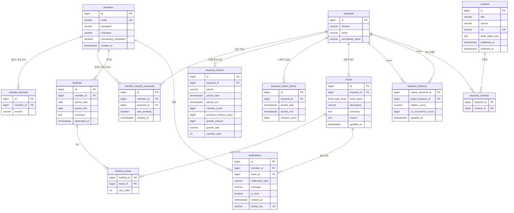

# ERD 00 — 현행 기준 (v2)

**이 문서가 기준이다.** 이 디렉터리에는 이 파일 하나만 있다.

원본은 다이어그램이고 이 파일은 Spark 쪽에서 참조하기 위한 **전사본**이다. 원본이 바뀌면 여기도 갱신한다. 타입·제약은 원본에 표시된 것만 옮겼고, 표시가 없는 것(ON DELETE 정책, 인덱스, CHECK, NOT NULL 여부)은 **미표기**다.

> **v1 과 달라진 것** — `trend_metrics` 가 사라지고 **`keyword_metrics`(기간별 통합 지표) + `keyword_metric_history`(시계열 언급량)** 로 갈렸다. 지표의 키가 `trend_id` 에서 **`keyword_id`** 로 바뀌었고, 유형은 `trends.trend_types` **배열**로 올라갔다. `keywords.first_seen_at` · `trends.first_detected_at` · `contents.summary` 는 없어졌다. 각 변경이 Spark 쪽에 무엇을 요구하는지는 [§5](#5-v1-에서-달라진-것과-그-결과).

## 1. 다이어그램



## 2. 테이블 13개

### members

| 타입 | 컬럼 | 키 |
| --- | --- | --- |
| bigint | id | PK |
| varchar | email | UK |
| varchar | password | |
| varchar | nickname | |
| boolean | onboarding_completed | |
| timestamptz | created_at | |

### member_domains

| 타입 | 컬럼 | 키 |
| --- | --- | --- |
| bigint | id | PK |
| bigint | member_id | FK → members |
| varchar | domain | |

### member_interest_keywords

| 타입 | 컬럼 | 키 |
| --- | --- | --- |
| bigint | id | PK |
| bigint | member_id | FK → members |
| bigint | keyword_id | FK → keywords |
| boolean | was_trending | NOT NULL, default false |
| timestamptz | created_at | |

### keywords

| 타입 | 컬럼 | 키 |
| --- | --- | --- |
| bigint | id | PK |
| varchar | domain | |
| varchar | name | |
| varchar | normalized_name | |

**`first_seen_at` 이 없다.** v1 에는 있었고 `NEW` 판별의 근거였다. 지금 `NEW` 는 언급량 이력으로 판별하므로 이 컬럼을 필요로 하지 않는다 ([07 §6](../07-metrics-and-ranking-spec.md)).

### contents

| 타입 | 컬럼 | 키 |
| --- | --- | --- |
| bigint | id | PK |
| varchar | title | |
| varchar | source | |
| varchar | url | UK |
| text | body_object_key | |
| timestamptz | published_at | |
| timestamptz | collected_at | |

**`summary` 가 없다.** 서비스 테이블에 문서 요약을 담을 자리가 아예 없어졌다 ([03 §8](../03-normalization-spec.md)).

### keyword_contents

| 타입 | 컬럼 | 키 |
| --- | --- | --- |
| bigint | keyword_id | PK, FK → keywords |
| bigint | content_id | PK, FK → contents |

### keyword_metrics

| 타입 | 컬럼 | 키 |
| --- | --- | --- |
| bigint | id | PK |
| bigint | keyword_id | FK → keywords |
| varchar | period | |
| timestamptz | period_start | |
| timestamptz | period_end | |
| bigint | mention_count | |
| bigint | previous_mention_count | |
| bigint | growth_amount | |
| numeric | growth_rate | |
| int | mention_rank | |

관계명이 **"기간별 통합 지표"** 다. 한 키워드·한 기간에 **행 하나**이고, 매 실행이 그 행을 갱신한다 — v1 의 `trend_metrics` 처럼 측정이 쌓이는 이력 테이블이 아니다. 이력은 아래 `keyword_metric_history` 가 담는다.

**`trends` 를 거치지 않는다.** 트렌드가 아닌 키워드도 지표를 가질 수 있다. v1 의 가장 큰 제약이 이것으로 풀렸다 ([§5](#5-v1-에서-달라진-것과-그-결과)).

### keyword_metric_history

| 타입 | 컬럼 | 키 |
| --- | --- | --- |
| bigint | id | PK |
| bigint | keyword_id | FK → keywords |
| timestamptz | bucket_start | |
| timestamptz | bucket_end | |
| bigint | mention_count | |

관계명이 **"시계열 언급량"** 이다. 상세 화면의 추이 그래프가 이 테이블을 읽는다. `period` 컬럼이 없으므로 **버킷 계열은 하나뿐**이고, 버킷 폭은 `bucket_end − bucket_start` 가 담는다 ([07 §3](../07-metrics-and-ranking-spec.md)).

### trends

| 타입 | 컬럼 | 키 |
| --- | --- | --- |
| bigint | id | PK |
| bigint | keyword_id | FK → keywords, **UK** |
| trend_type_array | trend_types | |
| varchar | description | |
| text | summary | |
| text | reason | |
| timestamptz | updated_at | |

`keywords ||--o| trends` 이므로 키워드 하나당 트렌드는 최대 하나다. 모든 키워드가 트렌드가 되는 것은 아니다.

**`trend_types` 는 배열이고 값이 복수일 수 있다.** `CURRENT` / `NEW` / `RISING` 이 배타적이지 않다. 다만 **기간 구분이 없다** — 이게 Spark 쪽 판별과 어긋나는 유일한 지점이고 [07 §6](../07-metrics-and-ranking-spec.md) 에서 다룬다.

**`first_detected_at` 이 없다.** "언제 처음 트렌드가 됐는지" 를 서비스 테이블에서 알 수 없다.

### keyword_relations

| 타입 | 컬럼 | 키 |
| --- | --- | --- |
| bigint | source_keyword_id | PK, FK → keywords |
| bigint | target_keyword_id | PK, FK → keywords |
| numeric | relation_score | |
| bigint | co_occurrence_count | |
| timestamptz | updated_at | |

### briefings

| 타입 | 컬럼 | 키 |
| --- | --- | --- |
| bigint | id | PK |
| bigint | member_id | FK → members |
| date | period_start | |
| date | period_end | |
| text | summary | |
| timestamptz | generated_at | |

### briefing_trends

| 타입 | 컬럼 | 키 |
| --- | --- | --- |
| bigint | briefing_id | PK, FK → briefings |
| bigint | trend_id | PK, FK → trends |
| int | sort_order | |

브리핑 자체와 전체 요약은 `briefings` 가, 브리핑에 담긴 트렌드 목록과 노출 순서는 `briefing_trends` 가 갖는다.

```
briefing_id | trend_id | sort_order
1           | 10       | 1
1           | 25       | 2
1           | 31       | 3
```

### notifications

| 타입 | 컬럼 | 키 |
| --- | --- | --- |
| bigint | id | PK |
| bigint | member_id | FK → members |
| bigint | trend_id | FK → trends |
| varchar | notification_type | |
| varchar | message | |
| boolean | is_read | |
| timestamptz | created_at | |
| varchar | dedup_key | UK |

`dedup_key` 에 UK 가 있으므로 같은 알림을 두 번 만들어도 두 번 발송되지 않는다. Spark 범위 밖이지만, 이 테이블을 채우는 쪽이 생기면 그 키 규약을 정해야 한다.

`briefings` · `briefing_trends` · `notifications` 는 **Spark 범위 밖이다** (차후 확장, [00 §1](../00-overview.md)).

## 3. Spark 가 쓰는 테이블

| 테이블 | Job |
| --- | --- |
| `contents` | ingest |
| `keywords` | extract |
| `keyword_contents` | extract |
| `keyword_metrics` | aggregate |
| `keyword_metric_history` | aggregate |
| `trends` | aggregate |
| `keyword_relations` | aggregate |

나머지 여섯(`members`, `member_domains`, `member_interest_keywords`, `briefings`, `briefing_trends`, `notifications`)은 건드리지 않는다.

## 4. 화면과 테이블

어느 테이블이 어느 화면을 받치는지다. 지표의 키가 키워드로 바뀐 뒤의 흐름이다.

```
회원가입 → members
온보딩   → member_domains (FASHION / DEVELOP)

── 대시보드 ─────────────────────────────
관심 분야 선택 → 24H / 7D / 30D 기간 선택 → 트렌드 탐색
  keywords
  keyword_metrics   period · mention_count · mention_rank
                    previous_mention_count · growth_amount · growth_rate
  trends            trend_types (CURRENT / NEW / RISING, 복수 가능)
                    description · summary · reason
관심 키워드 등록 → member_interest_keywords

── 트렌드 상세 ───────────────────────────
24H / 7D / 30D 기간 선택
추이            → keyword_metric_history
언급량 · 증가량 · 증가율 → keyword_metrics
AI 설명         → trends
연관 키워드     → keyword_relations
관련 콘텐츠     → contents · keyword_contents

── 개인화 ───────────────────────────────
관심 키워드 기반 브리핑 / 알림
  member_interest_keywords · briefings · briefing_trends · notifications
```

**추이 그래프와 기간 지표가 서로 다른 테이블이다.** 상세 화면 하나가 `keyword_metric_history`(그래프)와 `keyword_metrics`(숫자)를 함께 읽는다. 두 값이 같은 실행에서 나와야 화면이 어긋나지 않으므로, `aggregate` 는 둘을 같은 회차에 쓴다 ([08 §2](../08-storage-schema.md)).

트렌드 유형의 정의(`CURRENT` 는 무엇이고 `NEW` 를 언제 붙이는지)는 [07 §6](../07-metrics-and-ranking-spec.md) 이 갖는다. 여기서는 그것이 `trends.trend_types` 에 담긴다는 사실만 적는다.

## 5. v1 에서 달라진 것과 그 결과

| # | 변경 | Spark 쪽 결과 |
| --- | --- | --- |
| 1 | `trend_metrics` → `keyword_metrics` + `keyword_metric_history` | 지표가 `trends` 를 거치지 않는다. **v1 한계 4(트렌드가 아닌 키워드는 지표가 없다)가 해소됐다.** 관심 키워드로 등록만 한 키워드도 그래프가 나온다 |
| 2 | 지표의 키가 `keyword_id` | 도메인별 목록 조회가 `keyword_metrics → keywords` **2단 조인**이다. v1 의 3단 조인과 비정규화 논의가 사라졌다 |
| 3 | `keyword_metrics` 가 기간별 1행 | 충돌 키가 `(keyword_id, period)` 다. 재실행 멱등성이 구조적으로 확보된다 |
| 4 | 시계열이 별도 테이블 | v1 의 "`period='24H'` 행을 매일 쌓아 시계열로 쓴다" 우회가 필요 없다 |
| 5 | `trend_type` → `trends.trend_types` 배열 | 유형이 배타적이지 않다. 그리고 **기간별 유형을 담을 자리가 없다** ([07 §6](../07-metrics-and-ranking-spec.md)) |
| 6 | `previous_rank` · `measured_at` 삭제 | 순위 변동을 보여줄 수 없고, 그 행이 언제 계산됐는지 서비스 쪽에서 알 수 없다 |
| 7 | `keywords.first_seen_at` 삭제 | `NEW` 판별을 언급량 이력으로 한다. **내부 일별 원자료가 유일한 근거가 된다** ([07 §6](../07-metrics-and-ranking-spec.md)) |
| 8 | `trends.first_detected_at` 삭제 | "처음 트렌드가 된 때" 를 서비스에서 알 수 없다. 필요하면 내부에 남긴다 ([08 §3](../08-storage-schema.md)) |
| 9 | `contents.summary` 삭제 | MVP 결정이 스키마로 굳었다. 소스가 준 리드문이 서비스로 새어 나갈 경로가 없어졌다 ([03 §8](../03-normalization-spec.md)) |
| 10 | `period_start`·`period_end` 가 timestamptz | date 가 아니므로 경계 규약(포함/제외)을 코드가 정한다 ([07 §4](../07-metrics-and-ranking-spec.md)) |
| 11 | `briefings`·`briefing_trends`·`notifications` 컬럼 확정 | Spark 범위는 그대로 밖이다. `briefing_trends` 가 `trends` 를 참조하므로 **`trends` 행을 지우지 않는 이유가 하나 늘었다** |

## 6. 원본에 없어서 확인이 필요한 것

다이어그램은 제약을 다 담지 못한다. 아래는 적재 코드가 성립하려면 반드시 정해져야 하는 것들이다. 자세한 근거와 우선순위는 [`../08-storage-schema.md` §5](../08-storage-schema.md).

| # | 항목 | 없으면 |
| --- | --- | --- |
| 1 | `keywords` 의 `(domain, normalized_name)` UNIQUE | **upsert 충돌 키가 없어 같은 키워드가 계속 새 행으로 쌓인다.** 나중에 붙일 수 없다 |
| 2 | `keyword_metrics` 의 `(keyword_id, period)` UNIQUE | 기간별 1행이 보장되지 않는다. 재실행마다 같은 기간이 중복 삽입된다 |
| 3 | `keyword_metric_history` 의 `(keyword_id, bucket_start)` UNIQUE | 재계산할 때마다 같은 날짜가 그래프에 여러 번 나온다 |
| 4 | **`trend_type_array` 의 실제 정체** | PostgreSQL 네이티브 enum 배열이면 Spark JDBC 쓰기가 캐스트 없이 죽고, JPA `@ElementCollection` 이면 실제 DDL 은 별도 조인 테이블이라 적재 대상이 달라진다 ([01 §6](../01-architecture.md)) |
| 5 | `period` 의 허용 값 | varchar 라 값 규약이 코드 밖에 없다. `24H`/`7D`/`30D` 를 제안 |
| 6 | `contents.url` 의 길이와 인덱스 | varchar UK 라 긴 URL 에서 삽입 실패 위험 |
| 7 | `growth_amount` 가 생성 컬럼인지 | 생성 컬럼이면 INSERT 에서 빼야 한다 |
| 8 | `mention_rank` 가 `NOT NULL` 인지 | 언급량 0 인 기간에 넣을 순위가 없다 ([07 §5](../07-metrics-and-ranking-spec.md)) |
| 9 | `keywords.domain` · `member_domains.domain` 의 허용 값 | 수집 이벤트는 `dev` 를 주는데 백엔드 enum 은 `DEVELOP`, 표시명은 `개발` 이다. 세 표기가 다르므로 `ingest` 가 매핑한다 ([01 §6](../01-architecture.md)) |
| 10 | `keywords` 삭제 시 FK 동작 | 트렌드·관심사·연관·지표·시계열이 딸려 있다 ([05 §1](../05-keyword-registry-spec.md)) |
